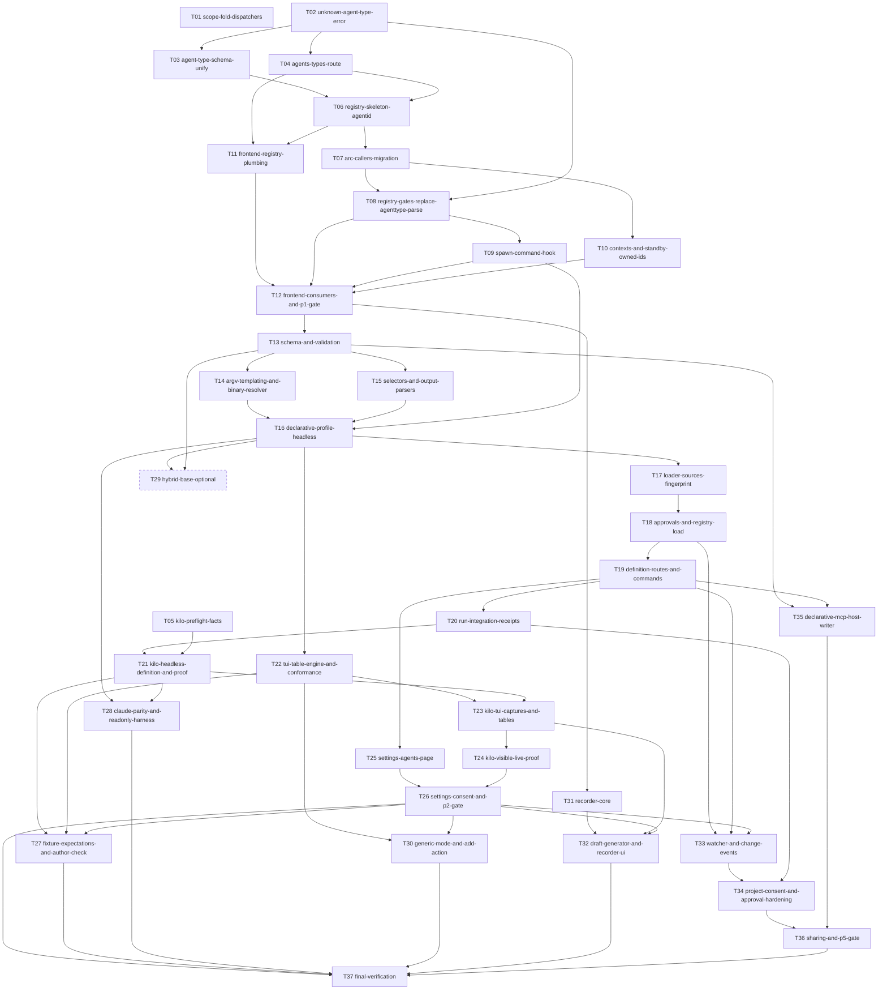

# Agent definitions: tiny-phase execution order

This directory re-slices `../PLAN.md` (phases 0-5 plus final verification) into small phases, each sized for one agent session (about half a day to a day, 1-4 commits). Scope is unchanged: every original task id (P0-1 ... P5-8, V-1 ... V-9) is covered by exactly one tiny phase (see the `covers` column and the annotations in `PLAN.md`).

Each phase is independently shippable: the repo builds and all suites pass at the end of it, and there is no half-migrated state. Each phase file holds goal, scope, file allow-list tasks with done-when, tests to write first, exact verification commands, risks and rollback, the open questions it depends on, and a ready-to-paste agent prompt with the hard rules baked in.

Conventions: `src/` = `packages/app/src-tauri/src/`. Sizes: S = under half a day, M = about a day. Shared rules (never stage the user's uncommitted README.md / docs/wiki/README.md / package-lock.json / packages/app/src-tauri/Cargo.toml; explicit `git add` paths; commit trailer `Co-Authored-By: Claude Opus 5.5 <noreply@anthropic.com>`; shared `CARGO_TARGET_DIR`; rebuild the MCP exe when schemas change) are repeated in every agent prompt.

## Index

| Phase | Title | Goal | Depends on | Size | Covers | User-visible effect | Milestone |
|---|---|---|---|---|---|---|---|
| [T01](T01-scope-fold-dispatchers.md) | Scope the five fold dispatchers to one profile | Make `tui::is_chrome_line/strip_dialogs/tidy_reply/is_tool_activity_line/looks_like_menu` take an `agent_type` and consult only that profile, so ad... | - | S | P0-1 | none - internal (fixes cross-profile bleed) |  |
| [T02](T02-unknown-agent-type-error.md) | UNKNOWN_AGENT_TYPE error and shared lookup helper | Add `tui::require_registered(id)` and the HTTP 400 `UNKNOWN_AGENT_TYPE` error (with `context.valid`) at every id gate, so the schema can later stop... | - | S | P0-3 | none - internal (new error code for bad ids; INVALID_AGENT_TYPE kept on delegate_work) |  |
| [T03](T03-agent-type-schema-unify.md) | One agent_type schema helper, single catalog_version bump | Replace the three hard-coded `agent_type`/`backend` enums with one `agent_type_schema()` (string + pattern + description), bump and pin `catalog_ve... | T02 | M | P0-2, P0-6 | MCP clients may pass any pattern-valid agent_type; errors come from the server | Phase 0 gate (schema stable forever) |
| [T04](T04-agents-types-route.md) | GET /agents/types listing the nine code profiles | Add the `GET /agents/types` route returning the SPEC 7.5 shape for the existing nine profiles, so later phases (registry, frontend, schema descript... | T02 | S | P0-4 | new read-only endpoint listing agent types (no UI yet) |  |
| [T05](T05-kilo-preflight-facts.md) | Verify the unverified Kilo facts | Run the cheap live checks listed under 'Not verified' in AGENT-CHOICE.md and record the results (or mark them as explicit assumptions) so T21 is no... | - | S | P0-5 | none - docs only |  |
| [T06](T06-registry-skeleton-agentid.md) | AgentId and registry skeleton (not yet wired) | Add `TuiProfile::id()` and a `Registry` (ArcSwap snapshot seeded with the nine code profiles) with tests, while `profile_for` keeps returning `&'st... | T03, T04 | M | P1-1 | none - internal |  |
| [T07](T07-arc-callers-migration.md) | Return Arc from profile_for and fix callers | Switch `profile_for`/`profiles()` to the registry (`Arc<dyn TuiProfile>`) and mechanically fix every caller that `cargo check` flags, with no logic... | T06 | M | P1-2 | none - internal |  |
| [T08](T08-registry-gates-replace-agenttype-parse.md) | Registry lookup replaces AgentType::parse gates | Every validity gate asks the registry instead of `AgentType::parse`; `AgentType` survives only in `pty/agents.rs` and the code-profile launch path;... | T07, T02 | M | P1-3 | none - internal (persisted runs for removed agents degrade to agent_gone) |  |
| [T09](T09-spawn-command-hook.md) | TuiProfile::spawn_command for non-enum ids | Add `TuiProfile::spawn_command(&SpawnRequest) -> Option<LaunchSpec>` (default `None` = existing `resolve_command`) so a profile outside the enum ca... | T08 | M | P1-4 | none - internal (nine ids spawn exactly as before) |  |
| [T10](T10-contexts-and-standby-owned-ids.md) | agent_contexts owned strings; standby keyed by id string | Make `AgentContextProfile` use owned/Cow strings and registry-backed listing, and key the standby pool by id string, with identical JSON and file f... | T07 | M | P1-5, P1-6 | none - internal (JSON/files unchanged) |  |
| [T11](T11-frontend-registry-plumbing.md) | Tauri agents_list command, agentRegistry.ts, loosened shared schema | Expose the registry listing to the frontend through a Tauri command and a typed `agentRegistry.ts` with a compiled-list offline fallback, and loose... | T04, T06 | M | P1-7 (plumbing half) | none visible (UI still shows the nine from the compiled fallback) |  |
| [T12](T12-frontend-consumers-and-p1-gate.md) | Spawn menu and viewers read the registry; Phase 1 docs and gate | Make the spawn menu, `TUI_AGENTS`, `ansi.ts`, `TerminalViewport` and standby UI read `agentRegistry`, update docs, rebuild, and prove 28/28 | T11, T08, T09, T10 | M | P1-7 (consumers half), P1-8, P1-9 | none - UI identical for the nine agents | Phase 1 gate: registry-driven, behaviour identical |
| [T13](T13-schema-and-validation.md) | Definition schema structs, strict parse, and validation | Parse SPEC 7.1 TOML into serde structs with `deny_unknown_fields` and implement the pure validator producing every SPEC 7.4 `AGENT_DEF_*` code | T12 | M | P2-1, P2-2 | none - internal (pure parsing, nothing registered) |  |
| [T14](T14-argv-templating-and-binary-resolver.md) | Argv templating and binary resolver | Add the injection-proof argv renderer and the Windows-aware binary resolver as pure/unit-tested modules | T13 | M | P2-3, P2-6 | none - internal |  |
| [T15](T15-selectors-and-output-parsers.md) | JSON selector engine and the three output parsers | Implement `where/where_regex/~exists/pick/regex/trim` selectors and the `plain_text`, `json_single`, `json_lines` parsers with size caps and exit-c... | T13 | M | P2-4, P2-5 | none - internal |  |
| [T16](T16-declarative-profile-headless.md) | DeclarativeProfile implementing TuiProfile (headless side) | Build `DeclarativeProfile` mapping definition tables onto `TuiProfile`: features, run_options, headless launch via T14, parsing via T15, `is_instal... | T14, T15, T09 | M | P2-8 (headless half) | none - internal (constructible in tests, not loaded) |  |
| [T17](T17-loader-sources-fingerprint.md) | Loader, sources, and fingerprint (read-only, nothing registered) | Scan definition directories per SRC-1..SRC-7, apply precedence/shadowing (REG-7/8), and compute a stable fingerprint, all against temp dirs | T16 | M | P2-10 (loader half) | none - internal |  |
| [T18](T18-approvals-and-registry-load.md) | Approvals store and startup registry integration | Persist approvals in `agent-approvals.json` (same load/save/bad-file semantics as `standby/config.rs`) and load approved definitions into the regis... | T17 | M | P2-10 (approvals half), P2-11 (registry half) | a TOML in the user agents dir becomes a registered agent once its approval record exists (no UI/route yet) |  |
| [T19](T19-definition-routes-and-commands.md) | /agents/definitions routes and Tauri commands, app-session gate | Add `GET /agents/definitions`, `POST .../reload|validate|approve|revoke|consent` per SPEC 7.5, plus thin Tauri command wrappers, with approval rest... | T18 | M | P2-11 (routes half) | definitions can be listed, validated, reloaded, approved and revoked over HTTP / Tauri; GET /agents/types now includes declarative agents | Approve a definition without hand-editing JSON |
| [T20](T20-run-integration-receipts.md) | Fingerprint/binary enforcement at spawn; agent_definition in receipts | Record `agent_definition` in run snapshots/receipts, enforce fingerprint and pinned binary at spawn (`AGENT_DEF_APPROVAL_STALE`, `AGENT_DEF_BINARY_... | T19 | M | P2-12 | run receipts for declarative agents show agent_definition; edits after approval block new runs |  |
| [T21](T21-kilo-headless-definition-and-proof.md) | Kilo definition (headless), real fixtures, live headless proof | Ship `kilo.toml` (headless table first), capture real `kilo` 7.0.50 JSON fixtures, assert parsing in tests, and prove `run_agent`/`followup_task` live | T20, T05 | M | P2-14 (headless half), P2-15 | Kilo headless works from ONE TOML: run_agent + followup_task | ★: Kilo headless works via TOML (first end-to-end value) |
| [T22](T22-tui-table-engine-and-conformance.md) | TUI table engine and conformance over definitions | Implement the `[tui]` table engine (chrome, tool-activity, menu, dialogs, busy marker, screen classification, footer model, prompts, standby screen... | T16 | M | P2-7, P2-9 | none - internal (visible-mode machinery, tested on synthetic definitions) |  |
| [T23](T23-kilo-tui-captures-and-tables.md) | Real Kilo PTY captures and [tui] tables | Capture real Kilo TUI screens through the app's pane tooling, save them as fixtures, and replace the guessed `[tui]` regexes in `kilo.toml` (and SP... | T22, T21 | M | P2-14 (TUI half) | none visible yet (visible mode proven in T24) |  |
| [T24](T24-kilo-visible-live-proof.md) | Live visible Kilo proof | Prove on the live bridge that `headless=false` creates a Kilo pane, delivers the task, returns a (result_inferred) result, supports followup_task, ... | T23 | S | P2-16 | Kilo visible panes work: run_agent headless=false, followup, permission answering | ★: Kilo visible works via TOML |
| [T25](T25-settings-agents-page.md) | Settings > Agents page (list, errors, reload, approve) | Add the Settings tab: list definitions with source badge and state, show errors with code/file/line, a Reload button, and the Approve dialog with r... | T19 | M | P2-13 (first half) | Settings > Agents lists definitions with source badge/state/errors, Reload, and an Approve dialog showing the rendered argv |  |
| [T26](T26-settings-consent-and-p2-gate.md) | Settings source toggles / consent / extra dirs; Phase 2 docs and gate | Finish the Agents page (source toggles, extra dir add/remove, consent toggles), update docs to the implemented code, rebuild the dist exe, and repe... | T25, T24 | M | P2-13 (second half), P2-17, P2-18 | Source toggles, extra directories and consent toggles in the UI; docs describe the feature | Phase 2 gate: Kilo headless + visible, 28/28 |
| [T27](T27-fixture-expectations-and-author-check.md) | *.expect.toml fixtures and in-app 'Check with fixtures' | Let each fixture carry a sibling `*.expect.toml` walked by one generic test, and expose the same runner through `agents_check_file(path, fixtures_d... | T21, T22, T26 | M | P3-1, P3-2 | Authors can verify a definition against a folder of captures without cargo |  |
| [T28](T28-claude-parity-and-readonly-harness.md) | Claude parity test and live read-only harness | Prove a declarative profile reproduces the Claude headless contract on existing Claude fixtures (gaps documented), and add a live script that fails... | T16, T21 | M | P3-3, P3-4 | none - tests/scripts only |  |
| [T29](T29-hybrid-base-optional.md) | OPTIONAL: hybrid base = code profile | Allow `base = "<code profile id>"` where only data fields override and everything else delegates to the base | T16, T13 | S | P3-5 | optional: a TOML can override only data fields of a code profile | optional BLOCKED on SPEC 11 Q5 |
| [T30](T30-generic-mode-and-add-action.md) | Generic zero-config mode and 'Add as generic agent' | Support `kind = "generic"` definitions (visible-only, experimental, shared heuristics) and an Add-as-generic action that writes `<app data>/agents/... | T22, T26 | M | P4-1, P4-2 | Try any CLI in 30 seconds: Settings creates an unapproved generic definition | ★: generic try-any-CLI |
| [T31](T31-recorder-core.md) | Recorder core with redaction | Add the recorder module: per-pane start/stop, snapshots on idle/working/prompt transitions, and strict redaction, never running on standby panes | T12 | M | P4-3 | none visible (no UI yet; engine only) |  |
| [T32](T32-draft-generator-and-recorder-ui.md) | Draft generator, recorder UI, Phase 4 gate | Generate a draft definition from recorded captures (busy/chrome/prompt regexes, headless skeleton from a probe) with provenance comments, add the p... | T31, T23, T26 | M | P4-4, P4-5, P4-6 | Record a session in a pane, get a draft TOML, validate it | ★: recorded Kilo session -> valid draft |
| [T33](T33-watcher-and-change-events.md) | Hot reload watcher and agent_definitions_changed event | Watch enabled source dirs with debounce and atomic registry swap, emit `agent_definitions_changed` (SSE + Tauri) with the diff, and drop an agent's... | T18, T19, T26 | M | P5-1, P5-2 | Saving a definition updates the registry within 1 s; UI refreshes without polling; standby workers invalidated on fingerprint change |  |
| [T34](T34-project-consent-and-approval-hardening.md) | Project/extra-dir consent banner and approval hardening | Implement per-canonical-path consent for project-local and extra dirs (banner, not modal; nothing loads until consent + approval), and harden appro... | T33, T20 | M | P5-3, P5-4 | Opening a project with .puppet-master/agents/ shows a consent banner; approval shows an argv diff and warnings; binary swaps re-prompt |  |
| [T35](T35-declarative-mcp-host-writer.md) | Declarative [mcp_host] writer | Implement JSON/TOML/YAML writers driven by `[mcp_host]` (key path, `.bak`, home/project-only paths, idempotent) and validate the table | T13, T19 | M | P5-5 | A definition can register Puppet Master's MCP server in another host's config file |  |
| [T36](T36-sharing-and-p5-gate.md) | Export/import, Phase 5 docs, Phase 5 gate | Add export/import of one definition (no network), update docs for watcher/consent/writer, and verify that editing `kilo.toml` during a run leaves i... | T34, T35 | M | P5-6, P5-7, P5-8 | Export a definition (+fixtures zip) and import into the user dir unapproved | Phase 5 gate: live edit during a run is safe |
| [T37](T37-final-verification.md) | Final verification (V-1..V-9) | Run every suite, rebuild the dist exe, check SCHEMA_DRIFT, run pm-regression, repeat the Kilo proof from a clean state, do the security spot checks... | T26, T27, T28, T30, T32, T36 | M | V-1..V-9 | none - verification, docs, memory | ★: SPEC section 12 done-when met |

## Milestones

- After T03: the MCP schema never enumerates agent ids again (one `catalog_version` bump, pinned).
- After T12: registry-driven backend and UI, behaviour identical for the nine agents (Phase 1 gate).
- ★ After T21: Kilo headless works from ONE TOML in the user agents dir (`run_agent` + `followup_task`), first end-to-end value.
- ★ After T24: Kilo visible works (real PTY captures, permission answering).
- After T26: Phase 2 gate, the minimum path to the stated done-when (Kilo headless + visible, 28/28).
- ★ After T30: any CLI can be tried as a generic experimental agent.
- ★ After T32: a recorded Kilo session yields a valid draft definition.
- After T36: hot reload, consent, MCP host writer, sharing (Phase 5 gate).
- ★ After T37: SPEC section 12 done-when met.

Minimum path to the headline value: T01-T03, T06-T09, T11, T13-T21 (T04/T05/T10/T12 can trail but T12 is required before declaring Phase 1 done). Items outside the minimum path: T27-T36.

## Blocked on open questions

| Phase | Question (SPEC section 11) | Default if unanswered |
|---|---|---|
| T29 (optional hybrid) | Q5: build `base = "<code profile>"` this iteration? | BLOCKED; do not start. Skipping it does not affect the done-when. |
| T14 | Q2: stdin task delivery for shim-only installs | refuse with `AGENT_DEF_SHIM_NEEDS_NATIVE` (proceed) |
| T21 | Q1: ship kilo.toml bundled? | user-dir only, approval flow is the proof (proceed) |
| T28 | Q4: live read-only test mandatory for bundled? | yes for bundled, note-only for user definitions (proceed) |
| T31 | Q8: recorder retention | until the app closes (proceed) |
| T34 | Q3: consent keyed by path vs git remote | path only (proceed) |
| (none) | Q6 cost/concurrency note, Q7 second proof agent (Command Code) | unscheduled follow-ups, reported by T37 |

## Dependency graph

## What can run in parallel

Parallel means separate agent sessions on separate branches/worktrees (created by the caller, never deleted recursively); rebase before merging. Phases are listed by wave. Within a wave, phases that share a file are marked and should be serialized in the order given.

| Wave | Phases | Notes |
|---|---|---|
| A | T01, T02, T05 | independent. T05 is docs only. |
| B | T03, T04 | both need T02 only. T03 touches the tool catalog and bumps the pin; T04 touches routes and `tui/types.rs`. Disjoint, but only T03 rebuilds the MCP exe. |
| C | T06 | needs T03 and T04. Single session (touches every profile file for `id()`). |
| D | T07 | single session (wide mechanical edit). Nothing else should touch `src/` meanwhile. |
| E | T08 then T09 (serial: both edit `pty/registry/spawn.rs`); T10 in parallel with them; T11 in parallel (frontend plus `commands/agents.rs`, `lib.rs` one line) | |
| F | T12 | gate for Phase 1. |
| G | T13 | single session (creates the `declarative/` module). |
| H | T14 and T15 in parallel; T22 can start once T16 exists | T14/T15 are disjoint modules; both touch `declarative/mod.rs` only trivially (module decls): rebase. |
| I | T16 | needs T14, T15, T09. |
| J | T17 then T18 then T19 then T20 (strict chain) in parallel with T22 (screen engine, `conformance.rs`) and T25 (frontend, after T19) | T22 and T17-T20 both touch `declarative/mod.rs`/`registry.rs` lightly: rebase on merge. |
| K | T21 then T23 then T24 (Kilo chain); T25 runs alongside | live tests need a quiet dev app: no `src-tauri` edits by other sessions during T21/T24 live runs. |
| L | T26 | Phase 2 gate. |
| M | T27, T28, T30, T31, T35 are mutually independent after their deps; T29 optional | T27/T30 both touch `AgentsTab.tsx`: serialize. T31 can start as early as after T12. |
| N | T32 (needs T31, T23, T26); T33 then T34; T35 | T33/T34/T35 each touch registry or approvals lightly: serialize T33 -> T34. |
| O | T36 then T37 | final. |

Rules for parallel work: only one session at a time may run live tests against the dev app, and no session edits `src-tauri` while another's live test runs (an edit restarts the app, about 1 minute).

