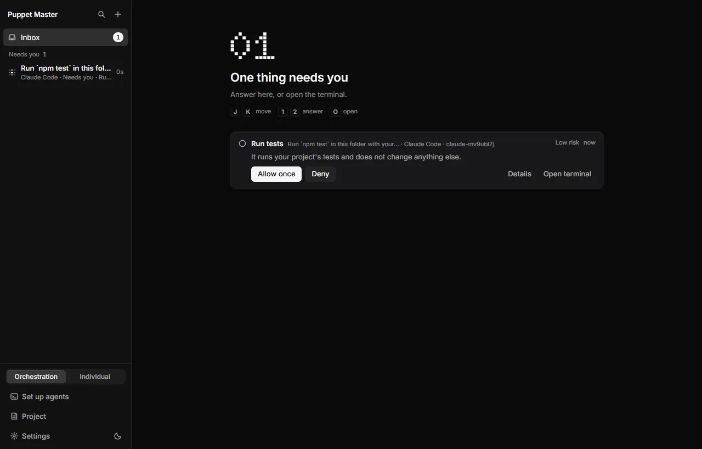
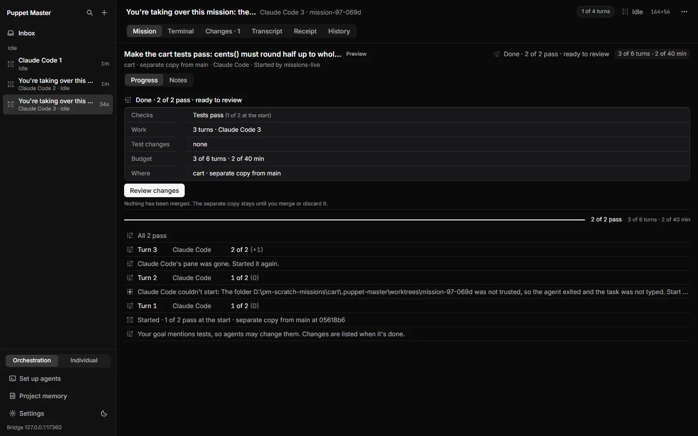

# Status today (2026-10-16)

## Releases on GitHub

| Version | What it is | State |
|---|---|---|
| **0.2.1** | The newest and best version. Everything below is in it. | **Latest**. This is what the in-app update check points to. |
| 0.2.0 | The first MVP build. It has a bug: it can keep showing old screens after an update. | Pre-release (test version) |
| 0.1.5 | 0.1.4 plus one security fix (bridge authorization bypass) | Older release |
| 0.1.4 and older | Old versions. They have the security hole. | Old |

Security advisory for the hole in 0.1.0 to 0.1.4: **GHSA-xg78-9222-r32r** (published, High).

Code:
- The 0.2.1 code is on the branch `release/v0.2.1`, tag `0-2-1`.
- Pull request #3 brings it into `main`: https://github.com/Potato-dev-inc/puppet-master/pull/3 (waiting for merge).

## What works today

"Works today" means it was checked live with real agents, or it is fully built and covered by automated tests. Each feature file in [features/](features/) says which.

**Everyday use**
- The cockpit: sidebar, panes, and the Terminal / Transcript / Receipt / History tabs.
- The Inbox with one "needs you" count, the same on the PC, the tray and the phone.
- Question cards with risk words. Each question is answered once, and a "yes" needs a real click.
- Receipts, History, and Undo to a checkpoint.
- Separate copies (git worktrees), Keep / Throw away, merge, Create PR, and Merge when green.
- The first-run welcome (7 steps), Simple mode, Settings inside the cockpit, and the Ctrl+K palette.

**Agents**
- Claude Code and Codex: checked live many times.
- OpenCode, Cursor Agent and Kilo: supported, but less tested.
- Set up agents / Doctor can install a missing agent for you. It shows the command first.
- Trust and startup screens: Puppet Master never answers them for you.
- Tested-version check ("Untested version" chip), budgets, the loop guard and Stop all.

**Agents controlling agents (MCP)**
- `run_agent`, `quick_ask`, `followup_task`, `wait_agents` and more.
- 22 tools in agent mode, 32 in "both" and 68 in "all".

**Phone**
- The phone app over your tunnel.
- **Allow once / Deny cards on the phone** (new in 0.2.1).
- Push notifications. Allow from the lock screen is offered for Low risk only.

**Labs (built, off by default)**
- Missions (new in 0.2.1).
- Co-work Heads-up for teams.
- The encrypted team relay (code only, not deployed).
- Hook Lane for Codex.

*Real run. A real Codex stopped at "Trust this folder". Puppet Master shows a card and waits for your answer.*

*Real run. A real Claude Code asking to run npm test. The card says it is low risk.*

*Real run. The first-run welcome, step 4 of 7. A real Claude Code read a project and answered, and the receipt says "Finished, not verified".*

*Real run. A mission (Preview) with real Claude Code finished: "Done, 2 of 2 pass, ready to review". Nothing is merged until you review it.*

## Tests on 0.2.1

- About 2510 Rust tests (run twice), 47 Rust program tests, 1876 interface tests and 27 fake-agent end-to-end tests: all pass.
- Live runs with real Claude Code and Codex, and a mission that fixed a failing project.
- Installer test: the installed app reports 0.2.1. An update from 0.2.0 shows the new screens.

## What is NOT done yet

- **Not code-signed.** Windows SmartScreen says "unknown publisher". This needs a certificate, which the founder must buy.
- **No real phone test.** The phone card was tested in a phone-sized browser, not on a real iPhone or Android phone.
- **No real Cloudflare named-tunnel test.**
- **No automatic updater.** The app tells you a new version exists, but you install it yourself.
- **No CI** (automatic tests on GitHub for each change).
- **Hand-off at the usage limit is detect-only.** Puppet Master shows a card but does not move the work to another agent.
- **Missions has no phone view.**
- **Team features need a deployed relay and real GitHub testing.** Neither is done.
- **Cursor stops at its own trust screen**, so it is not fully supported.
- **npm package `@puppet-master/mcp` is old (0.1.3).** The plugin files only work after a new npm release.
- **Small UI leftovers:**
  - The Orchestration/Individual switch is still in the sidebar.
  - An unused old card style is still in the code.
  - The disabled-button look is not the same everywhere.
- **The website is a draft, not online.** See [05-website.md](05-website.md).

## Where things are

- Release files: `D:\pm-night\release\v0.2.1\final\`.
- All night logs, plans and reports: `D:\pm-night\`, with the master log in `NIGHT-LOG.md`.
- The written tour: `D:\pm-night\tour\TOUR-CONTENT.md`.
- The tour video: `D:\pm-night\tour\out\puppet-master-tour.mp4`. It was also posted to Discord in 14 parts.
- The tour web page: https://claude.ai/artifact/Pq7u5B2Z1apwX3mber1bMm
