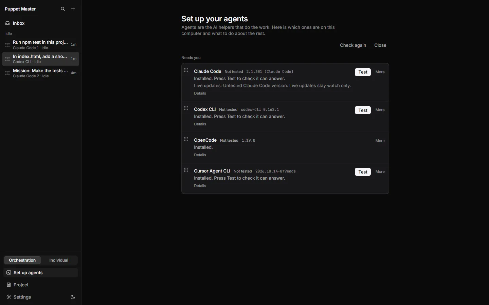
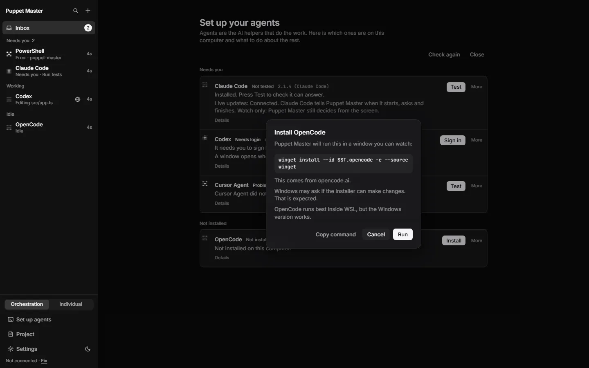
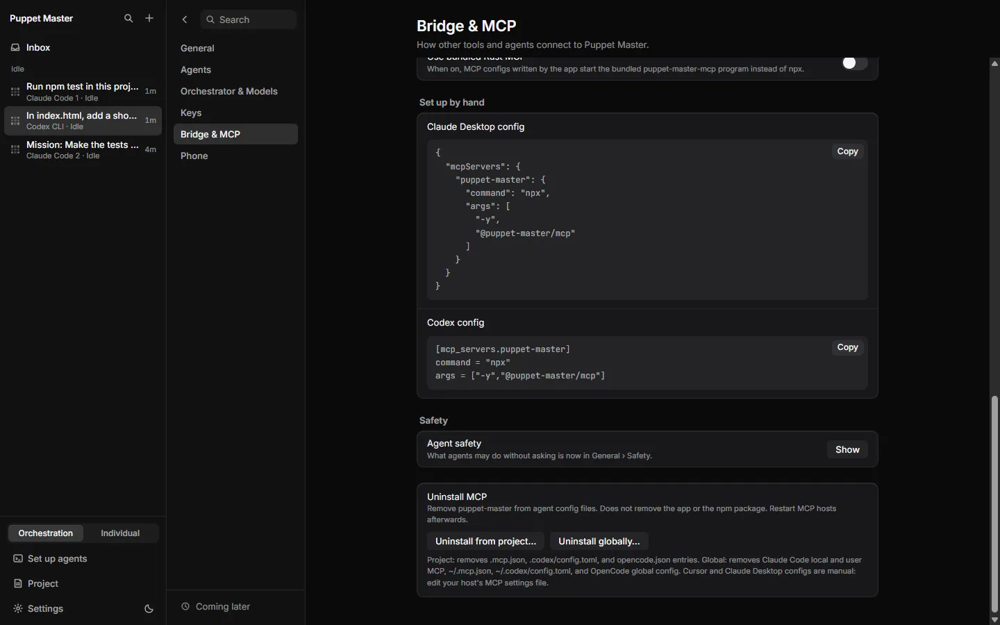

# Install and update

## Install

1. Go to https://github.com/Potato-dev-inc/puppet-master/releases/tag/0-2-1
2. Download **`Puppet-Master_0.2.1_x64-setup.exe`**. The `.msi` file is for company-managed PCs.
3. Optional: check the file. In PowerShell, run `Get-FileHash <file>` and compare the result with `SHA256SUMS.txt`.
4. Run the installer. Windows SmartScreen will say "unknown publisher", because the installer is not code-signed yet. Click **More info**, then **Run anyway**.
5. Start Puppet Master. The **welcome** opens. It asks how you work, finds your agents, and can install a missing one.

*Real run. The first start of Puppet Master 0.2.1: "Welcome to Puppet Master", step 1 of 7. You say how you work, and the welcome adapts.*

*Real run. Step 2 of the welcome. Puppet Master found the agents on this PC. Claude Code answered the test question and is "Ready".*

*Real run (0.2.1). Set up your agents (the Doctor) on a real PC with four agents installed. Each row says what to do next. Here every agent is installed and waits for Test.*

*Example data. The Install button shows the exact command first. You press Run, and it runs in a window you can watch.*

## Update from an older version

- Run the new installer over the old one. Your settings stay. They are kept in `%APPDATA%\com.puppetmaster.app`.
- **Updating from 0.2.0 is important.** 0.2.0 saved a copy of its screens inside the desktop window, and that copy never updated. 0.2.1 deletes it the first time it starts, so you see the new screens.
- The app checks GitHub for the "Latest" release. When a newer version exists, it shows a "New version available" message with a link. It does not install anything by itself yet.

## Connect your agents to Puppet Master (MCP)

Agents need the MCP connection to start and control other agents.

1. Open **Settings › Bridge & MCP**.
2. Click **"Add Puppet Master to your agents"**. It shows what it will change, then writes the connection, plus a few short skills, into each agent's config.
3. In Claude Code, run `/mcp` to reconnect. If an agent uses an old MCP program, a loud warning appears in its tool results.

*Real run (0.2.1). Settings, Bridge & MCP, further down: Install in project or globally, and the config text you can copy by hand for Claude Desktop and Codex.*

*Real run (0.2.1). "Add Puppet Master to your agents". The sheet lists every file it will write, per agent, before you press Install. Install was not pressed for this picture.*

## The phone

1. In the cockpit, open the phone pairing screen. It is in Settings, in the section about the phone and tunnel.
2. Scan the QR code with your phone and add the page to your home screen.
3. Choose what the phone may do: watch / answer / type / control.

*Real run. Step 5 of the welcome. You choose what the phone may do, then press Pair a phone to make a one-time code.*

## Files in a release

| File | What it is |
|---|---|
| `Puppet-Master_0.2.1_x64-setup.exe` | The normal installer |
| `Puppet-Master_0.2.1_x64_en-US.msi` | Installer for managed PCs |
| `puppet-master-mcp.exe` | The MCP program. The same file is inside the installer. |
| `SHA256SUMS.txt` | Checksums to verify the downloads |
