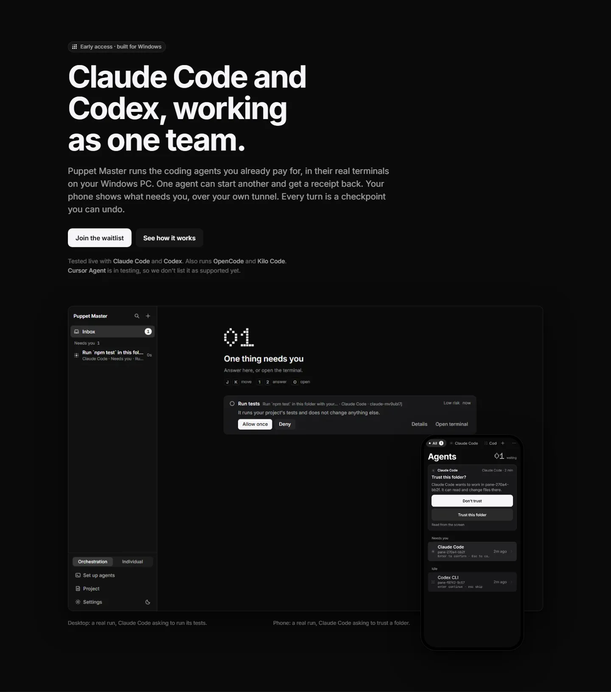
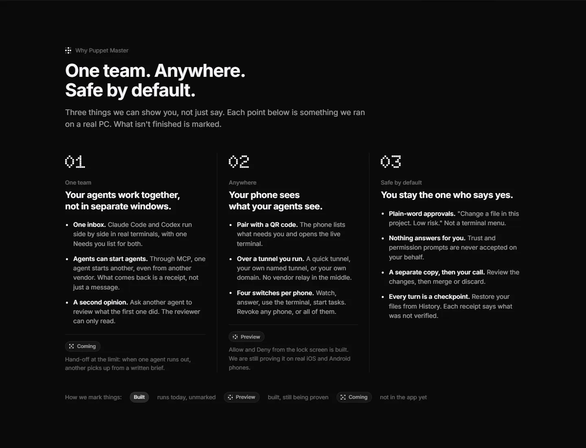
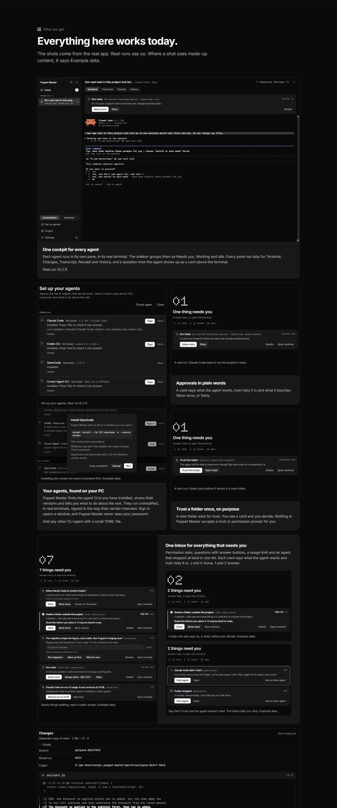
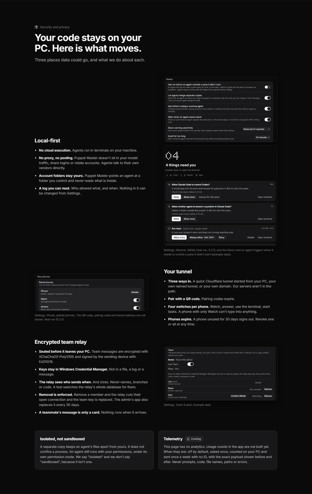
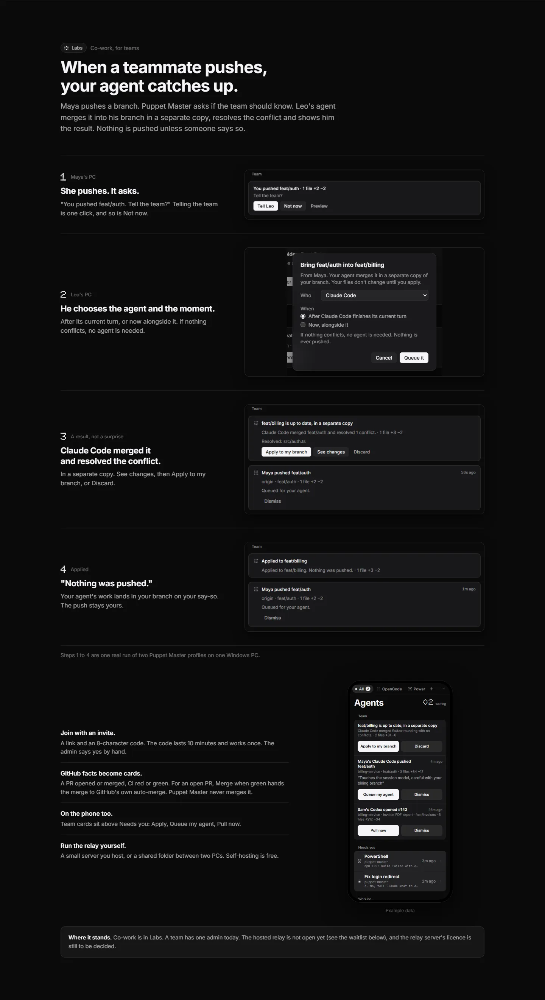
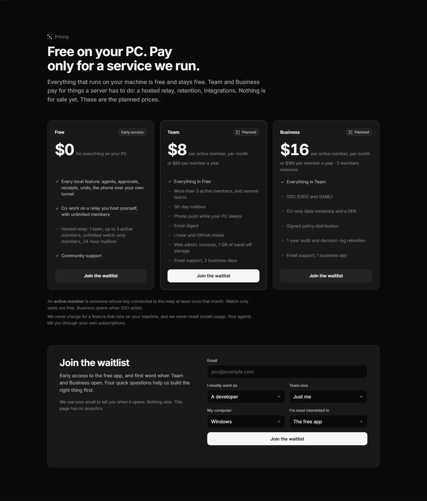
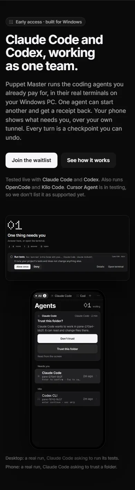

# The website (landing page)

**Status:** Draft. **It is not online.** It is hidden from search engines (`noindex`).

## Where it is

- The code is in the `site\` folder, on the branch `feat/landing-site` (worktree `D:\pm-site`). It is also in later branches.
- It is a static page: plain HTML, CSS and JS, built with `site\build.mjs`.
- Screenshots of it are in `D:\pm-night\p0\site\shots\`.

## What it says

- **Headline:** "Claude Code and Codex, working as one team."
- **Sections:** what Puppet Master is, the cockpit, approvals with risk words, undo, separate copies, the phone, agents controlling agents, and teams.
- **Honest labels.** Features that are not ready say **Coming**, **Preview** or **Labs**. It says "isolated, not sandboxed", and "Cursor Agent is in testing".
- **Prices** are shown as **"Planned"**: Team $8 and Business $16 per member per month.
- A **waitlist form**.

*Real run (0.2.1). The top of the landing page (desktop, dark), re-shot after the real 0.2.1 pictures went in. Both the desktop picture and the phone picture are real runs.*

*Example data. "One team. Anywhere. Safe by default." Each item is marked Built, Preview or Coming.*

*Real run (0.2.1). "Everything here works today" (the top part of the section): the cards now use real 0.2.1 screenshots. A few cards still use example data and say so under their picture.*

*Mixed. "Your code stays on your PC. Here is what moves." with the Settings screens that back each claim. The Safety screen is a real run (0.2.1); the consent card and the team settings are example data.*

*Example data. The co-work story in four steps, from "She pushes. It asks." to "Nothing was pushed."*

*Example data. Planned prices (Free, Team, Business) and the waitlist form. The form is not connected yet.*

*Real run (0.2.1). The same page at 390 px wide, as it looks on a phone.*

## What is not done

- **The waitlist form is not connected.** It does not send anywhere yet.
- **No domain.** The domain depends on the name decision (Ninedot?).
- **The MCP setup line is wrong for now.** It says `npx @puppet-master/mcp`, but that npm package is the old 0.1.3 server. It should say "Settings › Add Puppet Master to your agents" until a new npm package is published.
- **The licence line in the footer** waits for the licence decision.
- **Pages still to write:** privacy, security and the FAQ.
- **It still says "Puppet Master" everywhere.** It changes if the product is renamed.

## To publish it

1. Decide the name, then buy the domain.
2. Fix the MCP line and choose the final prices or keep "Planned".
3. Connect the waitlist form to an endpoint (for example, a small Cloudflare Worker).
4. Add the privacy and security pages.
5. Host it (for example, Cloudflare Pages), and remove `noindex` at the soft launch.
