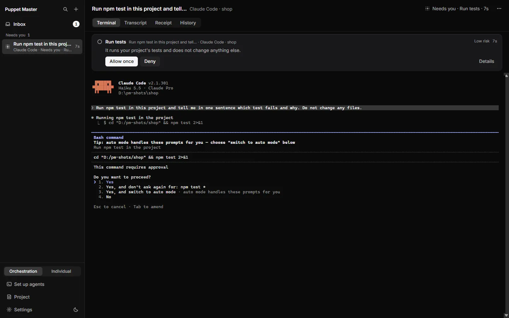
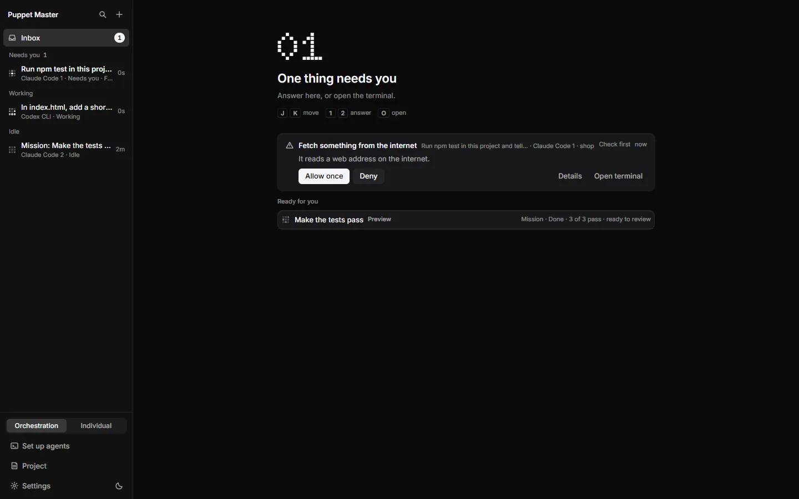
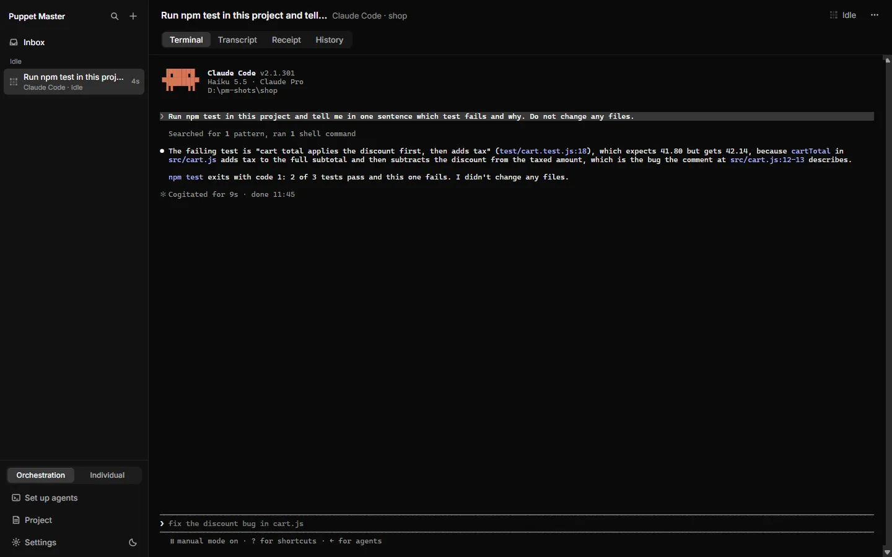
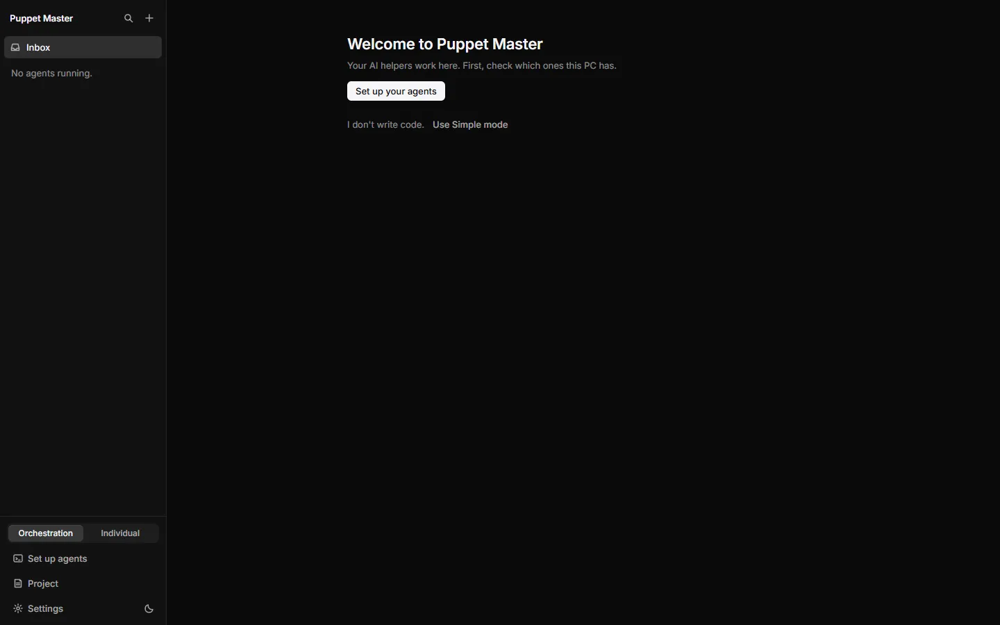
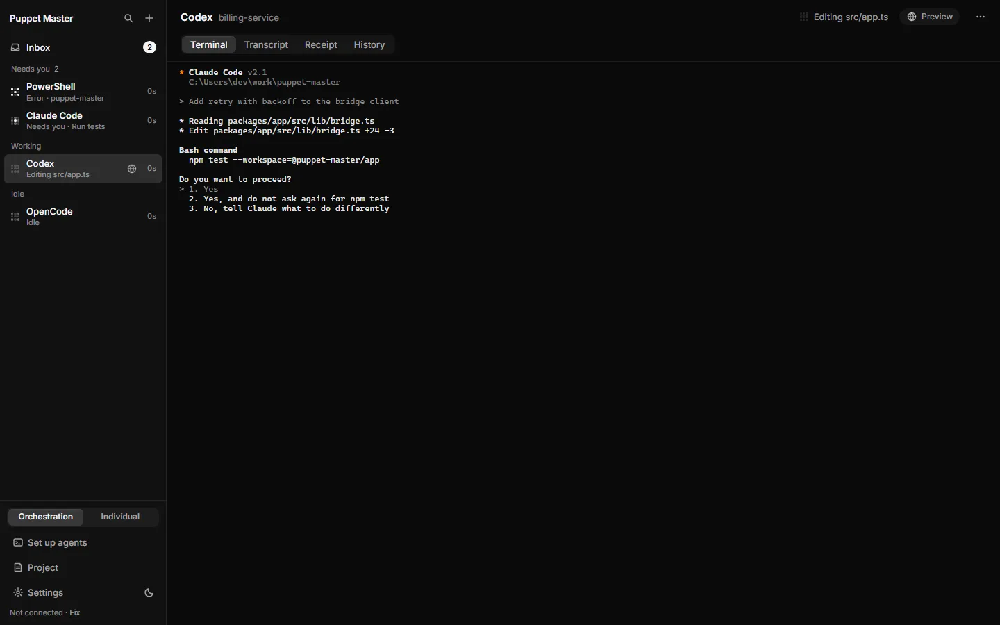
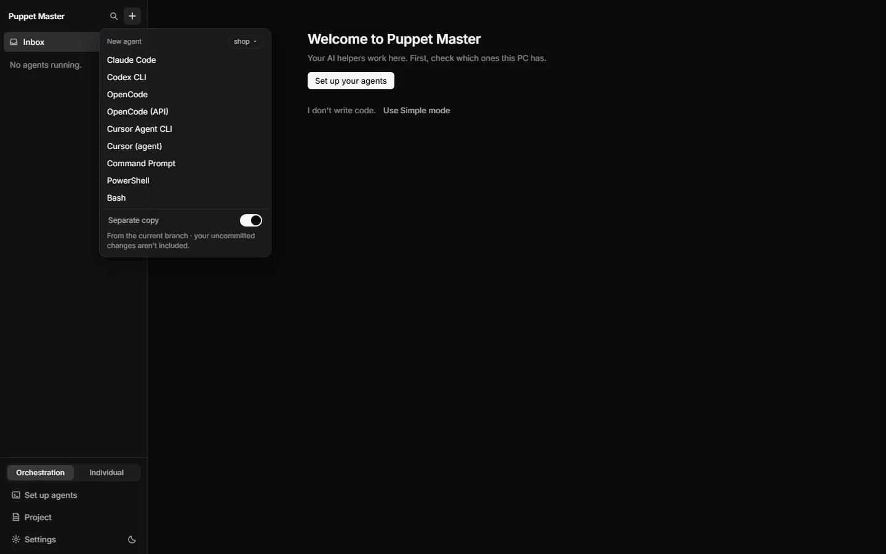
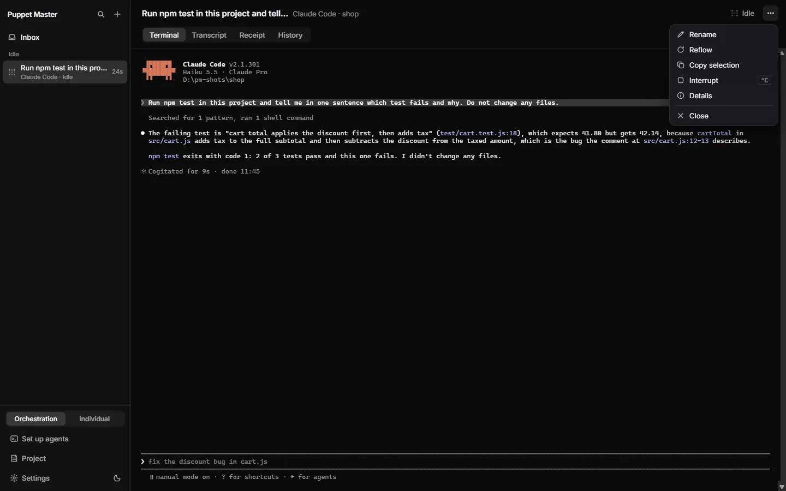
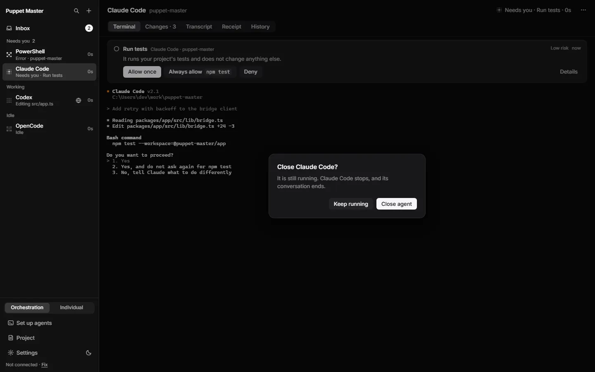
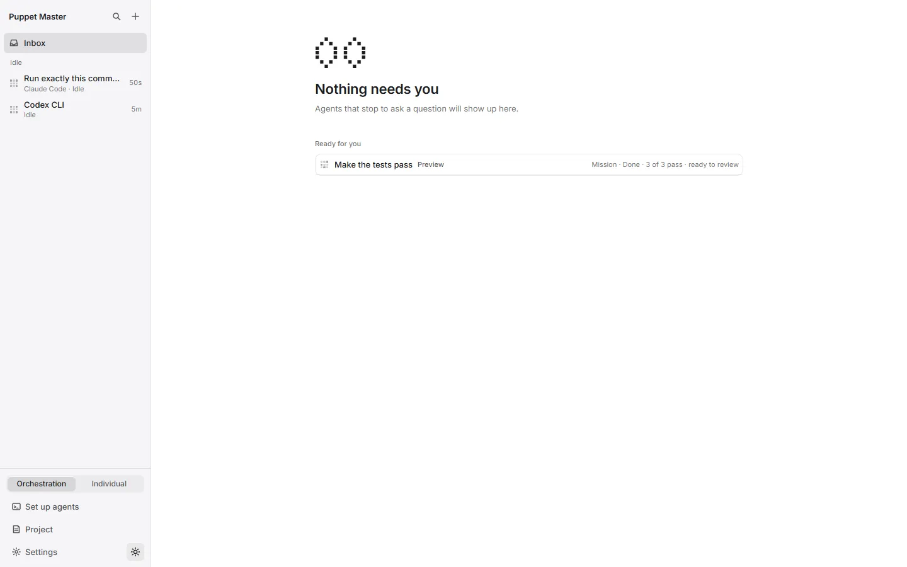

# The cockpit

**Status:** Works today. The Orchestration / Individual switch works; where it lives is still open (see "Limits").

## What it is

The cockpit is the main window of Puppet Master. On the left is a sidebar that lists all your agents. On the right is the main area, which shows one thing at a time: the Inbox, one agent, Set up agents, Project, or Settings. An "agent" is an AI coding program, such as Claude Code or Codex. Each agent runs in its own "pane", which is one real terminal.

Puppet Master has two modes. **Orchestration** (the default) puts every agent in the cockpit window. **Individual** gives every agent its own window.

*Real run (0.2.1). The cockpit with one real Claude Code open. Tabs on top: Terminal, Transcript, Receipt, History. The approval card ("Run tests", Low risk) sits above the real terminal.*

*Real run (0.2.1). The sidebar with all three groups at once: Needs you (a Check first card), Working (Codex) and Idle (a finished mission agent).*

## Why it matters

- Developers: all agents in one place, with the real terminal always one click away.
- People who build with AI: one list shows who is working, who is idle and who needs you.
- People who don't code: they can turn on Simple mode instead (see [Simple mode](07-simple-mode.md)).

It solves the "ten terminal windows" problem. You do not have to look at each window to find the one that is stuck.

## How to use it

1. Start Puppet Master. The cockpit opens in Orchestration mode.
2. Look at the sidebar. At the top you see the name, a search icon (the same as Ctrl+K) and a **+** button (New agent).
3. Under it is the **Inbox** row with a count. Below that, your agents are in three groups:
   - **Needs you**: an agent waits for an answer, has an error, or asked a question.
   - **Working**: the agent is busy. A moving dot pattern shows it.
   - **Idle**: the agent is ready for the next task.
4. Each row shows a short title (made from the task), one line about what the agent is doing, and how long it has been in this state. A small globe means the agent started a web page you can open (see [Live preview](11-live-preview.md)).
5. Click a row to open that agent. The header shows the title, the project name, the state and a **⋯** menu (Rename, Reflow, Copy selection, Interrupt, Details, Close). Closing a working agent asks first, unless you turned that off in Settings.
6. Use the tabs above the agent: **Terminal**, **Transcript**, **Receipt**, **History**. Terminal is the real terminal. Transcript is the same work as a clean chat. A **Changes** tab appears when the agent works in a separate copy of your project, and a **Mission** tab appears for missions (Labs).
7. To start an agent, press **+**. Pick the agent. Check the project chip at the top (change it with "Recent projects" or "Choose folder…"). The **Separate copy** switch makes the agent work on its own copy of the project. It starts **on** for a Git project that has a first commit, and Puppet Master remembers your choice for each project.
8. At the bottom of the sidebar you find the mode switch (**Orchestration | Individual**), **Set up agents**, **Project**, **Settings** and a light/dark button. A small "Fix" link appears there only when the local bridge is not working.
9. To change mode, use the switch, or press Ctrl+K and type "Individual". In Individual mode the cockpit only shows a note and a button, "Switch to Orchestration", and Settings opens in its own window.

*Real run (0.2.1). The Terminal tab is the real Claude Code program, not a copy of its text. Here it answered a question about a failing test.*

*Real run (0.2.1). The cockpit right after the first start, with no agents: "Welcome to Puppet Master" and a "Set up your agents" button. The bottom of the sidebar holds the Orchestration / Individual switch, Set up agents, Project and Settings.*

*Example data. A pane that is working: the header shows the activity ("Editing src/app.ts") and a Preview button for the web page the agent started.*

*Real run (0.2.1). The + button opens the New agent menu: the agents and shells you can start, the project chip (here "shop") and the Separate copy switch.*

*Real run (0.2.1). The ... menu in the pane header: Rename, Reflow, Copy selection, Interrupt, Details and Close.*

*Example data. Closing an agent that is still working asks first: "It is still running. Claude Code stops, and its conversation ends."*

*Real run (0.2.1). The light theme. The same cockpit, set in Settings, General, Appearance.*

## How it works (simple)

Puppet Master starts the real agent program inside a terminal that it controls. It watches the terminal screen and decides which of four states the agent is in: running, idle, waiting for you, or error. The sidebar groups come from those states. Nothing in the cockpit has its own AI. It uses your own agent logins.

The cockpit window talks to the Rust part of the app through a local "bridge" on your own PC (127.0.0.1). Settings and the mode are saved in one settings file.

## Limits and what is not done yet

- **The mode switch is in the sidebar footer.** The plan is to move it to Ctrl+K and Settings, because one stray click changes the whole window model. This is a founder decision and it is not made yet.
- In Individual mode there is no Inbox in the cockpit, no welcome and no "While you were away" screen. Each agent has its own window.
- When an agent needs you and you are on another tab, a slim "Needs you" bar appears. Click it to go to the Terminal tab and answer there.
- Windows only. The installers are not code-signed yet, so SmartScreen may warn.
- Claude Code and Codex are the best tested agents. Cursor Agent, Kilo and OpenCode are less tested.
- The animated tray icon and the taskbar badge are tested by automated tests. They were not checked by hand on a real desktop.

## For developers

- UI: `packages/app/src/CockpitApp.tsx` (one `MainView` value, see `components/cockpit/main-view.ts`), `components/cockpit/Sidebar.tsx`, `PaneView.tsx`, `NewAgentMenu.tsx`, `hooks/useCockpit.ts`.
- Grouping: `groupPanes` in `components/cockpit/model.ts`.
- Rust: `src-tauri/src/ui_mode.rs` (mode, saved as `settings.ui_mode`, written only by `set_ui_mode`, never by a settings patch), `cockpit.rs` (where a pane is shown by mode), `app_windows.rs`.
- Separate copy default: `copyDefault` in `lib/ship-model.ts` (remembered per project in local storage).
- Palette command: "Switch to Individual mode" / "Switch to Orchestration mode".

## Related

- [Inbox and Needs you](02-inbox-needs-you.md)
- [Command palette and ask bar](06-command-palette-and-ask-bar.md)
- [Simple mode](07-simple-mode.md)
- [First-run welcome](08-first-run-welcome.md)
- [Settings](09-settings.md)
- [Separate copies](22-separate-copies-worktrees.md)
