# Inbox and "Needs you"

**Status:** Works today. One count on the desktop and a paired test phone was seen live. Some card types were tested only by automated tests.

## What it is

The Inbox is one list of everything that waits for you. It is the first screen of the cockpit when no agent is selected. "Needs you" is the name for those things: a question from an agent, a permission request, an error, a folder you must trust, a spent budget, and more.

The number of things that need you is shown in the same way on every screen: the Inbox title and badge, the big dot number, the sidebar group, the Windows tray, the phone and the "While you were away" screen.

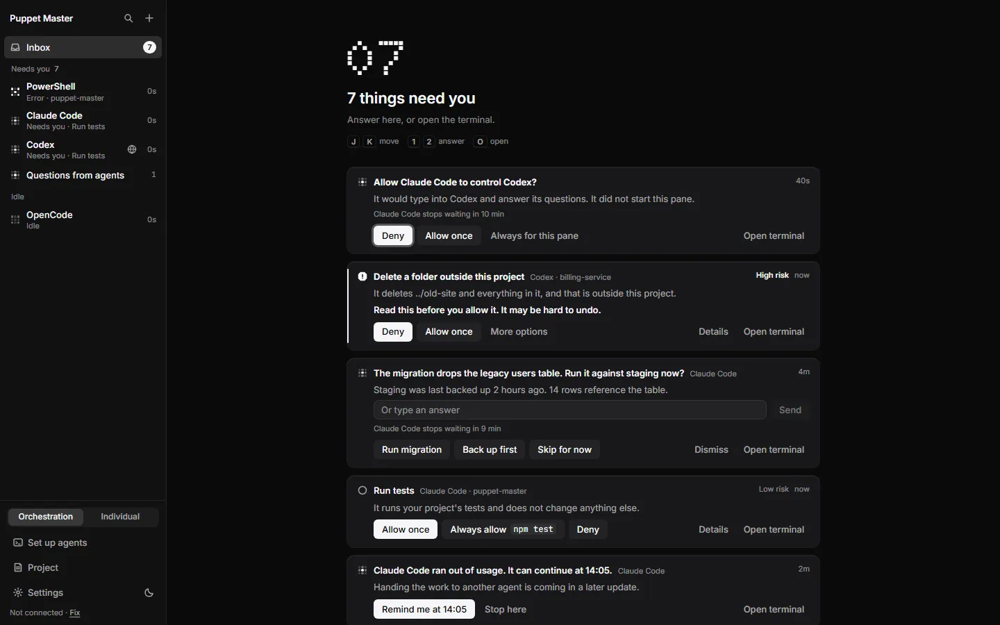

*Example data. The Inbox with seven things at once: a consent question, a high-risk approval, an agent question, a low-risk approval, and a usage-limit card. The big dot number and the sidebar count agree.*

## Why it matters

- Developers: you do not scan ten terminals. You press one key and answer.
- People who build with AI: the order is safe. Risky things come first.
- People who don't code: a short title tells you if anything needs you. "Nothing needs you" is a real answer.

Before 0.2.0, five screens counted "needs you" in four different ways. Now one list decides, and every screen shows that list.

## How to use it

1. Open the cockpit and click **Inbox** at the top of the sidebar (or click nothing: it is the home view).
2. Read the title. It says "Nothing needs you", "One thing needs you" or "3 things need you". The big number under it is the same count.
3. Each card shows a title (what the agent wants, verb first), who is asking and in which project, and how long it has waited ("12s", "4m").
4. Answer on the card. Cards use the same buttons for every agent. See [Approval cards](03-approval-cards.md) for the words and the keys.
5. Use the keyboard: **J** and **K** move between cards, **1 2 3** pick an answer, **O** opens the agent's terminal, **Esc** dismisses a card. A hint line under the title shows these keys.
6. Use the sidebar. An agent that needs you is listed under **Needs you**. If an agent asked a question that belongs to no pane, a row **Questions from agents** shows how many.
7. On a new install with no agents, the Inbox says "Welcome to Puppet Master". The **Set up your agents** button opens the welcome (see [First-run welcome](08-first-run-welcome.md)), or Set up agents after the welcome is done. There is also "I don't write code. Use Simple mode".

**Order of the list.** High-risk approvals and consent requests are first. Then medium and unrated approvals, then low-risk approvals and questions, then budget and usage-limit cards, then errors and stuck agents. In the same group, the card that waited longest is first.

**What is a card?** Approval (with risk), folder trust, a question from an agent, agent-control consent, budget used, usage limit, error, "looks stuck". Answers from the Ask bar and "Untested version" notices appear below the list. With Labs on, Missions and Team cards appear in their own sections.

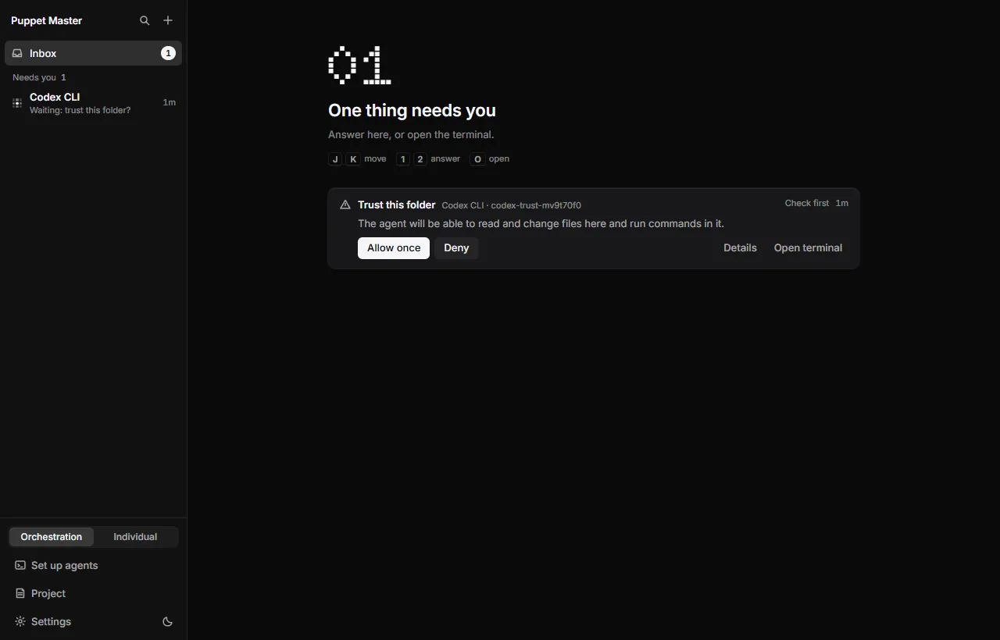

*Real run. One thing needs you. The big dot number, the sidebar group "Needs you" and the badge all say 1.*

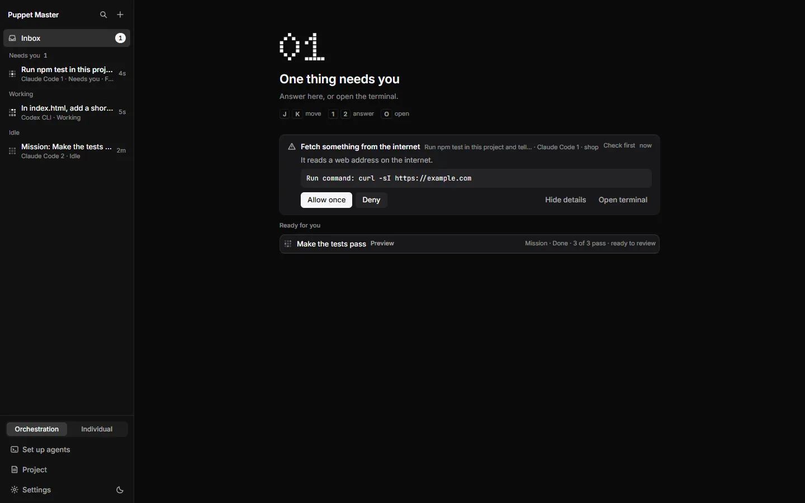

*Real run (0.2.1). A Check first card with Details open: "Fetch something from the internet" and the exact command it wants to run.*

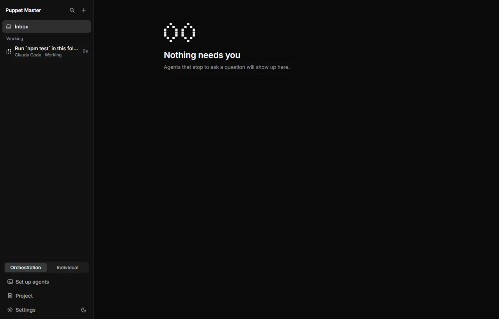

*Real run. After you answer, the card is gone, the agent is back in "Working", and the Inbox says "Nothing needs you".*

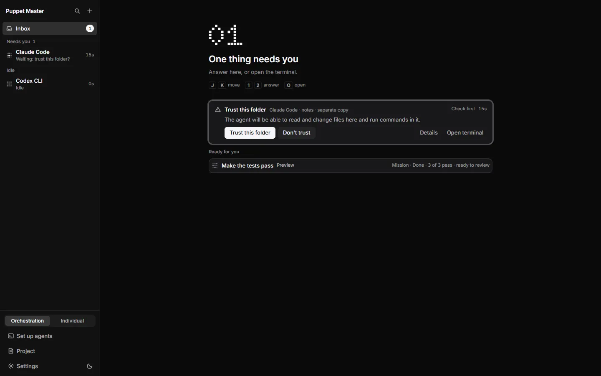

*Real run (0.2.1). A trust card for a separate copy of a project, with a finished mission listed under "Ready for you".*

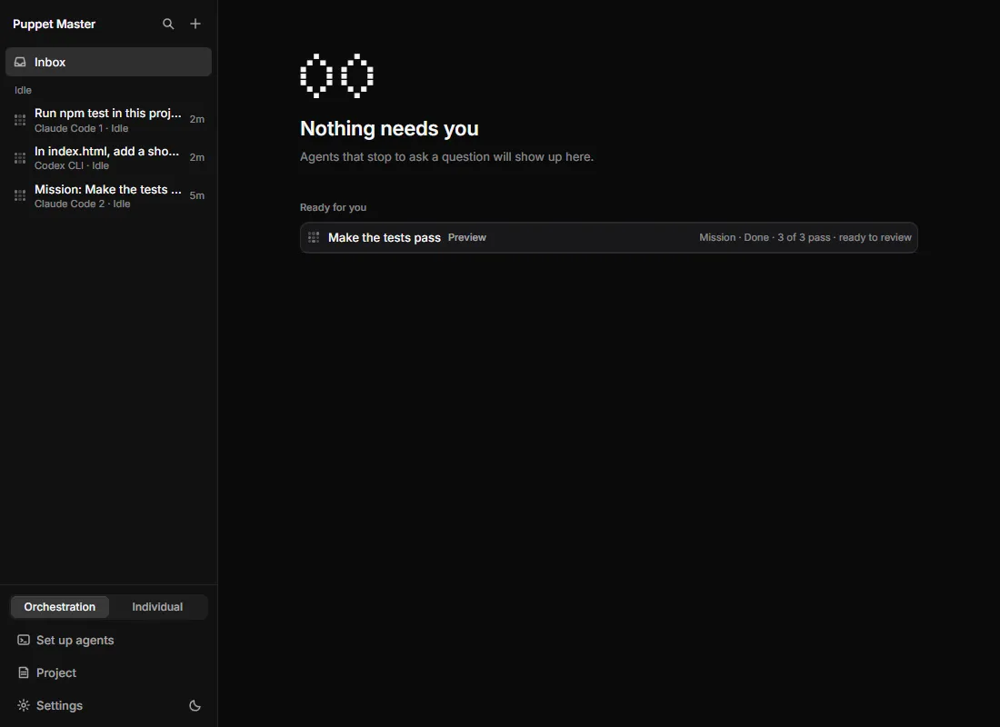

*Real run (0.2.1). All clear: every agent is Idle and the Inbox says "Nothing needs you". A finished mission waits under "Ready for you".*

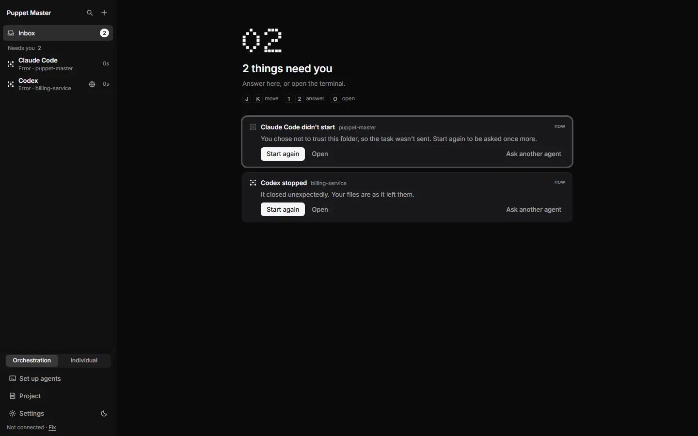

*Example data. Error cards: "Claude Code didn't start" and "Codex stopped". Each says in plain words what happened and offers Start again.*

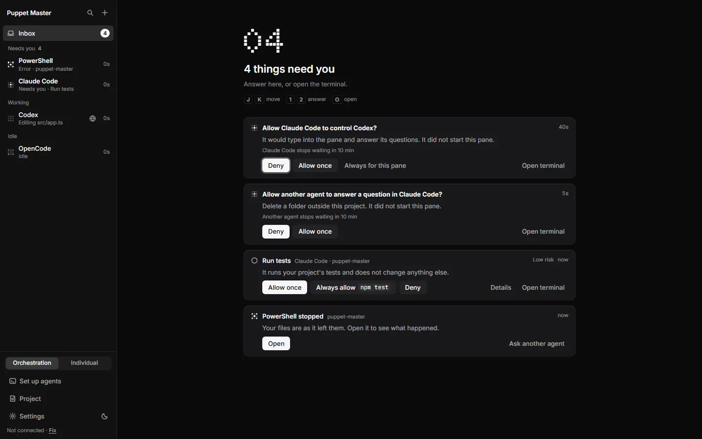

*Example data. Cards that ask if one agent may control another, next to a normal approval card and an error card.*

*Real run (0.2.1). A budget card: "Codex CLI used its 3 turns", with Add 2 turns and Stop here.*

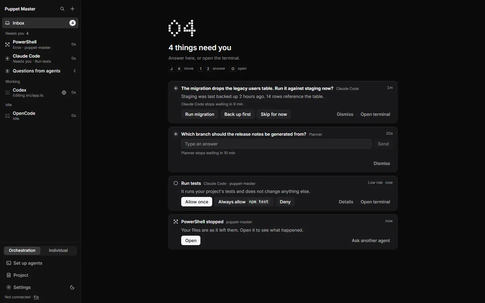

*Example data. Questions from agents: choice buttons, or a text box to type your own answer.*

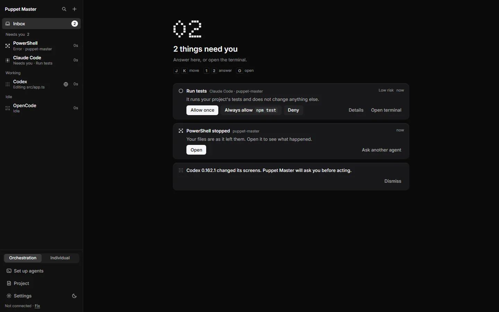

*Example data. A notice card in the Inbox: "Codex 0.162.1 changed its screens. Puppet Master will ask you before acting."*

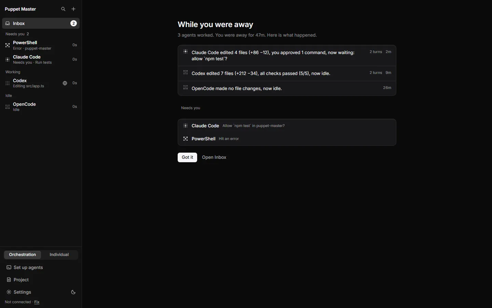

*Example data. "While you were away": one plain sentence per agent, then what needs you.*

*Real run (0.2.1). The same count on the phone: one thing is waiting. It shows as the big dot number and a card, above the Needs you and Idle groups.*

## How it works (simple)

One module in the Rust part of the app decides what needs a person, in what order, and in which "lane". Only the "blocking" lane gets a number. An answer from the Ask bar that nobody saw is listed but not counted, because nothing is blocked. One pane shows only one state item: folder trust beats approval, approval beats error, error beats stuck. A mission card counts once.

A card that leaves stays for about 15 seconds as a quiet note, so you can see what happened. Then it goes. The phone and the PC get the full list each time, with a revision number, so they cannot drift apart.

## Limits and what is not done yet

- The desktop still builds its list in TypeScript. The Rust list drives the tray, the phone and push. A test compares both (25 shared cases). The desktop reading the Rust list is not done.
- The phone label under the big number says "waiting", not "need you". The number is the same.
- Mission cards are their own section, so **J** and **K** skip them.
- The old "Done" and "Ready for you" rows on the phone are not built. The "stuck" card with "Give it a hint" is on the desktop only, not on the phone.
- Some card types (stuck, budget, usage limit) were tested only by automated tests. The usage-limit screens in the tests are made up, not captured from a real limit.

## For developers

- Rust: `src-tauri/src/attention/` (`model.rs` lanes and rank, `derive.rs`, `store.rs`, `answer.rs`).
- HTTP: `GET /attention`, `POST /attention/{id}/answer`; SSE `event: attention` with the full snapshot; Tauri `attention_snapshot`, event `attention://changed`.
- UI: `components/cockpit/Inbox.tsx`, `InboxCard.tsx`, `inbox-keys.ts`, `lib/attention.ts` (`deriveNeedsYou`, `blockingItems`), `lib/inbox-order.ts`.
- Shared test cases: `packages/shared/fixtures/attention/*.json`.
- Design: `D:\pm-night\DESIGN-ATTENTION-PHONE.md`.

## Related

- [The cockpit](01-cockpit.md)
- [Approval cards](03-approval-cards.md)
- [Receipts and History](04-receipts-and-history.md)
- [Follow-ups and agent questions](10-follow-ups-and-agent-questions.md)
- [Loop guard and panic stop](27-loop-guard-and-panic-stop.md)
