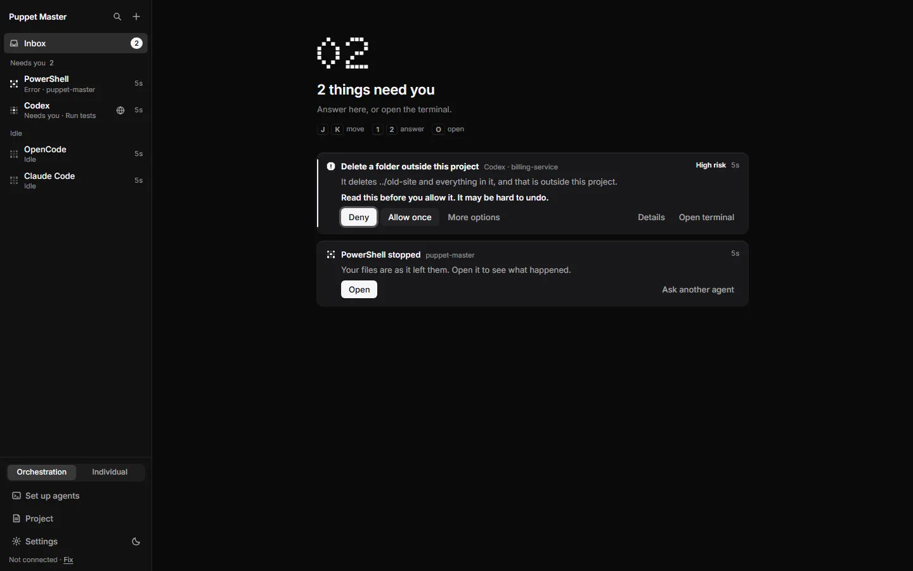
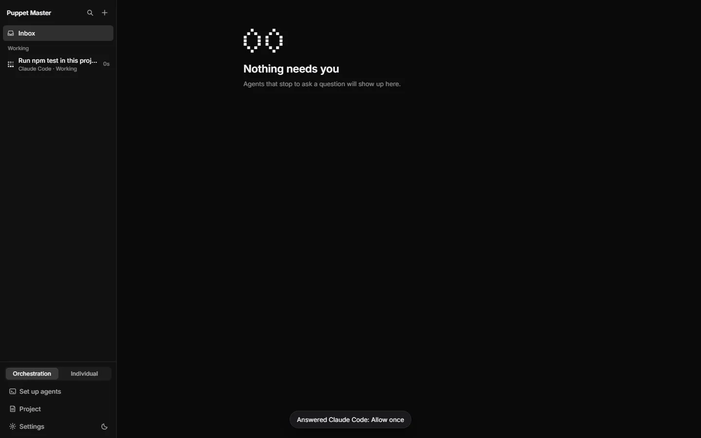
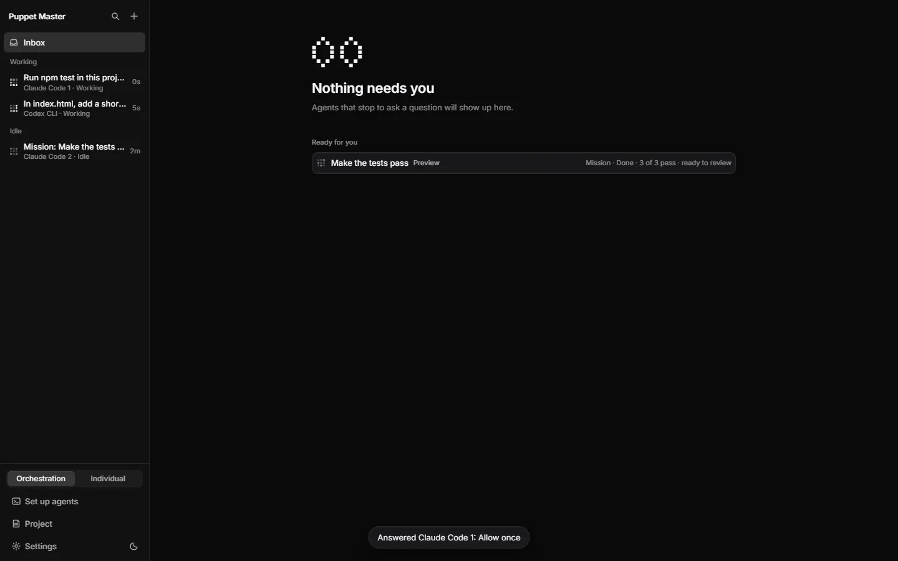
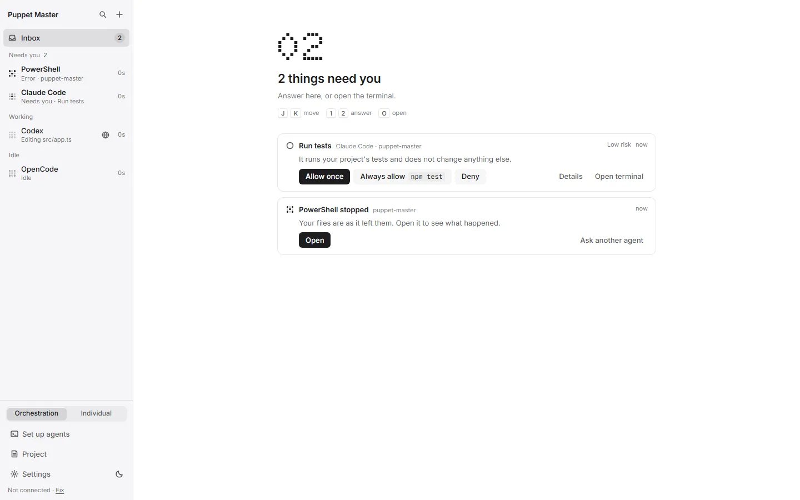

# Approval cards

**Status:** Works today. Checked live with Claude Code and Codex on a real build (folder trust and a tool approval from the Inbox). The phone card was tested in a phone-sized browser, not on a real phone.

## What it is

When an agent wants to do something that needs permission, it stops and shows a menu in its terminal. Puppet Master reads that menu and shows a card instead. The card says in plain words what will happen and how risky it is. You choose. Puppet Master never says "yes" for you.

There are two kinds of card. A **permission card** is about one command or edit. A **trust card** asks "Trust this folder?" and appears when an agent starts in a folder it has not seen before.

*Real run. A low-risk card: "Run tests - It runs your project's tests and does not change anything else." You choose Allow once or Deny.*

## Why it matters

Most people press "yes" on almost every agent prompt, because they cannot tell `rm -rf ../old-site` from a harmless command. Cards put a risk word and one plain sentence in front of that decision. That helps developers move fast, helps people who build with AI avoid a bad "yes", and helps people who don't code understand what is asked.

## How to use it

1. Wait for a card in the Inbox. The same card also sits at the top of the agent's Terminal tab.
2. Read the first line. It says what the agent wants, for example "Run tests".
3. Read the risk word next to it:
   - **Low risk**: tests, builds, lint, read-only commands, Git reads and commits.
   - **Check first**: Puppet Master could not judge it, or it touches something sensitive. An unknown command is "Run a command".
   - **High risk**: for example "Delete a folder outside this project", a forced Git push, a script piped into a shell, or writing to secret files.
4. Press **Allow once** or **Deny**. Low and medium cards can also offer **Always allow** with the command named, for example `npm test`. The words are the same for every agent. The agent's own words stay in the button's tooltip.
5. Press **Details** to see the full command and more reasons. **Open terminal** goes to the real terminal.
6. On a **high-risk** card, **Deny** is first and is the main button. A ring shows that the keyboard starts on Deny. The "always allow" choices are hidden under **More options**. A line says: "Read this before you allow it. It may be hard to undo."
7. On a **trust card**, the buttons are **Trust this folder** and **Don't trust**. If you choose Don't trust, the task is not typed anywhere. The card says the agent did not start and offers **Start again**, which asks you once more.
8. Use keys if you like: **J** and **K** move between cards, **1 2 3** press the first, second, third answer, **O** opens the terminal, **Esc** dismisses. The number keys do not work on high-risk or consent cards.
9. On the phone, the same question appears as an **Allow once / Deny** card in the "Needs you" list. A phone that has only "watch" access sees the card but has no buttons.

*Example data. A high-risk card looks different. Deny is the main button, Allow once is smaller, and "Always allow" is hidden under More options.*

*Real run (0.2.1). After a real click on Allow once, a toast says "Answered Claude Code: Allow once", the card is gone and the agent is Working again.*

*Real run (0.2.1). A Check first card ("Fetch something from the internet") with Details open. The exact command is shown: curl -sI https://example.com.*

*Real run (0.2.1). After a real click on Allow once on the Check first card. The agent is Working again and the Inbox is clear.*

*Real run. A trust card from a real Claude Code: "The agent will be able to read and change files here and run commands in it."*

*Real run. A trust card from a real Codex. The buttons are Allow once and Deny.*

*Example data. The same card in the light theme. "Always allow npm test" is offered only for low-risk commands.*

*Example data. The same card on the phone: "Install packages", Check first, with Allow once and Deny.*

## How it works (simple)

Puppet Master reads the agent's screen to find the menu. A rule engine then reads only the command text, the type of prompt and the project folder (never the agent's name). It splits chained commands (`;`, `&&`, `|`), looks inside `bash -c`, `cmd /c` and `powershell -Command`, and reports the worst part first. An unknown command is "medium".

Each answer is sent once:

- A "yes" and every folder-trust answer need a real click or key press from you. A timer, a re-draw or a program cannot make one.
- If the same question is answered twice within 5 seconds, the second one types nothing.
- If your phone and your PC answer the same question, the first one wins. The other screen says "Already answered on your PC: Allowed once."
- Before it types, Puppet Master checks that the question on screen is still the same one. If not, nothing is typed and the card says "This question changed. Look again."

Puppet Master also types only when the agent's screen is ready. On a screen it does not know, it stops and asks you.

## Limits and what is not done yet

- Risk is a guess from text. A script such as `./deploy.sh` is judged by its name, not by what is inside it.
- A key you press in the terminal goes to the agent's own dialog. The card controls only its own buttons.
- Real iPhone and Android phones were not tested. Lock-screen Allow is only for low risk, and iPhone shows no action buttons. This was tested only by automated tests.
- Opening an agent on the phone resizes its terminal, and the agent may redraw its dialog. A tap at that moment can be refused as "changed". Nothing is typed. Wait for the card to be still, then tap again.
- A phone cannot give a broad answer ("don't ask again"). The PC refuses it.
- Cursor Agent stops at its own trust screen, so it is less tested.
- Simple mode uses Yes / No cards and answers No by itself to high-risk steps (see [Simple mode](07-simple-mode.md)).

## For developers

- Risk rules: `src-tauri/src/prompt_risk/` (`assess`); per-agent additions in the TOML `[[risk.patterns]]` table. 73 command samples are tested.
- Answers: `src-tauri/src/pane_prompt/answers.rs` (one answer per occurrence, `UserGesture`), `attention/answer.rs` for `POST /attention/{id}/answer` (outcomes `answered`, `already_answered`, `changed`, `gone`, `failed`).
- UI: `components/cockpit/ApprovalPrompt.tsx`, `PaneApprovalCard.tsx`, `InboxCard.tsx`, `inbox-keys.ts`, `lib/approval-risk.ts`, `lib/user-gesture.ts`; phone `components/mobile/ApprovalCard.tsx`.
- MCP: an agent can answer with `answer_prompt`; the agent-authority rules apply.
- Words: `LEVEL_WORD` = Low risk / Check first / High risk.

## Related

- [Inbox and Needs you](02-inbox-needs-you.md)
- [Receipts and History](04-receipts-and-history.md)
- [Follow-ups and agent questions](10-follow-ups-and-agent-questions.md)
- [Simple mode](07-simple-mode.md)
