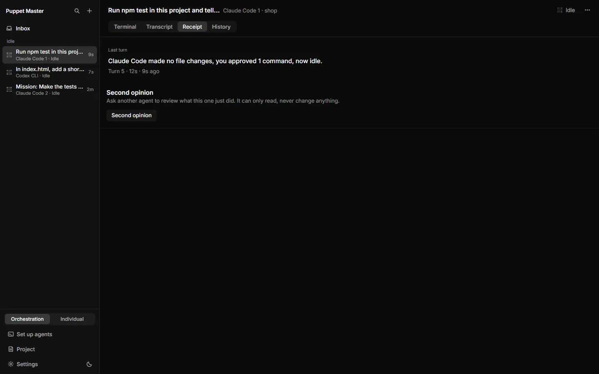
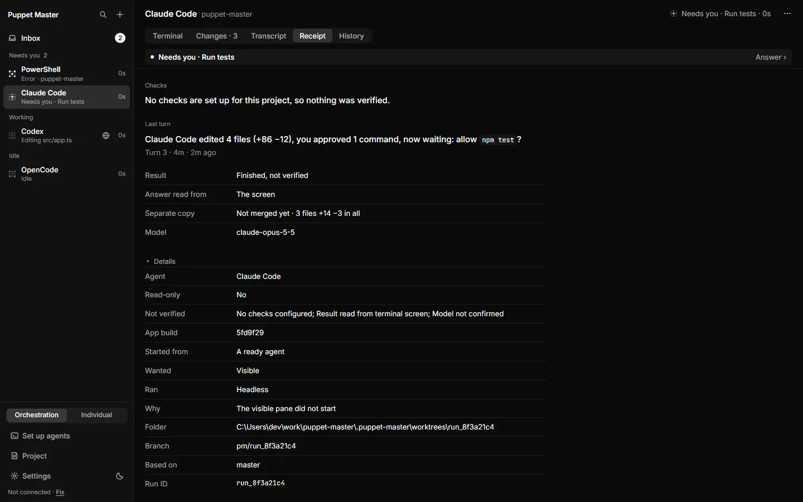
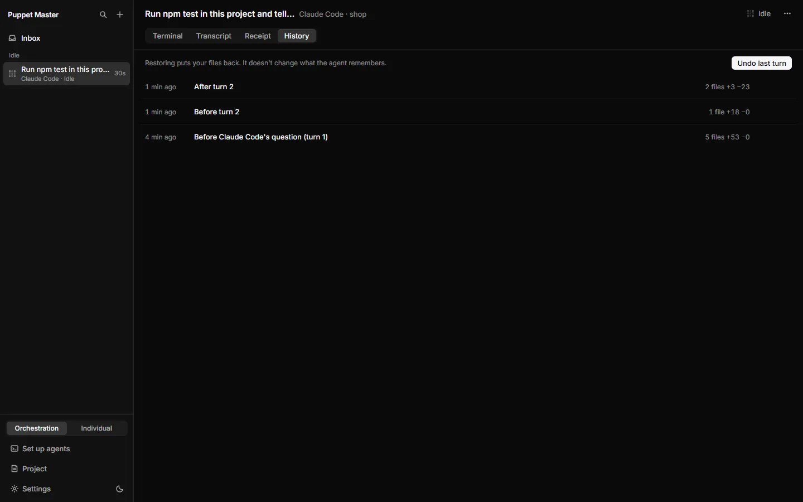
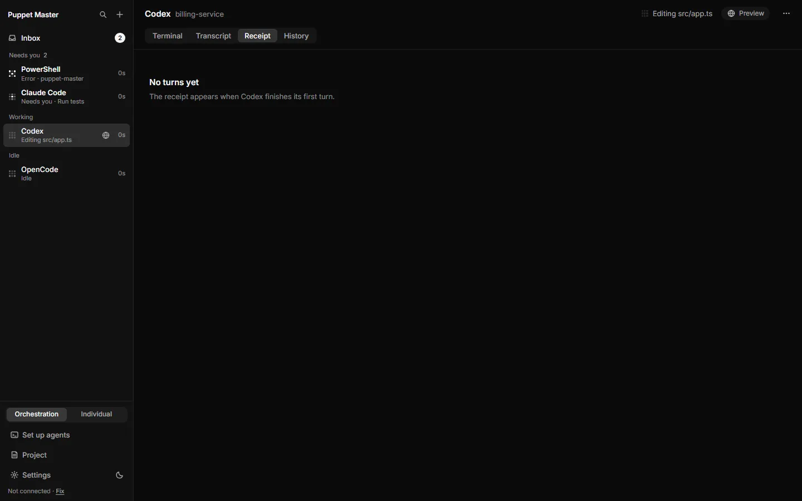
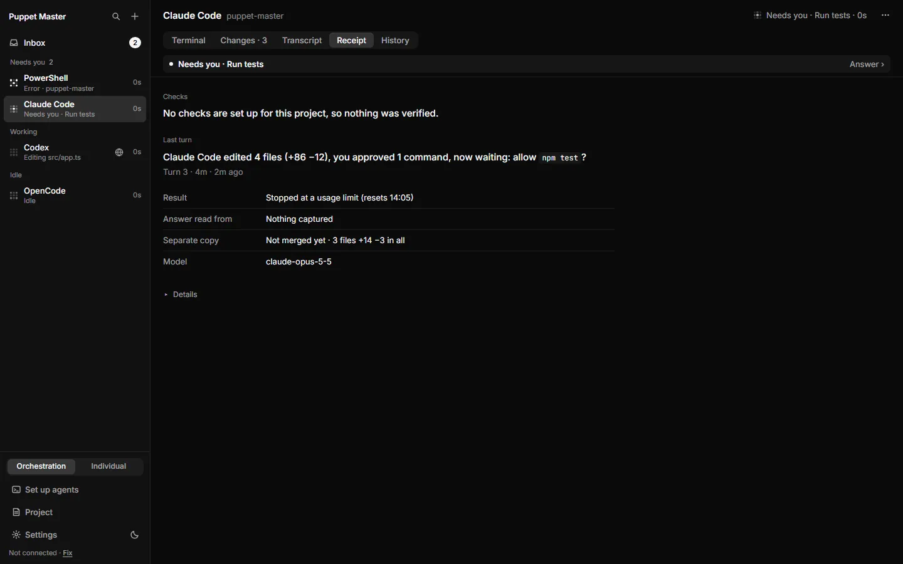
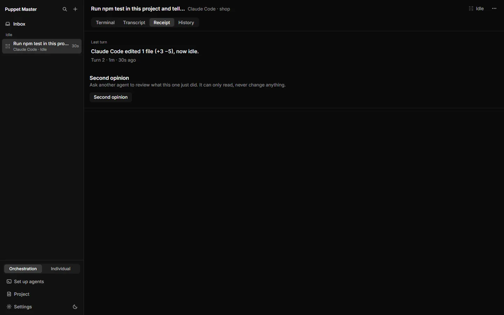
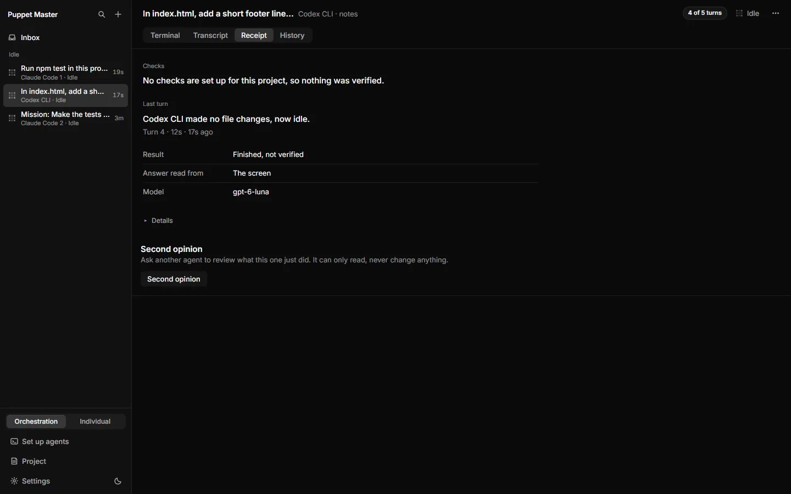

# Receipts and History

**Status:** Works today. The receipt matched History in a live run. The "While you were away" screen and some parts were tested only by automated tests.

## What it is

Every agent turn leaves a short receipt in plain words. A "turn" is one task the agent works on, from when you send it until the agent stops. The receipt says what the agent did, and what was **not** checked.

**History** is the list of file snapshots (called "checkpoints") that Puppet Master takes around each turn. It is the log of your project's past states. **While you were away** is a short summary that appears when you come back after a break.

*Real run (0.2.1). The Receipt tab after a real turn. It says what the agent did ("made no file changes, you approved 1 command, now idle"), and offers a Second opinion.*

## Why it matters

You can not watch an agent all day. Receipts answer "what did it just do?" without reading a terminal. They help developers check quickly, help people who build with AI trust but verify, and help people who don't code come back to one calm answer.

Receipts are honest on purpose. A turn that no check verified says "Finished, not verified", not "Success".

## How to use it

1. Open an agent and click the **Receipt** tab. It shows, from top to bottom:
   - **Checks**: one sentence, for example "No checks are set up for this project, so nothing was verified."
   - **Last turn**: one sentence and a small line "Turn 3 · 2m · 1m ago". Example: "Claude Code edited 1 file (+1 −0), you approved 2 requests, no checks ran, now idle."
   - **Facts**: at most five rows, such as Result, "Answer read from" (the agent or the screen), Separate copy and Model.
   - **Details** (closed at first): every other fact and the Run ID.
2. Hover an agent row in the sidebar. The tooltip shows the same last-turn sentence.
3. Open the **History** tab to see all checkpoints, newest first. Each row has the time ("5 min ago"), a title ("Before turn 3", "After turn 3", "Before Claude Code's question (turn 3)"), and how many files changed ("3 files +12 −4"). Click a row to see the files. To go back to one, see [Undo and checkpoints](05-undo-checkpoints.md).
4. **While you were away**: leave the PC without touching the keyboard or mouse for 5 minutes. When you come back and the cockpit is in front, a full screen appears. It says how many agents worked and how long you were away, gives one line per agent (up to 12), and lists what needs you. Press **Got it** (or Esc), or **Open Inbox**. A row under "Needs you" opens that agent.
5. On a paired phone, a compact version sits at the top of the **All** view until you press **Got it**.
6. Change the wait time in **Settings › General › When you are away › Away digest after**. Use 0 to turn it off.

*Example data. Details open: agent, read-only or not, what was not verified, the folder, branch and run ID.*

*Real run (0.2.1). The History tab: a checkpoint before and after each turn, with the files changed per turn and "Undo last turn".*

*Example data. "While you were away" is made from the same receipts, one sentence per agent.*

*Example data. Before the first turn: "No turns yet. The receipt appears when Codex finishes its first turn."*

*Example data. A receipt for a turn that stopped at a usage limit: "Stopped at a usage limit (resets 14:05)".*

*Real run (0.2.1). A receipt after a real edit: "Claude Code edited 1 file (+3 -5), now idle."*

*Real run (0.2.1). A receipt from a real Codex turn. Checks: "No checks are set up for this project, so nothing was verified." Result: Finished, not verified. The answer was read from the screen. The model is shown.*

## How it works (simple)

No AI writes these sentences. Every part is a recorded fact:

- The turn starts when the agent starts working and ends when it stops. An approval in the middle is part of the same turn.
- File counts come from comparing the "before" and "after" checkpoints of that turn.
- Approvals come from the answers you gave.
- The end state ("now idle", "now waiting: ...") comes from the agent's screen state.
- The receipt facts (checks, result) come from the run record.

If checkpoints are off or Git is missing, the sentence says "worked for 3m" and does not guess the files. Puppet Master keeps the last 100 summaries per agent in a small file in the project's `.puppet-master/` folder. A summary is also kept when a pane closes by itself (checked live in VERIFY-R13).

## Limits and what is not done yet

- Plain shells have no turns, so no receipts.
- Two agents in the same folder share one file list, so each turn's files can include the other agent's edits.
- The sentence says "you approved" even when a rule or an automatic path answered.
- The receipt is read when the turn settles. A fact written a moment later shows only in the next summary.
- If Codex's own tool fails, the receipt says so under "Not verified". Tested only by automated tests.
- A failed follow-up still uses up a turn number. This is known and not fixed.
- Away detection works on Windows only. Other systems never show the digest.
- The Settings row "What's new" still has the title "What's new in 0.2.0" in this build.

## For developers

- Rust: `src-tauri/src/turn_summary/` (`model.rs` has `render_sentence`, `tracker.rs`, `store.rs`), `presence.rs`, `digest.rs`.
- Tauri: `turn_summaries(paneId)`, `away_digest_pending`, `away_digest_dismiss`; event `turn://summary`; SSE `turn-summary`.
- HTTP: `GET /digest?since=<ms>&seen=1` (a remote caller needs a paired token).
- Setting: `away_minutes` (0 to 1440, default 5).
- UI: `components/cockpit/ReceiptTab.tsx`, `LastTurn.tsx`, `receipt-view.ts`, `History.tsx`, `AwayDigest.tsx`; phone `components/mobile/DigestCard.tsx`.
- Receipt data: `RunReceipt` in `agent_runs/runtime/receipt.rs`.

## Related

- [Undo and checkpoints](05-undo-checkpoints.md)
- [Inbox and Needs you](02-inbox-needs-you.md)
- [Settings](09-settings.md)
- [Review, merge and pull requests](23-review-merge-and-pull-requests.md)
