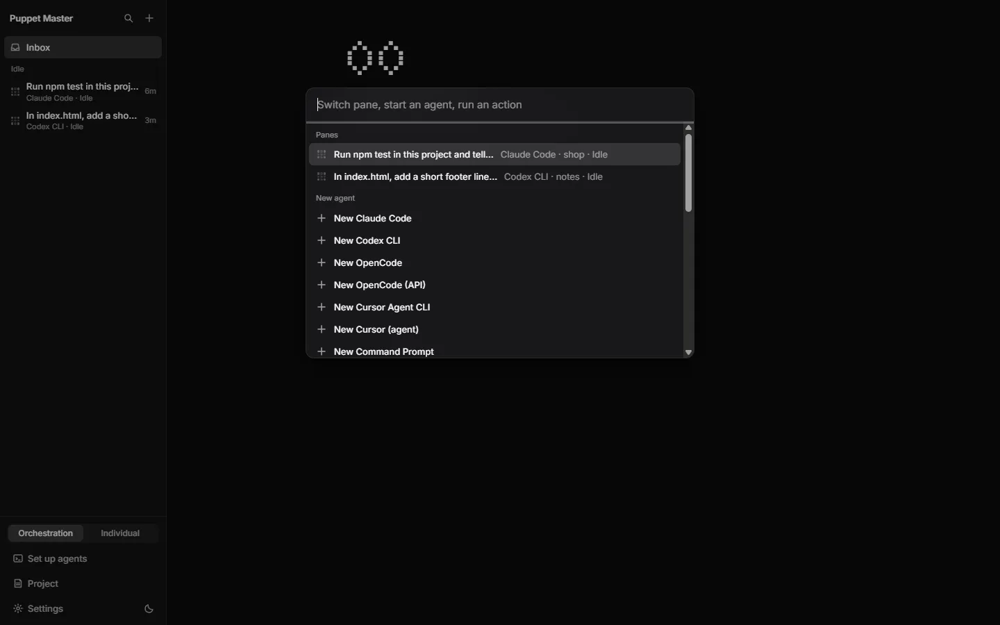
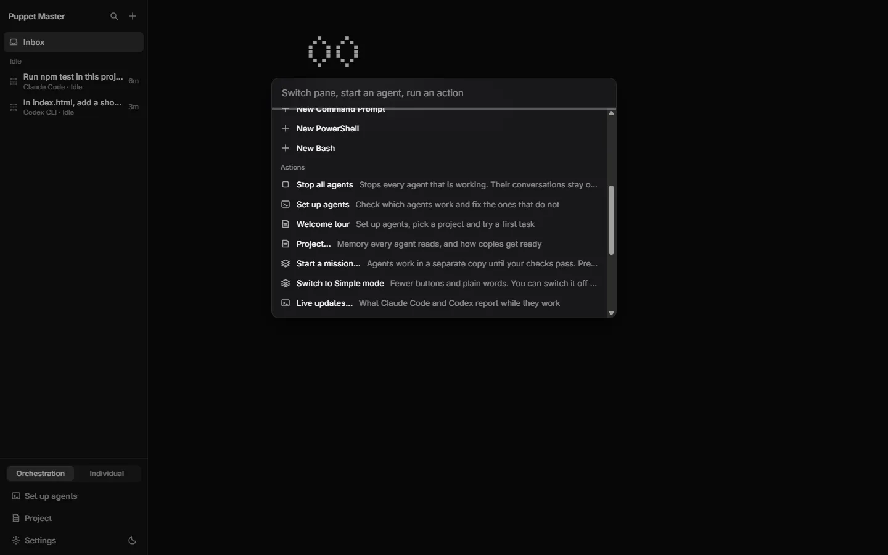
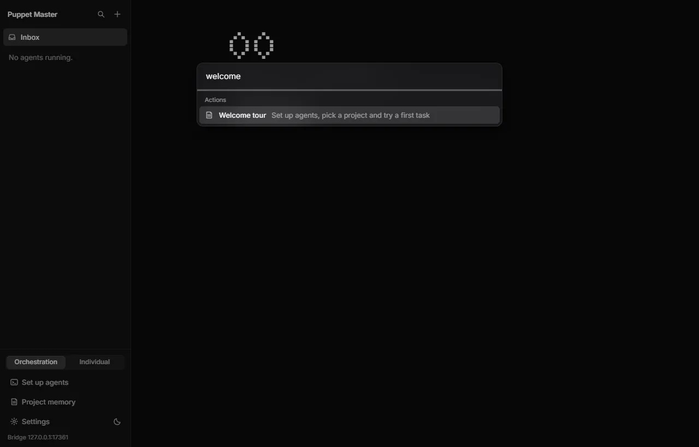
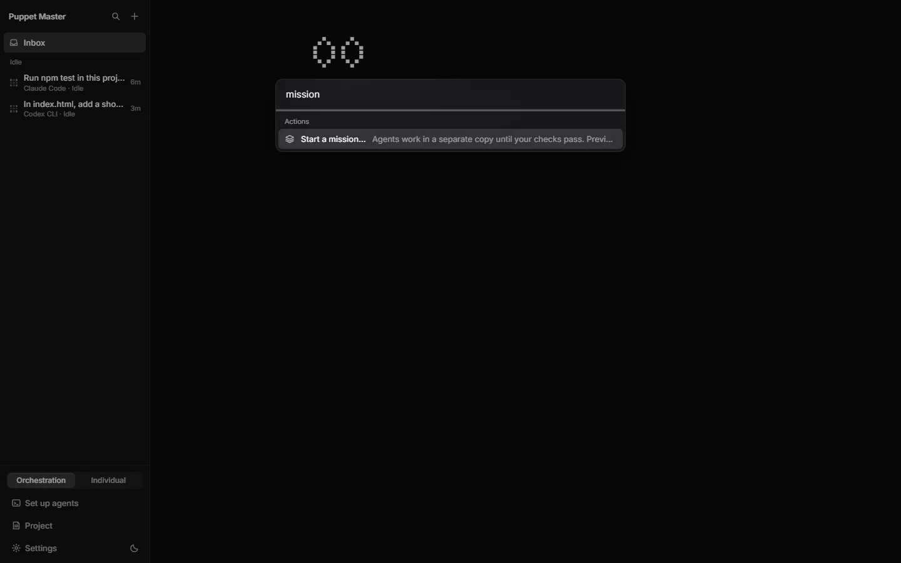
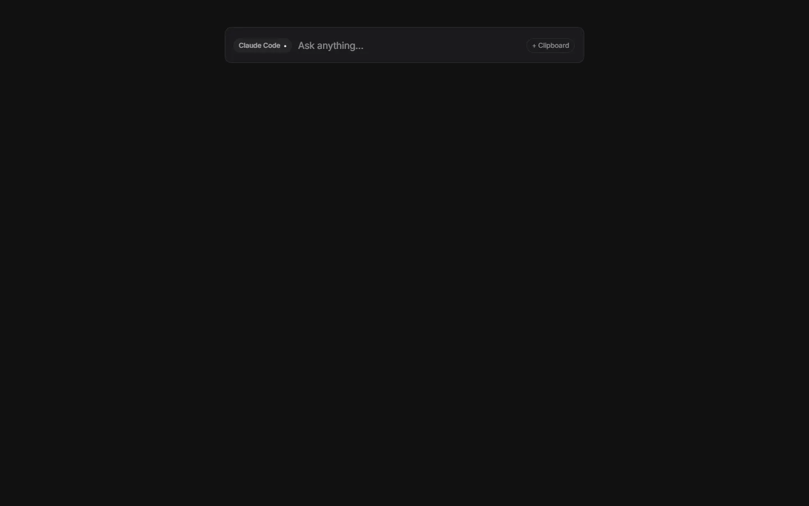
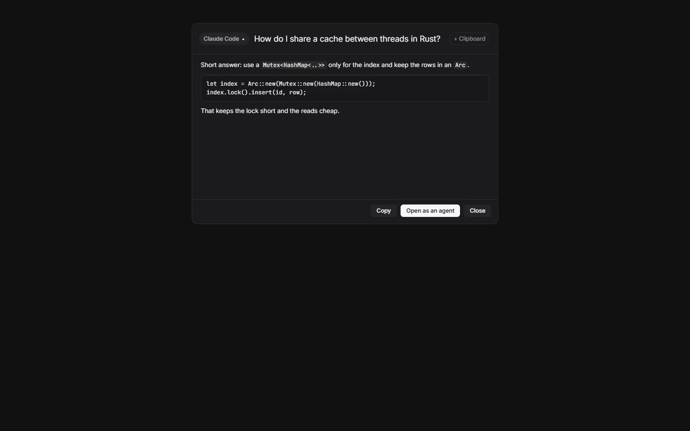
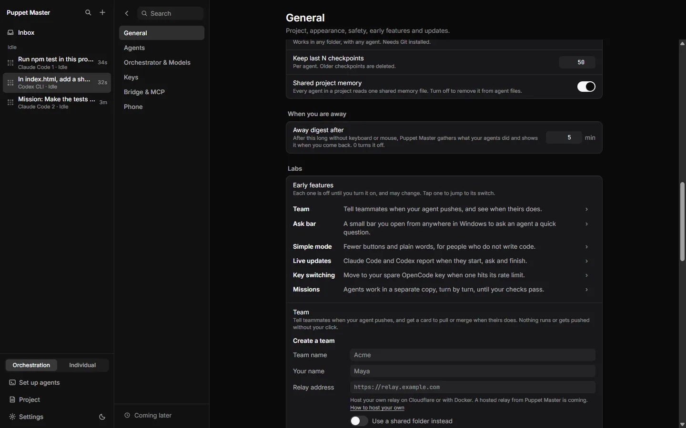
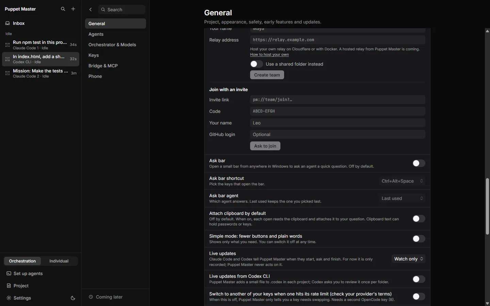

# Command palette and Ask bar

**Status:** Works today for the Ctrl+K palette. The Ask bar is Preview (Labs, off by default).

## What it is

The **command palette** is a search box that opens in the cockpit with Ctrl+K. You type a few letters to jump to an agent, start a new agent, or run an action such as "Undo last turn" or "Stop all agents".

The **Ask bar** is a small Spotlight-style bar that opens from anywhere in Windows, even when Puppet Master is in the background. You type one question, an agent answers in the bar, and nothing in your project is changed.

*Real run (0.2.1). The Ctrl+K palette: switch to a pane, start a new agent ("New Claude Code"), or run an action.*

## Why it matters

- Developers: no mouse. Find any agent or action in a second.
- People who build with AI: you do not need to remember where a setting lives. Type "budget" or "phone".
- People who don't code: the Ask bar gives a quick answer ("what does this error mean?") without opening a project.

## How to use it

**Command palette**

1. Press **Ctrl+K** in the cockpit (or click the search icon at the top of the sidebar).
2. Type what you want. The list filters as you type. It matches the title, the description and hidden search words.
3. Use the arrow keys, then **Enter**. **Esc** closes the palette.
4. The list has three groups:
   - **Panes**: every agent, with its state. Choose one to open it.
   - **New agent**: start a new agent. Ready agents say "Opens instantly".
   - **Actions**, for example: Stop this agent, Undo last turn…, Open preview: Claude Code :5173, Stop all agents, Set up agents, Welcome tour, Project…, Switch to Simple mode, Live updates…, Budgets…, Team…, Pair a phone…, Save a diagnostic file…, Open settings, Toolbelt…, Switch to Individual mode, and the light/dark theme.
5. With Missions (Labs) off, "Missions…" opens its switch. With it on, "Start a mission…" opens the start sheet.
6. Commands that end in "…" only open the place where the feature lives. They do nothing by surprise. "Stop all agents" acts at once: it stops every agent that is working (plain shells keep running), then shows a report.

**Ask bar**

1. Turn it on: **Settings › General › Labs › Ask bar**. It is off by default, and no shortcut is registered until you turn it on.
2. Choose the shortcut (**Ask bar shortcut**): Ctrl+Alt+Space (default), Ctrl+Shift+Space, Alt+Space or Ctrl+Alt+K. Choose the agent (**Ask bar agent**): "Last used" or one agent.
3. Press the shortcut anywhere. The bar opens in the middle of the screen. Type your question and press Enter.
4. Press **+ Clipboard** if the agent should also see what you copied. The text is cut at 8,000 characters. A chip always shows when text is attached. You can also turn on **Attach clipboard by default**, but clipboard text can hold passwords or keys.
5. A dot spinner runs, then the answer appears with **Copy**, **Open as an agent** and **Close**. If it fails, you see **Try again**. **Esc** hides the bar.
6. If you click away before the answer arrives, the answer waits as a card "Answer from <agent>" in the Inbox, with **Open** and **Dismiss**.

*Real run (0.2.1). The palette scrolled to Actions: Stop all agents, Set up agents, Welcome tour, Project, Start a mission (Preview), Switch to Simple mode and Live updates.*

*Real run. Typing "welcome" finds the "Welcome tour" action, so you can open the first-run guide again.*

*Real run (0.2.1). Typing "mission" filters the palette down to "Start a mission..." (Preview).*

*Example data. The Ask bar (Labs, off by default): a small bar with the agent picker and "Ask anything".*

*Example data. The answer comes back in the bar, with Copy, "Open as an agent" and Close.*

*Real run (0.2.1). Settings, General, Labs. The early features (Team, Ask bar, Simple mode, Live updates, Key switching, Missions) are off until you turn them on.*

*Real run (0.2.1). The Ask bar switch (off), its shortcut (Ctrl+Alt+Space), the agent that answers and "Attach clipboard by default" (off).*

## How it works (simple)

The palette is built from the live state of the cockpit and the list of commands. It has no AI.

The Ask bar sends your question through `quick_ask`, a one-shot, read-only question to an agent that can answer without a visible window. It runs in your default project folder. The agent cannot change files. Only agents that can do this, and are installed, are listed. A small window (640 pixels wide, no frame, always on top) shows the answer.

## Limits and what is not done yet

- The Ask bar is Preview. Its logic is tested, but the real window, the global shortcut, hide-on-click-away and the Inbox card were not checked by hand in the notes I read.
- If another program already uses your shortcut, it does not register. The failure is only logged, not shown to you.
- The shortcut list is fixed. There is no key recorder.
- An answer that was on screen when you clicked away is gone. Only answers that arrive while the bar is hidden become Inbox cards. These cards are kept in memory only and are not sent to the phone.
- A question that takes more than 90 seconds ends with "taking longer than expected". The run goes on. "Open as an agent" starts a new agent. It does not join that run.
- Answers are plain text. Code blocks show in a fixed-width font. There is no markdown display.
- The palette works in the cockpit window. In Individual mode there is no cockpit palette.

## For developers

- Palette: `packages/app/src/components/cockpit/Palette.tsx`, `palette-shortcuts.tsx` (add new commands there, opening a Settings row id). Keys are handled in `CockpitApp.tsx`.
- Ask bar Rust: `src-tauri/src/askbar/` (`mod.rs`, `glue.rs`), `commands/askbar.rs`; settings in `askbar.json` in the app data folder.
- Ask bar UI: `components/askbar/AskBar.tsx`, `components/cockpit/AskNotices.tsx`, `components/settings/blocks/AskBarSettings.tsx`, `lib/askbar.ts`.
- MCP: `quick_ask` (agent mode).
- Events: `askbar://shown`, `askbar://notice`.

## Related

- [The cockpit](01-cockpit.md)
- [Inbox and Needs you](02-inbox-needs-you.md)
- [Undo and checkpoints](05-undo-checkpoints.md)
- [Settings](09-settings.md)
