# Simple mode

**Status:** Preview (Labs, off by default). Checked live once: it made a class timer page. The first-run welcome can also turn it on.

## What it is

Simple mode replaces the cockpit with a calmer screen: fewer buttons and plain words. You see "Your projects" and one big button, "Make something". An AI agent works for you on a copy of your folder. You press **Keep** to put the result in your folder, or **Throw away** to drop it.

It is for people who do not write code. In the settings file and in the code it is called `simple_mode`.

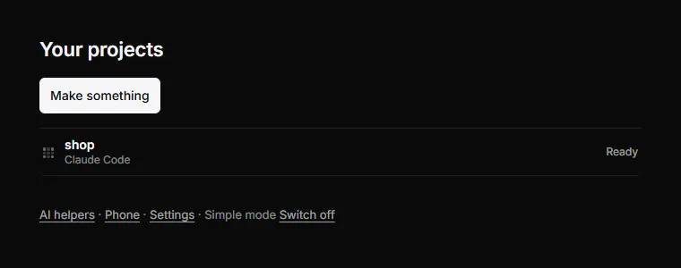

*Real run (0.2.1). Simple mode home: "Your projects" with a status for each project (here "shop", Ready) and one big "Make something" button.*

## Why it matters

People who don't code are afraid of losing real files and of words they do not know. Simple mode never touches your own folder until you press Keep. It never shows words like repository, branch, merge, commit or checkpoint. Many readers know English only as a second language, so each sentence is short.

## How to use it

1. Turn it on in one of these ways:
   - **Settings › General › Labs**, switch **Simple mode: fewer buttons and plain words**.
   - Press Ctrl+K and choose **Switch to Simple mode**.
   - In the first-run welcome, answer "I build with AI, not much code" or "I don't code".
   - On the empty Inbox, press **Use Simple mode** next to "I don't write code."
2. Press **Make something**. Answer three short questions ("Question 1 of 3"). Puppet Master shows the words it will send to the agent ("Here is what Puppet Master will ask"). You can edit them. The house rules are folded under "Puppet Master also asks it to". Press **Start**.
3. Or press **Use a folder I already have** and **Choose a folder**. That folder must already be a Git project with a commit.
4. Open a project. The tabs are **Preview**, **Conversation**, **What changed** and **Earlier versions**. The header says "Working on a separate copy". The bottom bar has **Keep** (main), **Throw away** and **Stop**.
5. When the agent asks something, you see one short question with **Yes** or **No**. There is no "Always allow". A high-risk step is not asked at all. Puppet Master answers No for you and says "Puppet Master stopped Claude Code" and "Your files are safe." You can press **Tell Claude Code why**.
6. If something goes wrong you see one card. It says if your work is safe. Buttons can be **Start again**, **Sign in**, **Ask Claude Code to fix it**, **Go back** or **Copy report**.
7. If Puppet Master cannot read the agent's screen, it says so and **Show the screen** opens the real terminal under Details.
8. At the bottom of Home you find **AI helpers · Phone · Settings · Simple mode · Switch off**. Use **Switch off** any time to get the full cockpit back.
9. If no agent is ready: "No AI is ready on this computer." The button **Set up an AI helper** opens Set up agents inside Simple mode.

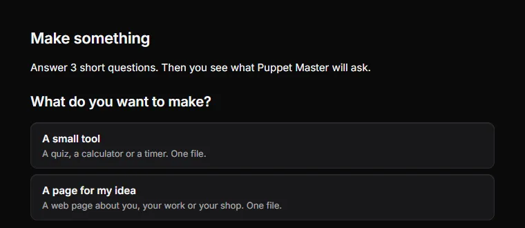

*Real run (0.2.1). "Make something": you pick what you want, a small tool or a page for your idea.*

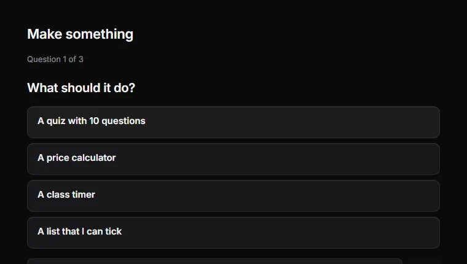

*Real run (0.2.1). Question 1 of 3: "What should it do?" with ready-made choices or your own words.*

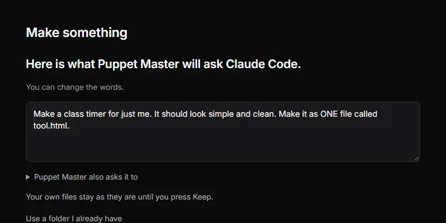

*Real run (0.2.1). You see the exact words Puppet Master will ask the agent, and you can change them. Your own files stay safe until you press Keep.*

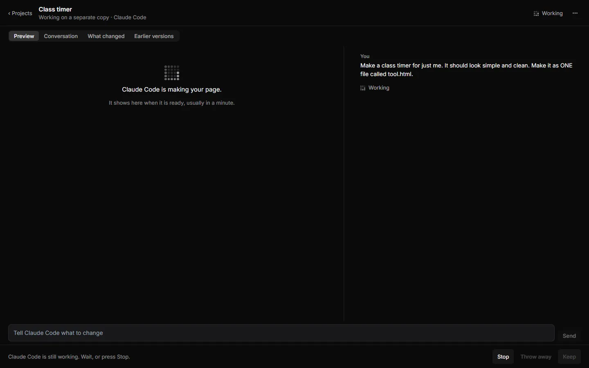

*Real run (0.2.1). While the agent works: "Claude Code is making your page." You can press Stop. Throw away and Keep wait until it is ready.*

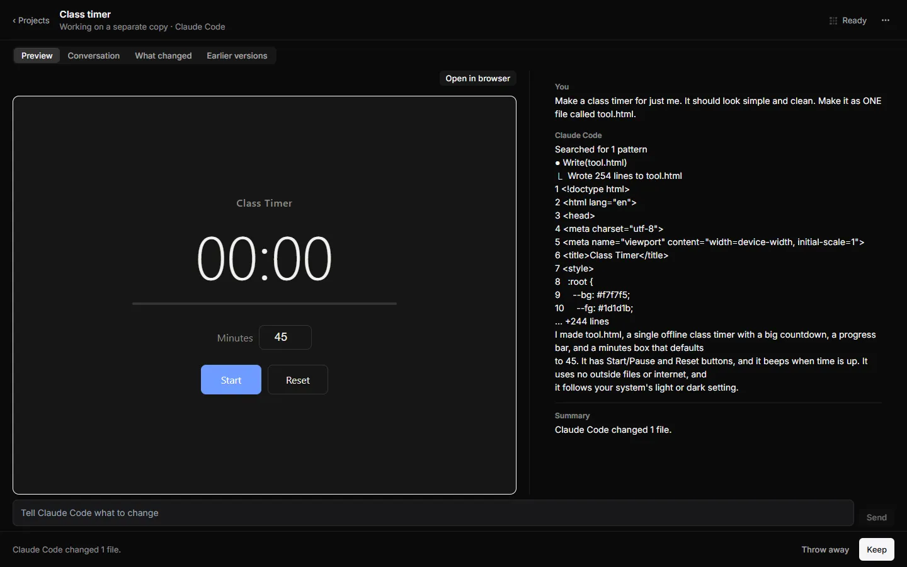

*Real run (0.2.1). A real Claude Code made a class timer. The Preview tab shows the page next to the conversation, with an Open in browser button. Throw away and Keep are at the bottom.*

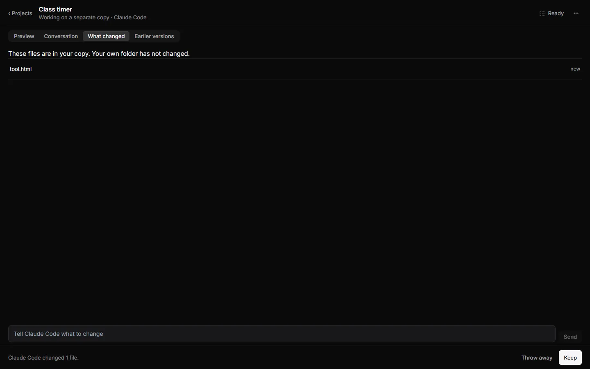

*Real run (0.2.1). "What changed": the files in your copy (here tool.html, new). "Your own folder has not changed."*

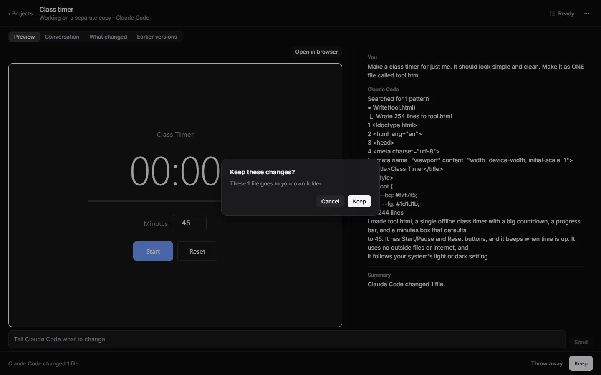

*Real run (0.2.1). Keep asks first: "Keep these changes? These 1 file goes to your own folder."*

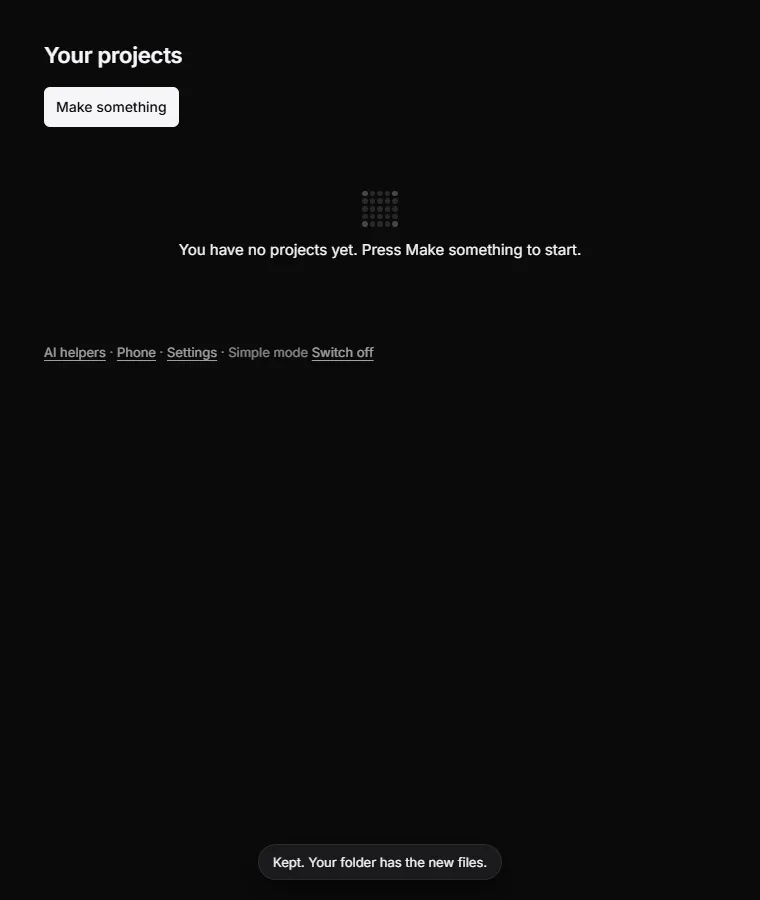

*Real run (0.2.1). After a real Keep: "Kept. Your folder has the new files."*

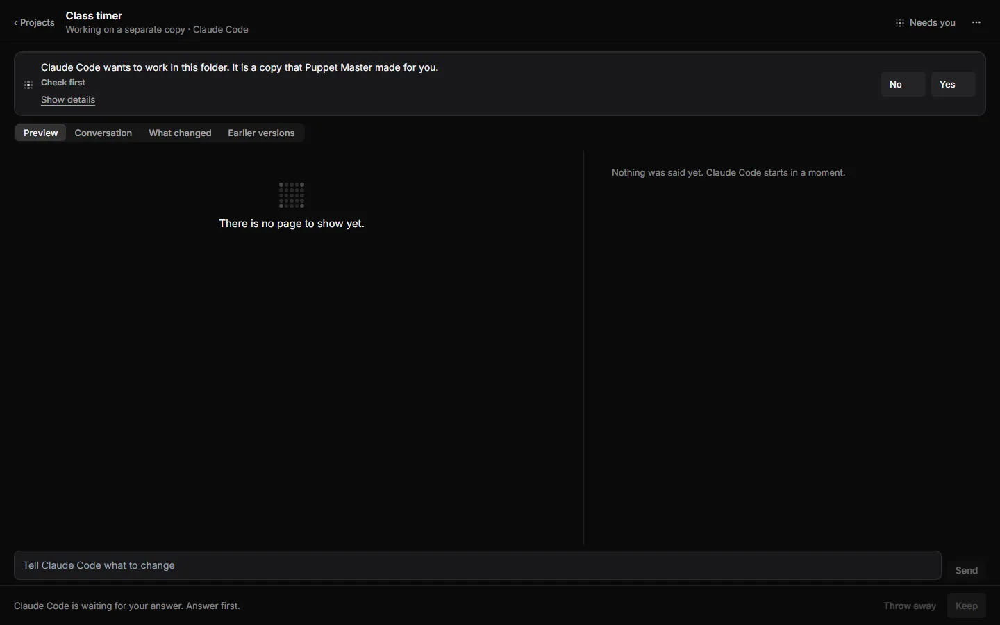

*Real run (0.2.1). A question in plain words: "Claude Code wants to work in this folder. It is a copy that Puppet Master made for you." The answers are No and Yes.*

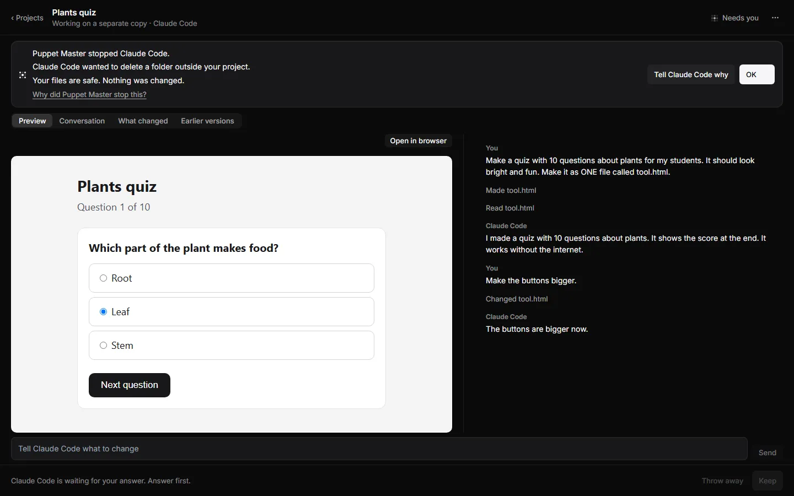

*Example data. When an agent tries something risky, Puppet Master stops it: "Your files are safe. Nothing was changed."*

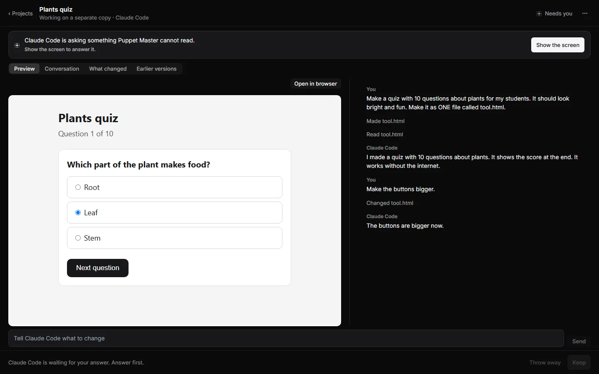

*Example data. When Puppet Master cannot read a question, it says so and offers "Show the screen" instead of guessing.*

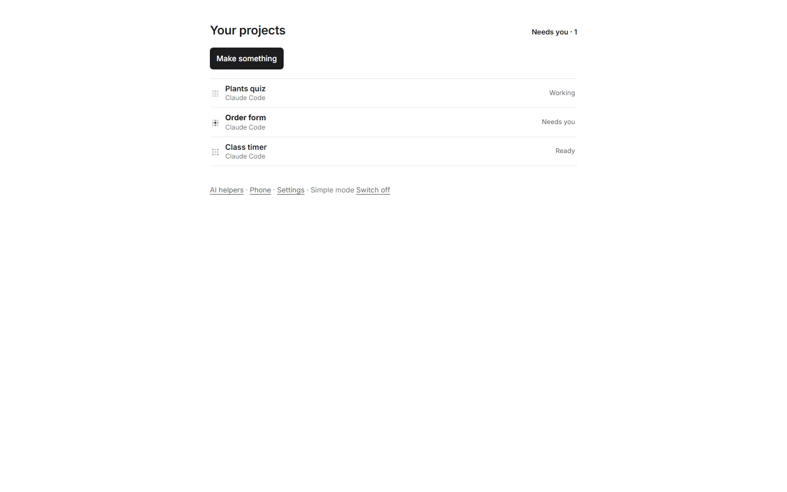

*Example data. Simple mode in the light theme.*

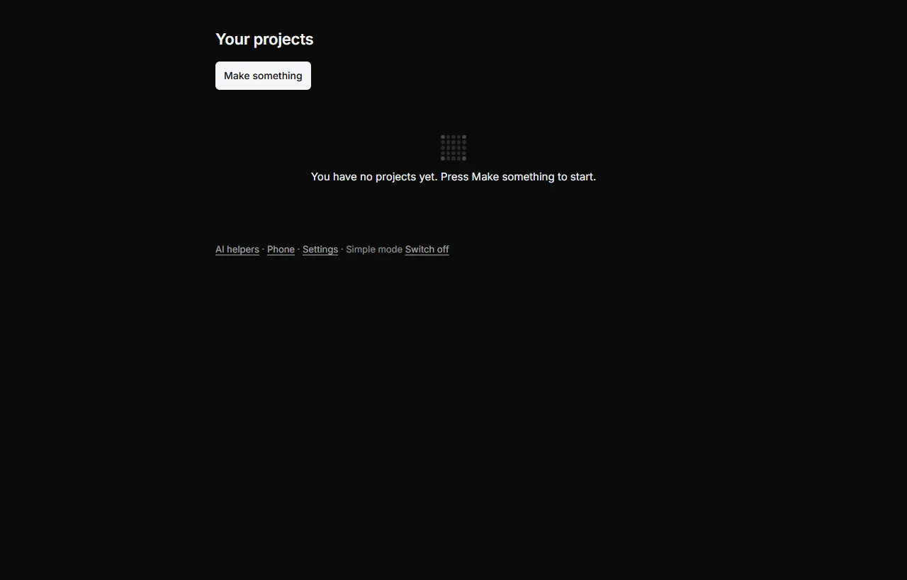

*Real run. Simple mode right after you choose it in the first-run welcome.*

## How it works (simple)

- **A copy, always.** Every task runs in a separate copy of the project (a Git "worktree"). Your own folder changes only when you press Keep. If a file in your folder changed meanwhile, nothing is kept and your files stay safe.
- **Broad folders are refused**: your profile, Desktop, Documents, Downloads, a OneDrive root, a drive root, Windows, Program Files, ProgramData, AppData, and any folder over 5,000 files or 500 MB.
- **A new project** is a folder under `Documents\PM`. Puppet Master quietly makes it a Git project so Keep and Earlier versions work.
- **Earlier versions** uses the same checkpoints as History (see [Undo and checkpoints](05-undo-checkpoints.md)).
- **Words are checked by tests.** A sentence has at most 15 words, a card at most 3 sentences, and every word must be on a plain-word list.

## Limits and what is not done yet

- It is a Preview (called "v0"). Not built: point-and-fix on the preview, named versions, screenshots in Earlier versions, copying folders that are not Git projects, sign-in cards, plan usage, phone changes, `ask_user` question cards, translations.
- English only.
- Home lists only projects that work on a copy. There is no Inbox, and no Changes or Merge screens. Use Switch off for the full cockpit.
- Simple mode is not shown in Individual mode. While the welcome is open, the normal cockpit stays visible so sign-in windows are not hidden.
- Only a few live runs were done. Claude Code and Codex are the tested agents.

## For developers

- UI: `packages/app/src/components/simple/` (all text in `copy.ts`; `language.test.ts` enforces the word rules; `folder-guard.ts`).
- Rust: `src-tauri/src/plain_mode/` (`run_request` sets `isolation: "worktree"`; `guard::verdict` refuses broad folders).
- Switch: `simple_mode` in the settings file; `lib/simple-mode.ts`; palette command in `palette-shortcuts.tsx`.
- Reuses `Changes`, the History checkpoints, `worktree_merge` and `worktree_discard`.
- Design notes: `D:\pm-night\IDEAS-R8-PLAIN-MODE.md`.

## Related

- [First-run welcome](08-first-run-welcome.md)
- [Settings](09-settings.md)
- [Approval cards](03-approval-cards.md)
- [Undo and checkpoints](05-undo-checkpoints.md)
- [Separate copies](22-separate-copies-worktrees.md)
