# First-run welcome

**Status:** Works today. New in 0.2.1. Checked with automated tests and screenshots of every step. I found no note of a full run on a clean PC, and the in-app Install button was tested only by automated tests.

## What it is

The first-run welcome is a 7-step guide that opens the first time you start Puppet Master on a new profile. It asks how you work, finds and installs your agents, helps you pick one project, and walks you through a first safe task. It covers the whole window while it is open.

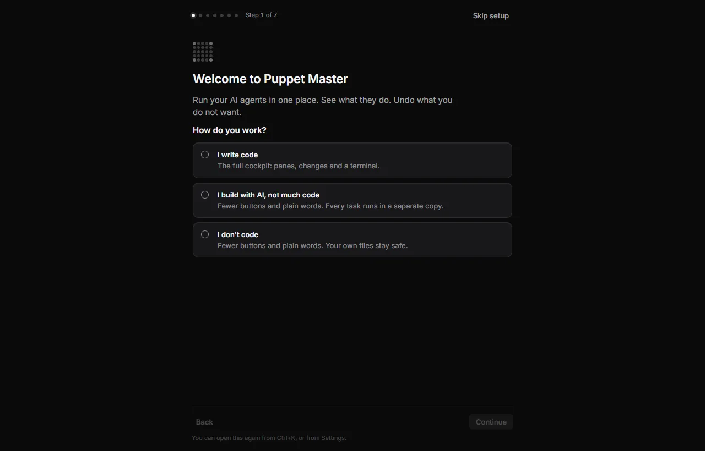

*Real run. The first start of Puppet Master 0.2.1: "Welcome to Puppet Master", step 1 of 7. You say how you work, and the welcome adapts.*

## Why it matters

Before 0.2.1, a new person saw an empty Inbox and had to guess what to do. The welcome gives every kind of user a road in:

- Developers can skip it in one click.
- People who build with AI get Simple mode and a copy-only first task.
- People who don't code get plain words and a task that cannot change any file.

## How to use it

It opens by itself once, when the profile is new and no agent was ever started. Existing users who already have agents never see it automatically.

1. **Welcome.** Read "Run your AI agents in one place. See what they do. Undo what you do not want." Answer "How do you work?":
   - **I write code**: the full cockpit.
   - **I build with AI, not much code**: Simple mode, and every task runs in a separate copy.
   - **I don't code**: Simple mode, and your own files stay safe.
2. **Your agents.** The list shows each agent as Install, Sign in, Test or Ready. Install one, sign in, then press **Test**. Test asks the agent one tiny question. **Continue** turns on when one agent is Ready.
3. **Your first project.** Press **Choose folder…** or pick one under "Recent". The folder must be a Git project with a first commit. If it is not, **Set up Git here** offers to make it one. Nothing is uploaded. Folders that are too broad or too big are refused.
4. **A first task.** Puppet Master shows the words it will send. The task asks the agent to read the project and say what it does. Press **Run the task**. The task runs in a separate copy, so your folder is not touched. You see "What it said", a short note about the **Receipt**, a note about **Undo**, and an example **approval card** if the agent asks something.
5. **Use your phone.** Scan the code with your phone camera to watch and answer your agents. You choose what the phone may do. You can skip it.
6. **Add Puppet Master to your agents.** It teaches your installed agents how to use Puppet Master. **Review and install** shows every file first. You can skip it.
7. **You are set.** Three tips: **Ctrl+K**, **Inbox**, **History**. Press **Start using Puppet Master**.

You can press **Back** on every step after the first. From step 2 to step 6 you can press **Skip for now** (on the phone and agent-setup steps it says **Later**). **Skip setup** leaves the whole welcome and shows on every step except the last. When you press Sign in or open an agent, the welcome pauses to a thin bar ("Setup is paused. Finish in the window, then come back.") with **Back to setup**. Your place is saved, so a restart opens the step you left.

**Open it again:** press Ctrl+K and choose **Welcome tour**, or go to **Settings › General › Appearance › Welcome** and press **Show the welcome**. On the empty Inbox, **Set up your agents** continues the welcome until you finish or skip it, and then opens Set up agents.

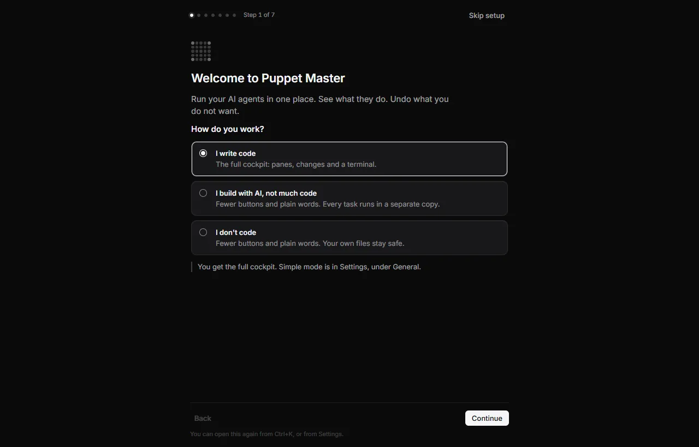

*Real run. You choose how you work. For "I write code" you get the full cockpit, and a note says where Simple mode is.*

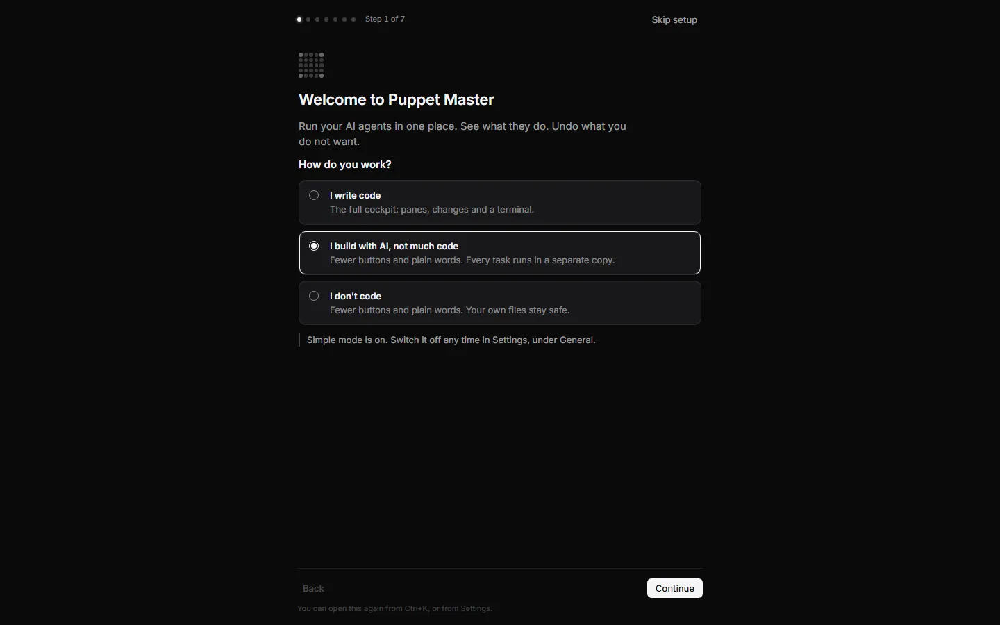

*Example data. "I build with AI, not much code" turns Simple mode on. A note says you can switch it off in Settings.*

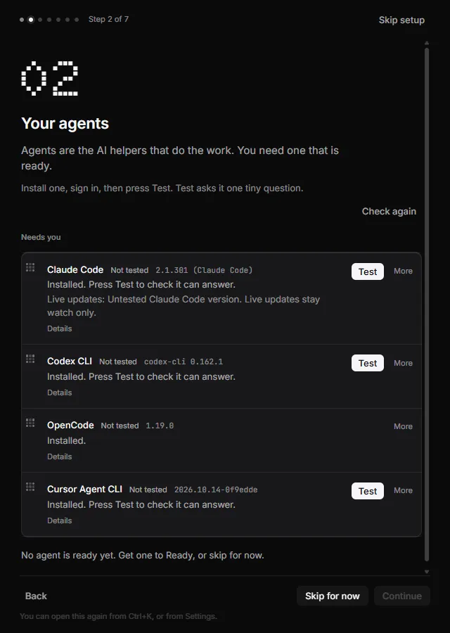

*Real run (0.2.1). Step 2 of 7: Your agents. Puppet Master found four agents on this PC. All are "Not tested" until you press Test.*

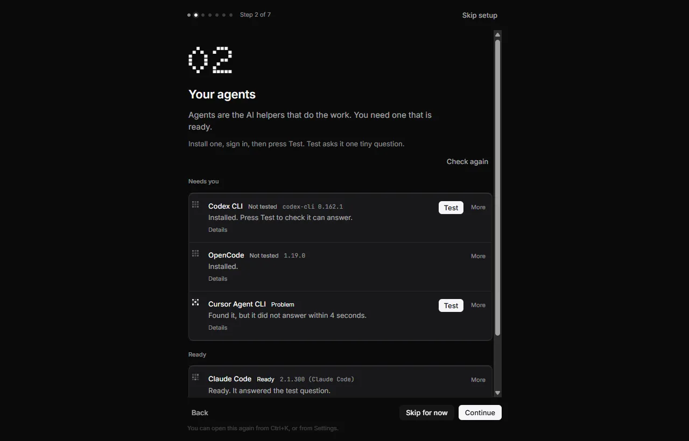

*Real run. Step 2 of 7: Your agents. Sign in, Test, or install; Claude Code is "Ready".*

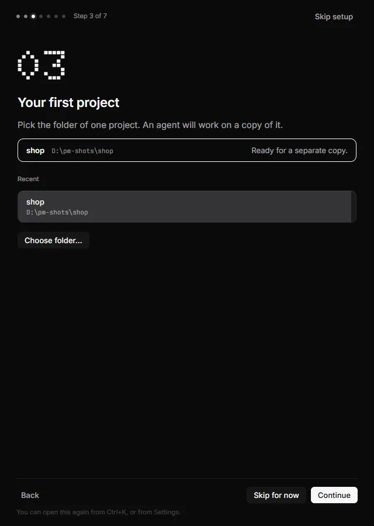

*Real run (0.2.1). Step 3 of 7: pick one project folder. "shop" is chosen and says "Ready for a separate copy."*

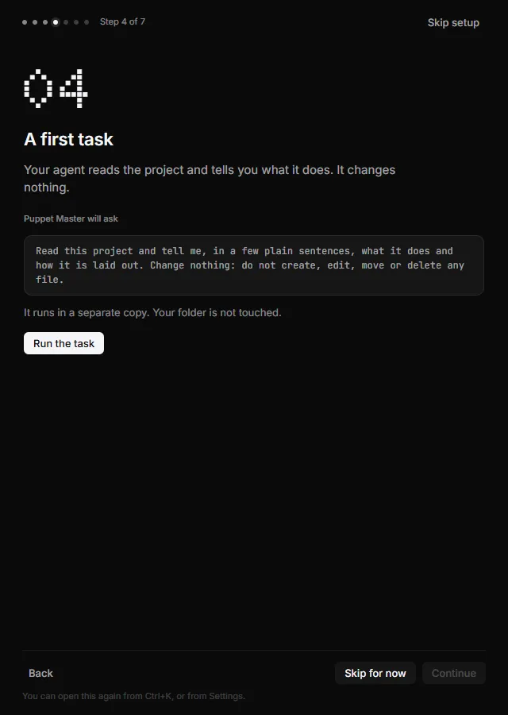

*Real run (0.2.1). Step 4 of 7 before you run it: "A first task". The exact words Puppet Master will ask are shown. It runs in a separate copy, so your folder is not touched.*

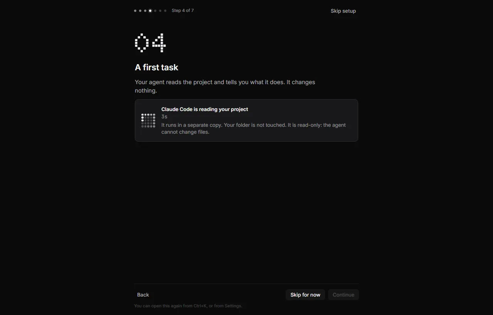

*Real run. Step 4 of 7: a safe first task. "Claude Code is reading your project." It runs in a separate copy and is read-only.*

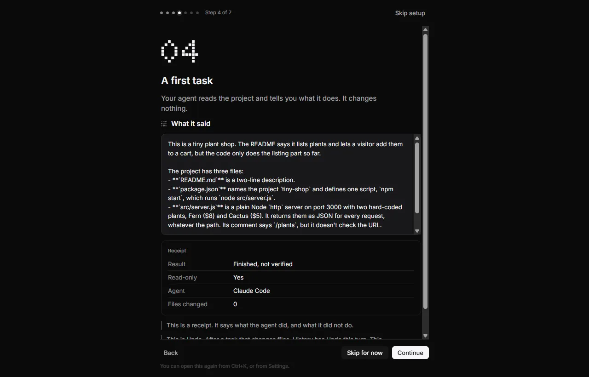

*Real run. The answer, and a receipt that explains "Finished, not verified" and the Undo idea.*

*Real run. Step 5 of 7: choose what the phone may do, then pair it.*

*Real run. Step 6 of 7: Puppet Master found your agents. "Review and install" opens a preview of every file first.*

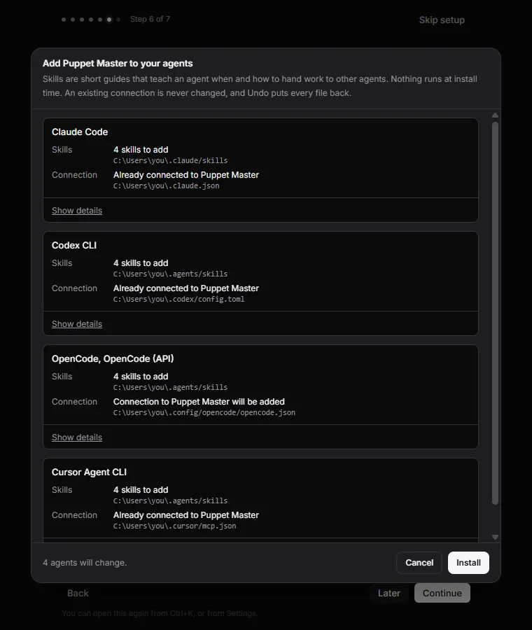

*Real run (0.2.1). "Review and install" opens a sheet that lists every file per agent before anything is written. Install was not pressed for this picture.*

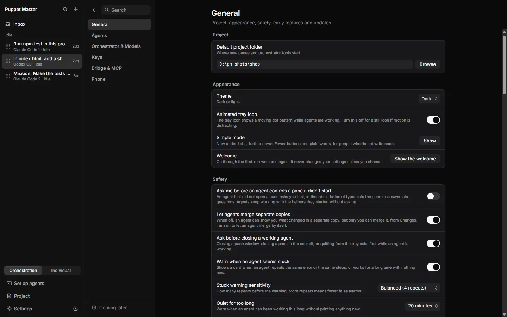

*Real run (0.2.1). You can open the welcome again from Settings, General, Appearance: "Show the welcome".*

*Real run (0.2.1). The cockpit when the welcome is done and before any agent is running.*

## How it works (simple)

The settings file holds a few keys: `onboarding_done` (missing = never decided, true = done, false = show again), `onboarding_step`, `onboarding_project` and `onboarding_agent`. The welcome writes your "how do you work" choice as the Simple mode switch as soon as you pick it, but the cockpit keeps its normal look until the welcome ends, so sign-in windows stay visible.

The first task is built in Rust, not in the screen. It always uses a separate copy. It is read-only where the agent can enforce that (a background run). It never skips the agent's own questions, never turns on shell or broad access, and uses the same "too broad folder" guard as Simple mode. The exact words of the task are checked by a test against the text on screen.

## Limits and what is not done yet

- Not every agent can be locked to read-only. The step then says "This agent cannot be locked to read-only. It still works in a separate copy, so your folder stays as it is."
- The task may end without an answer ("It finished but wrote no answer."), or fail ("The task did not finish. Your files were not touched.") with **Try again**.
- Install runs the agent's install command. It was tested only by automated tests, not on a clean PC.
- The phone step and the real phone were not tested on real devices.
- Cursor Agent stops at its own trust screen. Kilo and OpenCode are less tested.
- English only. The welcome is not shown in Individual mode.

## For developers

- UI: `packages/app/src/components/firstrun/` (`FirstRun.tsx`, `model.ts` for the steps and rules, `copy.ts` for every word, `useFirstRun.ts`).
- Rust: `src-tauri/src/first_run/mod.rs` (`state`, `plan_task`, `TASK_PROMPT`).
- Settings keys: `onboarding_done`, `onboarding_step`, `onboarding_project`, `onboarding_agent`, `simple_mode`.
- Step 2 reuses the Set up agents list (`AgentDoctor.tsx`); step 6 reuses the "Add Puppet Master to your agents" installer.
- Palette command: "Welcome tour".

## Related

- [The cockpit](01-cockpit.md)
- [Simple mode](07-simple-mode.md)
- [Settings](09-settings.md)
- [Inbox and Needs you](02-inbox-needs-you.md)
- [Approval cards](03-approval-cards.md)
