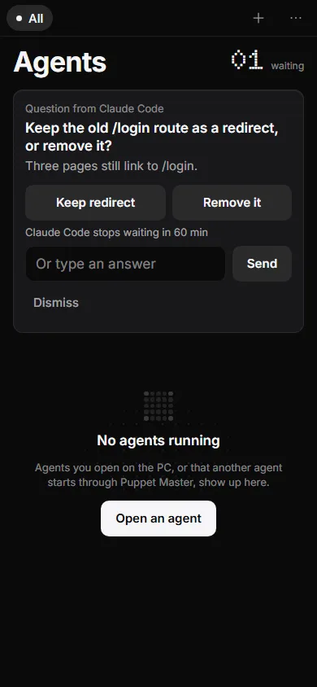
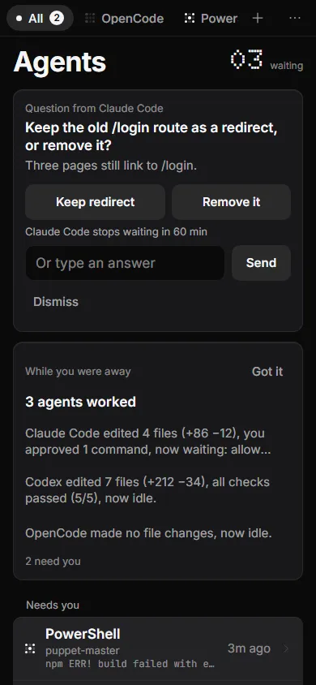
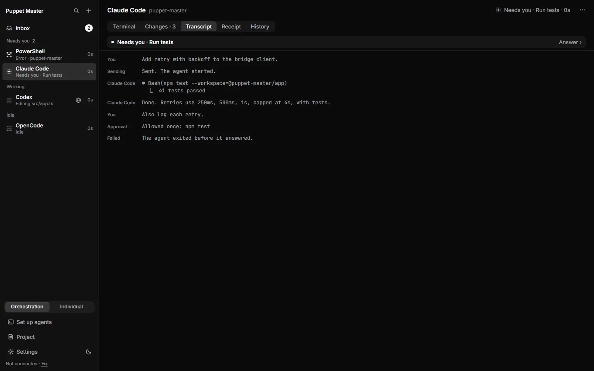
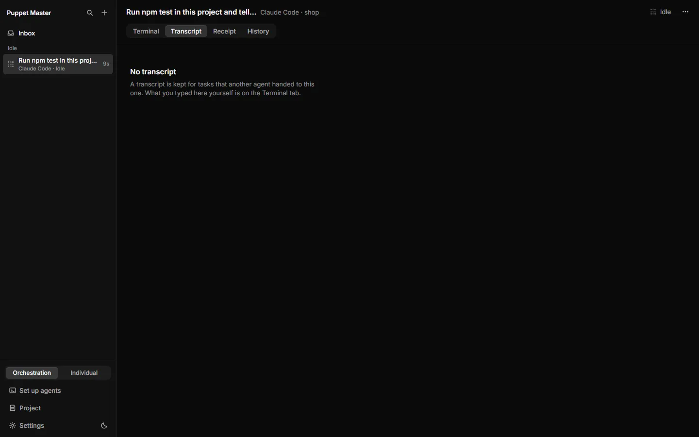

# Follow-ups and agent questions

**Status:** Works today. Follow-up tasks are stable and used in live runs. Agent questions (`ask_user`) and their phone push were tested only by automated tests, including the real MCP program. They were not tested with a real phone.

## What it is

Two tools that help agents work together with you.

- **Follow-up task** (`followup_task`): an agent that controls another agent sends it a new task as the next turn. The other agent keeps its conversation. This is how one agent "continues" with a helper.
- **Agent question** (`ask_user`): an agent asks **you** a question and waits. The question appears in your Inbox and on your phone. Your answer goes back to the agent as the result of the tool call.

Both are MCP tools. MCP is a standard way for AI programs to use tools. Puppet Master gives the tools to any agent that supports MCP.

*Example data. An agent asked you a question with ask_user. It appears in the Inbox with choice buttons, or a box for your own answer. The countdown says how long the agent waits.*

## Why it matters

- Developers: an orchestrating agent can run a long chain of turns and stop at the one decision that needs a human.
- People who build with AI: instead of a prompt stuck in a terminal nobody sees, you get a card with plain buttons.
- People who don't code: a clear question with Yes or No, even from the phone.

## How to use it

**Follow-up tasks (mostly done by agents, you see the result)**

1. An agent starts a helper with `run_agent` and gets a handle (a short name for that helper).
2. When the helper finishes a turn, the agent calls `followup_task(handle, task)` to give it the next task.
3. If the helper is still working, the follow-up waits in line and starts when the first turn ends. `send_message(handle)` is different: it steers the turn that is running now. `wait_agents` collects answers.
4. You see the new turn on that agent: the Receipt says "Turn 3", and History has "Before turn 3". In Simple mode, the box "Tell Claude Code what to change" works in a similar way: if the agent is busy, it says "Your message will be sent when Claude Code finishes."
5. If a budget is used up, the follow-up pauses before the next turn and you get a card (see [Budgets](24-budgets.md)).

**Questions from agents**

1. Wait for a card in the **Inbox**. The title is the question. It shows who asks, the age, and any background text under it.
2. Press one of the choice buttons. The agent wrote the choices, so they all look the same and none is the easy default. Or type in the box ("Type an answer" or "Or type an answer") and press **Send**.
3. A line shows how long the agent waits, for example "Claude Code stops waiting in 8 min".
4. **Dismiss** tells the agent "cancelled". **Open terminal** goes to that agent.
5. In the sidebar, the agent is under **Needs you**. A question that belongs to no pane shows as **Questions from agents** with a count.
6. On the phone, the question is at the top of the **All** view with the same buttons. A push message says "Question from Claude Code". It has no action buttons. Tap it to open the list. The phone needs the "Answer" permission.
7. To teach your agents these tools, use **Settings › Bridge & MCP › Add Puppet Master to your agents › Review and install**. It writes short skills for your agents. They name `ask_user` and `followup_task`.

*Example data. The same question on the phone, with the same buttons and the same text box.*

*Example data. On the phone, questions come first, then what needs you, Working and Idle.*

*Example data. The Transcript tab shows a task that another agent handed over: who sent what, the approval, and the failure line.*

*Real run (0.2.1). Transcript is empty for panes you used yourself: "A transcript is kept for tasks that another agent handed to this one."*

## How it works (simple)

`ask_user` does not hold one long connection. The first call creates the question and waits up to 4 seconds. The MCP program then asks again and again until there is an answer, a dismissal or a timeout. A restart of the bridge in between loses nothing. If the agent cancels the call, the card leaves the Inbox.

The answer comes back as `{answered: true, choice_id or text, answered_by: "desktop" or "phone"}`, or `{answered: false, reason: "timeout" or "cancelled"}`. The first answer wins. An agent can not answer its own question through MCP (the route says 403).

`followup_task` starts the next turn on the same worker. It reuses the same provider session where the agent supports it, and it has the same `checks`, `wait_ms` and `idempotency_key` as `run_agent`.

## Limits and what is not done yet

- Questions live in memory only. If you quit the app, they are gone and the agent sees "cancelled".
- Limits: at most 6 choices, 2,000 characters in the question, 50 open questions, and a wait of 600 seconds by default (3,600 at most).
- The setting `urgency: "high"` only makes the title bolder. It does not change the order.
- Simple mode does not show `ask_user` cards yet.
- Cursor headless runs can only be steered by a restart, and visible Cursor panes only queue messages.
- A follow-up that fails still uses up a turn number. This is known and not fixed.
- Real phone push, and the lock screen, were not tested.

## For developers

- Question tool: `src-tauri/src/tool_registry/catalog/questions.rs`, `questions/` (store and routes), `mcp_shim/ask_user.rs`; HTTP `POST /questions/ask`, `GET /questions`, `POST /questions/{id}/answer`, `.../dismiss`.
- Follow-up: `tool_registry/catalog/agents.rs` (`followup_task`, route `/agents/followup`), `agent_runs/runtime/followup.rs` and `queue.rs`.
- Push: `push/triggers.rs` (`Question from <agent>`), `push/hub.rs`.
- UI: `components/cockpit/QuestionCard.tsx`, `lib/questions.ts`; phone `components/mobile/QuestionsList.tsx`.
- Visible in agent, shell and both modes.

## Related

- [Inbox and Needs you](02-inbox-needs-you.md)
- [Approval cards](03-approval-cards.md)
- [Receipts and History](04-receipts-and-history.md)
- [Budgets](24-budgets.md)
