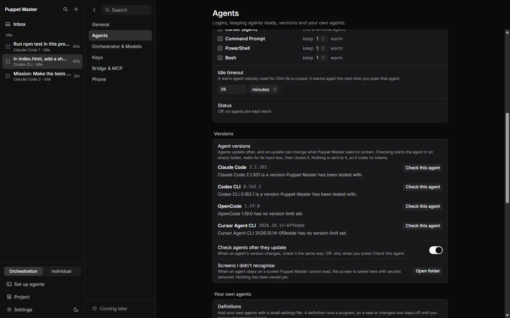
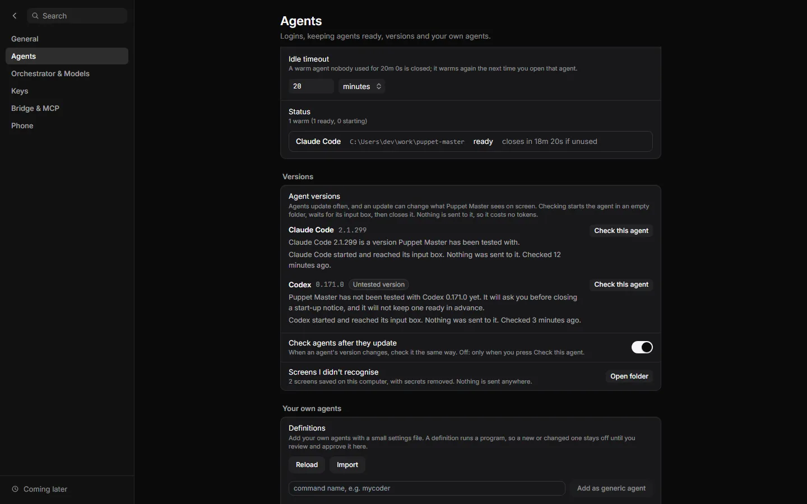
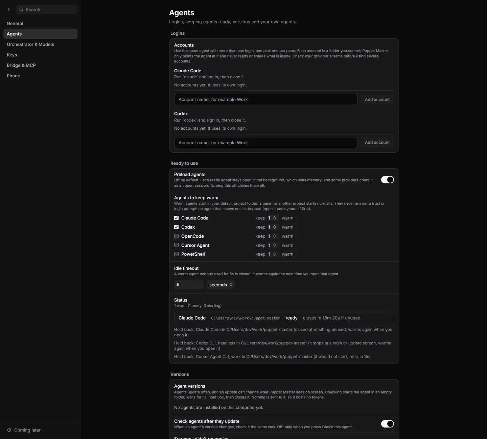
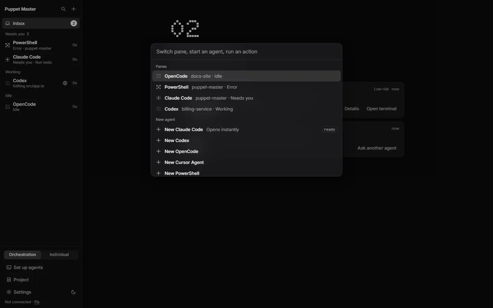

# Standby workers (keep agents ready)

**Status:** Works today · Off by default. The code calls it experimental.

## What it is
A standby worker is an agent that PM starts early and keeps waiting at its empty input box, in a hidden window. When you open that agent, PM shows the ready one instead of starting a new one. The setting is called **Keep agents ready**. The switch is called **Preload agents**.

*Real run (0.2.1). Settings, Agents, "Ready to use": the Preload agents switch (off by default), which agents to keep warm, and how many.*

*Real run (0.2.1). Below the list: the idle timeout (20 minutes) and the Status row. With Preload agents off it says "Off: no agents are kept warm."*

## Why it matters
Starting an agent takes time: the window opens, the program starts, the screen draws. With a standby worker the first task starts sooner. This helps people who open the same agent many times a day, and agents that start work for other agents through MCP.

## How to use it
1. Open **Settings > Agents**. Find **Keep agents ready** (in the group "Ready to use").
2. Turn on **Preload agents**. It is off by default.
3. Under **Agents to keep warm**, tick the agents you want, for example **Keep Claude Code warm**.
4. Choose how many to keep: 1 or 2 for each agent.
5. Set **Idle timeout**. The default is 20 minutes. A warm agent that nobody used for that time is closed. It warms again the next time you open that agent.
6. Open the agent as usual (**+** in the sidebar, or the tray's New pane menu). The tray marks agents that are ready with "(ready)".
7. Read **Status** in the same place. It lists each warm worker, and says why an agent could not stay warm.

Turning **Preload agents** off closes all warm workers.

*Example data. The Status row: "1 warm (1 ready, 0 starting)" and "closes in 18m 20s if unused".*

*Example data. Why an agent is not kept warm is spelled out ("Held back: ...").*

*Example data. In the palette, a ready agent shows "Opens instantly".*

## How it works (simple)
- **Where.** Warm agents start in your default project folder (**Settings > General > Project folder**). A pane for another folder starts normally.
- **Claiming.** When you open the agent, or an MCP call uses it, PM takes the ready worker, shows its window, and sends the task through the normal safe delivery (see [Typing permit](16-typing-permit.md)). A replacement warms up after every claim.
- **Health check.** Before PM hands out a worker, it reads the screen. Each agent's profile says what "ready" looks like.
- **Never answers dialogs.** If a warm agent shows a trust, sign-in or update screen, PM does not answer it. PM drops that worker. The settings page then says, for example: "Codex couldn't stay warm: it stops at a login or update screen (finish that once yourself). Not warming it until you open it."
- **Backoff.** After a failed worker PM waits 15 s, then 30 s, then 60 s, and so on, up to 5 minutes. After 3 failures in a row the agent goes "cold": PM stops trying until you open it yourself. The wait cannot be reset by a new folder or a settings save.
- **Untested versions.** If an agent has an "Untested version" chip, PM does not warm it. See [Tested versions and canary](18-tested-versions-canary.md).
- **Limits on number.** At most 2 warm workers per agent and 8 in total.

## Which agents can be kept warm
Claude Code, Codex, Cursor Agent and OpenCode (terminal). A TOML agent can opt in. The Kilo sample does. "OpenCode (API)" and shells are greyed out. Agents with no screen of their own for "ready" are marked "(experimental)": PM uses a warm one only after its screen has held still for two seconds with no dialog.

## Limits and what is not done yet
- Off by default because warm agents use memory. Some providers also count a warm agent as an open session.
- An agent that stops at a trust or update screen gets no warm worker until you pass that screen once. This is on purpose.
- Warm workers only help in the default project folder.
- A pane for an account (a second login) is not warmed until you have used that account once. See [Accounts and keys](20-accounts-and-keys.md).
- A warm headless Claude worker exists in the code, but there is no switch for it in the app. It needs a hand edit of the config file.
- Test coverage: automated tests, including a test for the backoff bug found in a live check. A live check of standby passed in an early build (round 6). I found no 0.2.1 live check of this feature.
- A fresh warm Codex or Cursor screen was never captured for the backoff fix. The screen reading was reasoned from earlier real captures.

## For developers
- `src-tauri/src/standby/`: `pool.rs` (state machine, `AgentBackoff`), `host.rs` (hidden panes), `config.rs`, `key.rs`, `stillness.rs`.
- Profile methods: `standby_support`, `standby_screen`. TOML: `[standby] visible = true`, `[tui.ready]`.
- Config file: `<app data>/standby-pool.json` (not `settings.json`). Defaults: `idle_timeout_secs` 1200, off.
- Route: `GET /standby`. Tauri: `standby_get_status`, `standby_set_config`. Event: `standby://ready-changed`.
- UI: `components/settings/blocks/PreloadSettings.tsx`, `lib/standby.ts`.

## Related
- [Trust and start-up screens](15-trust-and-startup-dialogs.md)
- [Typing permit](16-typing-permit.md)
- [Tested versions and canary](18-tested-versions-canary.md)
- [Supported agents](12-supported-agents.md)
