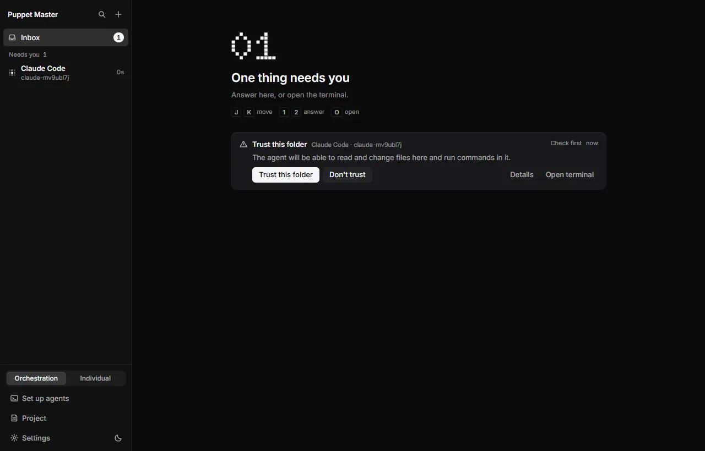
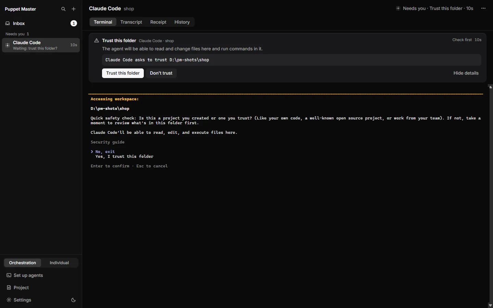
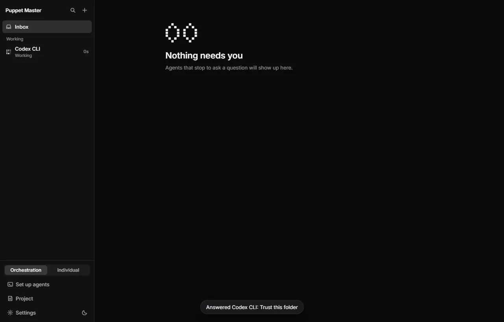
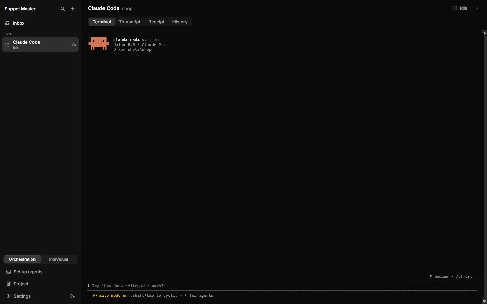
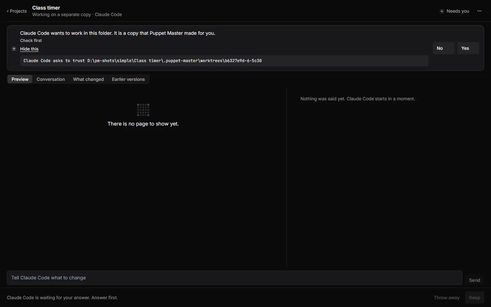
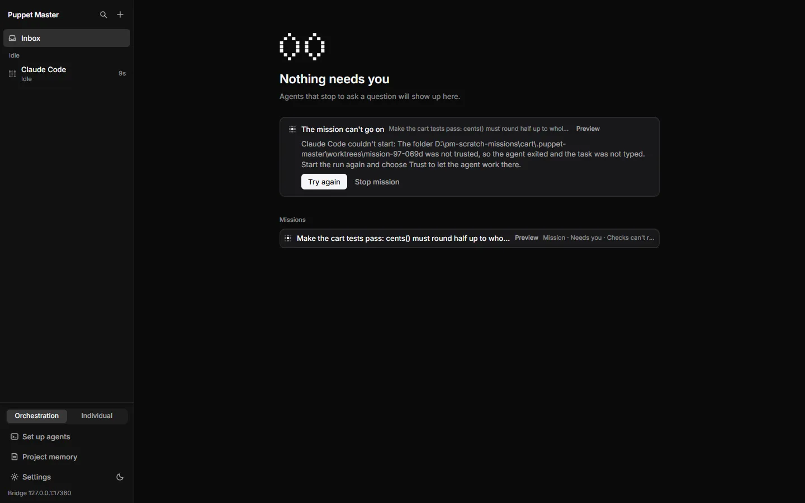
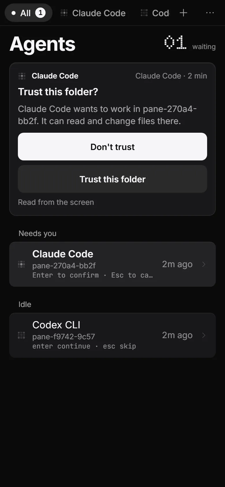
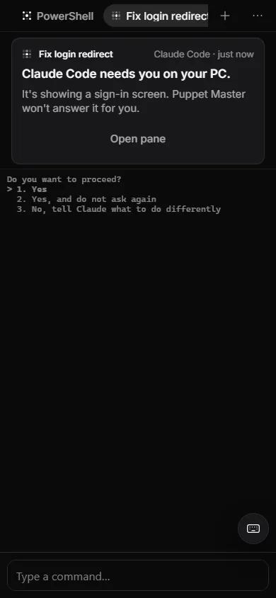

# Trust and start-up screens

**Status:** Works today · Checked live with real Claude Code and Codex. Cursor Agent was not re-checked live in 0.2.1.

## What it is
Before an agent can take a task, it may show a "start-up screen". Examples: "Do you trust this folder?", a sign-in page, an update notice, or a "press Enter to continue" page. PM reads these screens. It never answers a trust question or a sign-in for you. It stops the run, shows a card in the Inbox, and waits for you. After you answer, it sends the task once.

*Real run. A real Codex: "Trust this folder". Puppet Master never answers this for you.*

## Why it matters
A folder-trust answer gives an agent permission to read and run things in that folder. It must be your decision. If PM typed the task into a trust screen, the text could press the wrong choice, or go into the wrong place. Earlier builds had these bugs, and they are fixed.

## How to use it
1. Start an agent in a folder it has not seen before (**+** in the sidebar, pick the folder).
2. A card appears in the Inbox, and in the pane's Terminal tab. It reads "Trust this folder?" with two buttons: **Trust this folder** and **Don't trust**.
3. Press **Trust this folder** to go on. PM waits until the agent's screen is quiet and ready, then types your task once in the same visible pane.
4. Press **Don't trust** to stop. The run ends within a few seconds. The card says: "You chose not to trust this folder, so the task wasn't sent. Start again to be asked once more." Nothing was typed.
5. For a sign-in or "press Enter" page, the card has no buttons, because PM does not know the right keys. Use **Open terminal** to go to the pane, finish the page yourself, and the run goes on by itself.
6. Your click must be a real click or key press. The release notes say a burst of clicks used to press Enter several times. Now each question is answered once.

*Real run. A real Claude Code stopped at the same question.*

*Real run (0.2.1). Details shows what the agent asks: "Claude Code asks to trust D:\pm-shots\shop".*

*Real run. After you answer, a toast confirms ("Answered Codex CLI: Trust this folder") and the agent starts working.*

*Real run (0.2.1). After a real click on "Trust this folder", Claude Code starts and sits idle in the Terminal tab, ready for the task.*

*Real run (0.2.1). In Simple mode the same question is in plain words: "Claude Code wants to work in this folder. It is a copy that Puppet Master made for you." The path is under Show details.*

*Example data. If you say no: "Claude Code didn't start. You chose not to trust this folder, so the task wasn't sent."*

*Real run. A real mission: "Claude Code couldn't start: the folder was not trusted, so the agent exited and the task was not typed."*

*Real run (0.2.1). The same question on the phone: "Trust this folder?" with Don't trust and Trust this folder.*

*Example data. A sign-in screen: "Puppet Master won't answer it for you." You open the pane.*

## How it works (simple)
- **Reading.** Each agent's profile says which screens are start-up screens (called "gates"). See [Supported agents](12-supported-agents.md).
- **Two kinds of gate.**
  - A screen that only you may pass (folder trust, sign-in, first-time setup). It becomes a card and parks the run. PM presses nothing.
  - A notice that can be closed without choosing anything. The only one today is Codex's "Update available" menu and its "Hooks need review" screen. PM presses Esc ("skip"). It never presses Enter, so it never chooses "Update now" and never trusts anything.
- **Strict mode.** If an agent has an "Untested version" chip, PM does not even press Esc. It parks the run on the notice. See [Tested versions and canary](18-tested-versions-canary.md).
- **Which gates each agent has (in the code).**
  - Claude Code: folder trust.
  - Codex: update menu, hooks review, folder trust, sign-in, first-time setup.
  - Cursor Agent: folder trust ("Workspace Trust Required").
  - OpenCode and Kilo: no gate is known.
- **One delivery after Trust.** After you trust a folder, Codex draws its input box at once but takes keys a few seconds later. PM waits until the screen has been quiet for 1.5 seconds (up to 30 seconds). If the text does not show, PM clears it first and types again, up to 3 times, so there is never a double copy. If it still fails, the run ends with the pane kept open. It never moves your run to a hidden background run.
- **Declined runs.** The run ends with a clear error. The empty separate copy made for it is removed when you close the pane.

## Limits and what is not done yet
- Cursor Agent's trust screen stopped a run in an earlier live test. The code now builds a trust card for it, but I found no live check in 0.2.1.
- A phone with "watch" access sees the card but cannot answer it. See [Security: bridge and devices](29-security-bridge-and-devices.md).
- PM itself never answers trust. Two other paths exist, and both are choices made by the caller. A caller can start a hidden (headless) run with `trust_workspace: true`. An agent that is connected through MCP can send an answer with `answer_prompt`. How far the authority switches cover a trust answer from an agent, I did not check in detail. See [Agent authority](17-agent-authority.md).
- The update menu is skipped with Esc for this launch only. The notice comes back next time.
- A screen PM does not know is not a gate. It is handled by the typing rules in [Typing permit](16-typing-permit.md).

## For developers
- `tui/profile.rs`: `startup_gate(screen) -> Option<StartupGate { id, summary, dismiss }>`. `dismiss` is `None` when only the user may pass it.
- `bridge/startup_gate.rs` (closes notices with their own keys, only with a gate permit), `bridge/dispatch.rs` and `bridge/approvals.rs` (park, wait, resume).
- `agent_runs/readiness.rs`: `wait_until_settled` (1.5 s quiet, 30 s max). Errors: `WORKSPACE_TRUST_DECLINED`, `STARTUP_SCREEN_NOT_COMPLETED`, `PROMPT_NOT_TAKEN`, `PANE_BLOCKED_BY_PROMPT`.
- `pane_prompt/`: prompt detection and `answers::check_desktop_answer` (the desktop needs a user gesture).
- UI: `lib/approval-card.ts` (`trust_gate` kind), `components/cockpit/error-sentences.ts`.
- Docs for developers: `docs/features/trust-fixes.md`, `fix-live-codex.md`, `tui/README.md` ("Startup gates").

## Related
- [Typing permit](16-typing-permit.md)
- [Supported agents](12-supported-agents.md)
- [Agent authority](17-agent-authority.md)
- [Approval cards](03-approval-cards.md)
- [Phone approval card](37-phone-approval-card.md)
- [Standby workers](14-standby-workers.md) (they never answer these screens either)
