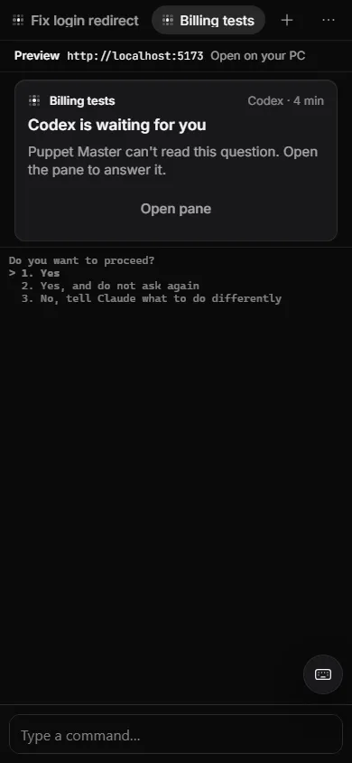

# Typing permit

**Status:** Works today · Checked in live runs with Claude Code and Codex (10 live runs, no false stops; delivery took 1.5 to 5.7 seconds).

## What it is
When PM sends a task to an agent, it types the text into the agent's real terminal. The typing permit is a rule: PM types only after it has looked at the screen and seen that the agent's input box is ready, with nothing new drawn since. If the screen is busy, shows a menu, or is not known, PM does not type. It waits, then stops and asks you.

*Real run. A real case: the agent was not ready, so the task was not typed. Puppet Master says so and offers Try again.*

## Why it matters
Typing into the wrong place does damage. In early tests, a task was typed over an update menu, and Enter chose "Update now". A task was also typed into PowerShell after a declined trust screen. The permit turns "I found no problem" into "I saw a ready input box". It protects people who start runs and leave, including runs started by other agents.

## How to use it
You do not turn it on. It is always on for a run's task text. What you may see:
1. You start a run (**+** in the sidebar, or an MCP call such as `run_agent`).
2. PM looks at the pane. If the agent is ready, the task is typed and sent. This takes a few seconds.
3. If the pane shows a menu or a screen PM does not know, PM keeps looking for about 10 seconds. Then the run waits, with this sentence: "The run is waiting: bring the agent to its input box in the pane (close any menu or message) and it continues by itself."
4. Open the pane (**Open terminal**), close the menu, and the run goes on by itself. PM keeps watching for 5 minutes.
5. If the agent is gone, the run stops with a plain card. For example: "Codex isn't installed" (with **Install**), "Claude Code stopped. It closed unexpectedly. Your files are as it left them.", or "Codex wasn't ready: It didn't reach a ready screen, so Puppet Master typed nothing."

*Example data. "You chose not to trust this folder, so the task wasn't sent. Start again to be asked once more."*

*Example data. On a screen Puppet Master does not know, it stops: "Puppet Master can't read this question. Open the pane to answer it."*

*Example data. The same rule in Simple mode: "Show the screen" instead of a guess.*

## How it works (simple)
PM checks these things in order. Each step can only move away from "ready".
1. The host shell says the agent's command was not found: not ready.
2. The agent process has ended: not ready. (The process wins over the screen. A dead agent can leave its last screen behind.)
3. The screen is blank: unknown.
4. A bare shell prompt where the agent should be: not ready.
5. A start-up screen or a dialog is up: not ready. See [Trust and start-up screens](15-trust-and-startup-dialogs.md).
6. The agent's own input-box reader says "empty box" = ready. "Working" = busy. Anything else = unknown.

More safety:
- **Fresh look.** The permit is valid only for the screen PM looked at. If any byte was printed after that, the permit is stale, and PM looks again.
- **Text first, Enter later.** The text is typed without Enter. PM checks it is visible in the input box. Only then it presses Enter, after another look and a short quiet time (40 ms).
- **No double text.** If the box did not take the text, PM erases its own text (never yours) before typing again.
- **Type-safe.** The permit cannot be made by other code. A compile test proves it.
- **Never a silent fallback.** A run that cannot type is parked. It does not turn into a hidden background run on its own.
- **Which agents read their box.** Claude Code, Cursor Agent and Codex have a reader for their input box. The check also leaves out faint "suggestion" text that the agent draws itself.

## Limits and what is not done yet
- The gap is narrow but not closed. Bytes that the agent wrote a moment before the key press may still be in the pipe. The verify-then-Enter steps are there to catch this.
- OpenCode and TOML agents (for example Kilo) have no input-box reader. They use a weaker rule: something is drawn, with no gate, dialog, shell prompt or working marker. The run log notes it.
- Cursor Agent's box reader was checked only against recorded screens.
- A shell's process id that is reused by another program could fool the process check (no start-time check).
- If the agent dies in the middle of a turn, PM sees it at the next write.
- Claude Code once showed typed text about 2 seconds late. A slower PC could retype.
- Not covered by the permit: your own typing, interrupts, answers to prompts that PM re-read, and raw input sent through `write_terminal_input` or `press_key` by an allowed caller.

## For developers
- `agent_runs/readiness.rs`: `Readiness`, `assess`, `TypingPermit`, `GatePermit`, `AnswerPermit`, `wait_while_parked`, `wait_until_settled`.
- `pty/write_origin.rs`: `WriteOrigin` on every `registry_write_input` (User, Task, Gate, Answer, Decided, Nudge, Api, Structured).
- `agent_runs/delivery.rs`, `bridge/dispatch.rs` (`park_on_unknown_screen`), `pty/agent_proc.rs` (process check).
- Profile hooks: `ready_recogniser`, `input_screen`, `retype_clear_sequence`.
- Park state: run `waiting_input`, `required_action.kind = "screen_not_ready"`. Codes: `PERMIT_STALE`, `SCREEN_NOT_READY`, `AGENT_EXITED`, `AGENT_NOT_INSTALLED`, `PROMPT_NOT_TAKEN`.
- Developer doc: `docs/features/typing-permit.md`.

## Related
- [Trust and start-up screens](15-trust-and-startup-dialogs.md)
- [Standby workers](14-standby-workers.md)
- [Supported agents](12-supported-agents.md)
- [Agents controlling agents (MCP)](32-agents-controlling-agents-mcp.md)
