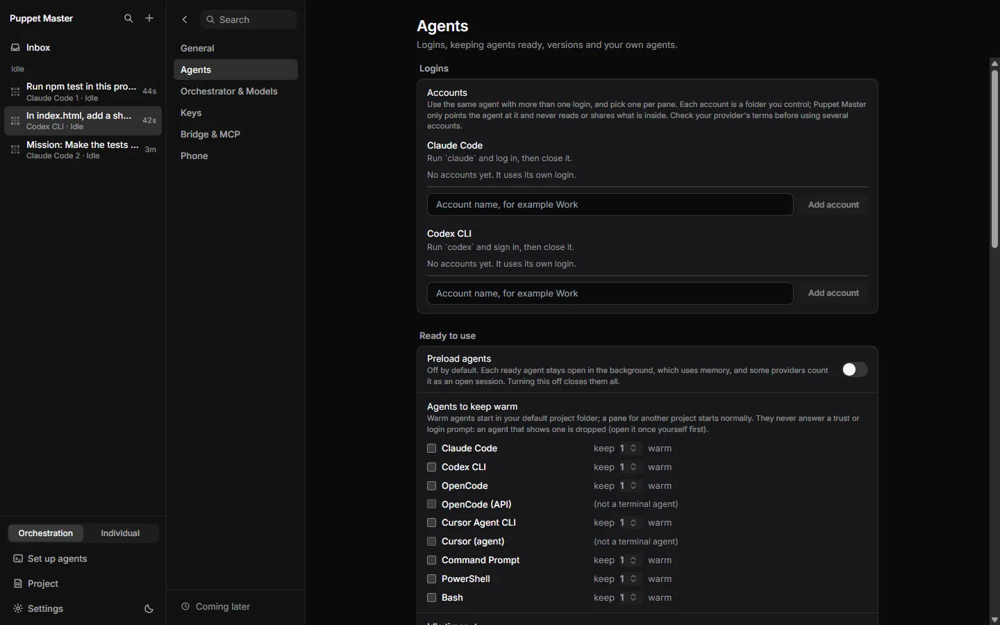
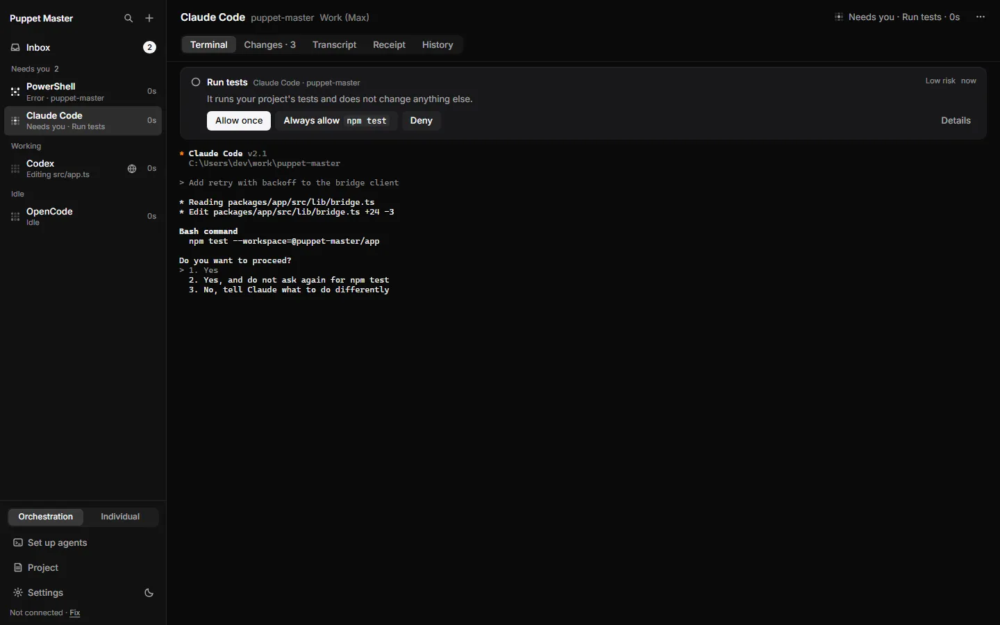
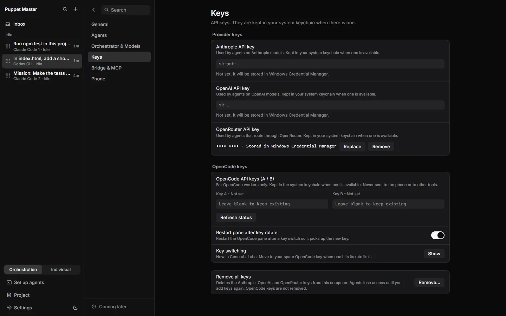
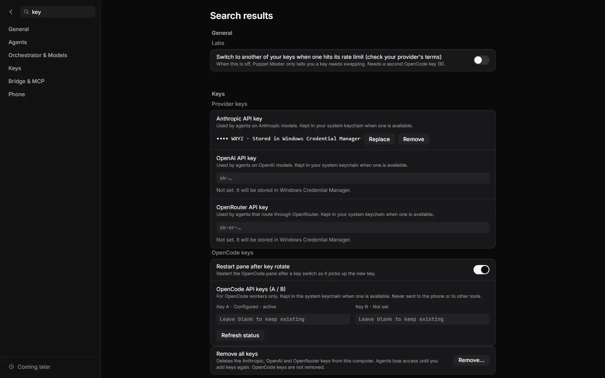
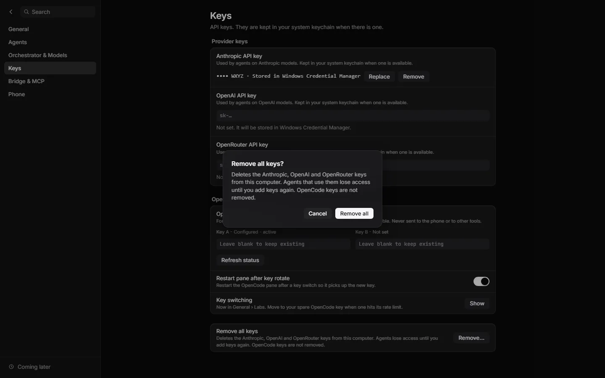

# Accounts and keys

**Status:** Works today · Accounts work for Claude Code and Codex only. Keys in Windows Credential Manager and OpenCode key switching are tested only by automated tests.

## What it is
Three related things:
- **Accounts.** Use one agent with more than one login, for example a work login and a personal login. You pick the login for each pane.
- **Provider keys.** API keys for Anthropic, OpenAI and OpenRouter. PM keeps them in Windows Credential Manager, not in a plain file.
- **OpenCode keys.** Two keys (A and B) for OpenCode. PM shows their status and can switch from one to the other.

*Real run (0.2.1). Settings, Agents, Accounts. With no account added, an agent "uses its own login". Type a name and press Add account to add another login for Claude Code or Codex.*

## Why it matters
People with two subscriptions want to choose which one an agent uses. People who paste an API key want to know it is stored safely. OpenCode users who hit a rate limit (a temporary stop from the provider) can move to a second key.

## How to use it
**Accounts (Claude Code and Codex)**
1. Open **Settings > Agents**. Find **Accounts** (group "Logins").
2. Under the agent, type a name such as "Work" and press **Add account**.
3. Press **Open login pane**. The agent opens in a pane. Log in there once, then close it.
4. To use the account: press **+** in the sidebar, choose the agent, then **N logins >**, then **Default login** or the account name. The pane header shows the account name.
5. **Remove** forgets the account but keeps its folder. You can rename an account by editing its name in the list.
6. An agent that calls PM through MCP can pass `account` in `run_agent`. It needs the account id from you.

**Provider keys**
1. Open **Settings > Keys**. Under **Provider keys**, paste a key into **Anthropic API key**, **OpenAI API key** or **OpenRouter API key**. It saves when you leave the field or press Enter.
2. A saved key shows as `•••• abcd · Stored in Windows Credential Manager`, with **Replace** and **Remove**.
3. **Remove all keys** deletes the three provider keys from this PC. It does not remove OpenCode keys.

**OpenCode keys**
1. In **Settings > Keys**, find **OpenCode API keys (A / B)**. Paste a key into **Key A** and, if you want, **Key B**. Status reads "Not set", "Configured" or "Configured - active". **Refresh status** reads it again.
2. The switch "Switch to another of your keys when one hits its rate limit (check your provider's terms)" is **off** by default. With it off, PM only tells you a key needs swapping. It needs a second key. It is also listed in General > Labs as "Key switching".
3. **Restart pane after key rotate** is on by default. A restarted pane picks up the new key.
4. An agent can call `read_opencode_key_status` (no key text is returned) and `rotate_opencode_key` (profile `next`, `a` or `b`).

*Example data. When you start an agent, a menu lets you pick the login: Default login, Work (Max), Personal.*

*Example data. The pane header shows which account it uses ("Work (Max)").*

*Real run (0.2.1). Keys: Anthropic, OpenAI and OpenRouter keys, stored in Windows Credential Manager. A saved key shows only as dots (masked in this picture).*

*Example data. Search for "key" also shows the Key switching option in Labs and the OpenCode A / B keys.*

*Example data. Remove all keys asks first: "Agents lose access until you add keys again."*

## How it works (simple)
- **Accounts.** An account is a folder you control. PM starts the agent with an environment variable that points to it: `CLAUDE_CONFIG_DIR` for Claude Code, `CODEX_HOME` for Codex. PM does not read, copy or share what is inside. Accounts are stored in `accounts.json` in the app data folder, and new account folders go in its `accounts` folder.
- **No mixing.** Warm panes and named workers are kept apart for each account. A run cannot continue in a pane that belongs to another account.
- **Keys.** The Windows store entries use the name `com.puppetmaster.app`. PM moves old keys out of `settings.json` at start: write to the store, read back, compare, then remove from the file. If the read back does not match, or no store exists, the file stays as it was and the screen says so. The screen never calls plain-file storage secure.
- **OpenCode.** Keys A and B are stored as `opencode_profile_a` and `opencode_profile_b` in the same store. The key that is active is also written to OpenCode's own `auth.json`, because OpenCode needs it there.
- **Rate limit.** PM watches an OpenCode pane's recent screen for rate-limit words. With the switch on and a second key, it rotates. Otherwise it notifies.

## Limits and what is not done yet
- **Check your provider's terms.** Some providers may not allow several accounts or keys. PM only points the agent at a folder you own. It does not rotate accounts for you.
- Accounts for Cursor Agent, OpenCode and Kilo do not exist. Their login folders are not confirmed. OpenCode has its A/B keys instead.
- Switching account when a limit is hit is designed but not built. PM only detects the limit and shows a card (see [Usage limit and hand-off](25-usage-limit-and-hand-off.md)).
- Env var names came from vendor docs. Tests show the variable reaches the program, not that each program obeys it. Claude Code on macOS may keep the login in the keychain (not tested).
- There is no button in the app to delete an account's folder.
- Keys were not checked against a real Credential Manager in a live session. Check once: set a key, then look for `com.puppetmaster.app` in Windows Credential Manager. `settings.json` should hold no key.
- The sidebar's API orchestrator still gets the raw key inside the app window to call its provider. The UI text says the keys are used by agents on those models. In the code I read, the API orchestrator is the part that uses them. I did not find another reader.
- OpenCode's own `auth.json` holds the active key as plain text, by OpenCode's own design.
- Old OpenCode keys move to the store at the next app start, not live.

## For developers
- `src-tauri/src/accounts/mod.rs`; Tauri: `accounts_list`, `accounts_add`, `accounts_rename`, `accounts_remove`; bridge: `GET/POST /accounts`, `/accounts/rename`, `/accounts/remove` (not in the MCP list). Profile hook: `TuiProfile::account_scheme()`, TOML `[accounts]`.
- `src-tauri/src/secrets.rs` (`SecretBackend`, `KeyringBackend`, `migrate_settings_file`), `commands/secrets.rs` (`secret_set`, `secret_get_masked`, `secret_delete`, `secret_storage_info`, `secret_get_for_llm`). Crate: `keyring` 3.6.
- `opencode/keys.rs` (profiles, `opencode-key-profiles.json`, automation mode `notify_only` default), `opencode/watch.rs`, `opencode/quota.rs`. Routes: `/opencode/keys/status`, `/opencode/keys/rotate`. These MCP tools are listed only in "all" mode.
- Settings keys: provider keys are no longer in `settings.json`. Automation mode lives in `opencode-key-profiles.json`.
- UI: `components/settings/accounts/AccountsGroup.tsx`, `ApiKeyField.tsx`, `sections/KeysSection.tsx`, `cockpit/NewAgentMenu.tsx`.

## Related
- [Supported agents](12-supported-agents.md)
- [Standby workers](14-standby-workers.md)
- [Usage limit and hand-off](25-usage-limit-and-hand-off.md)
- [Set up agents and Doctor](13-set-up-agents-and-doctor.md)
