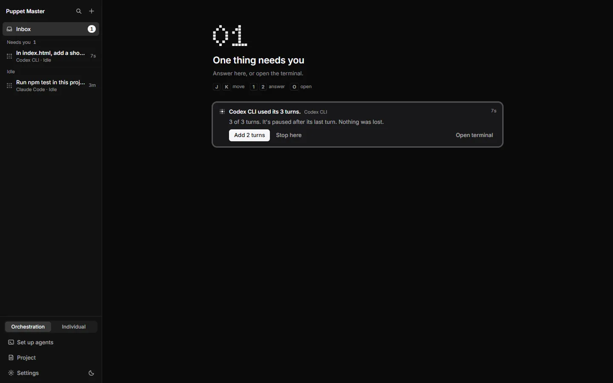
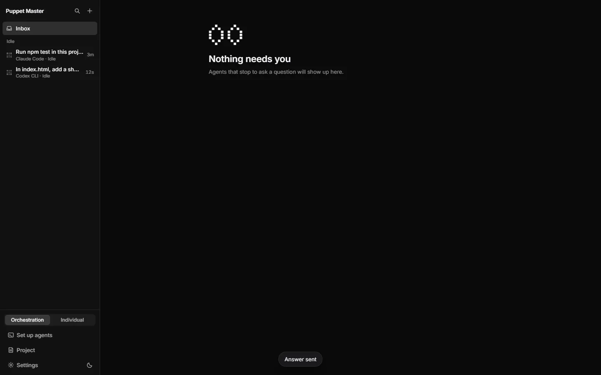
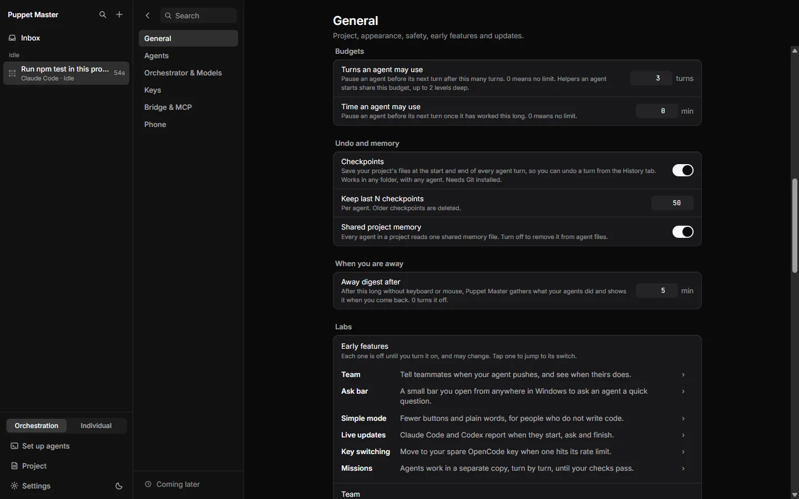
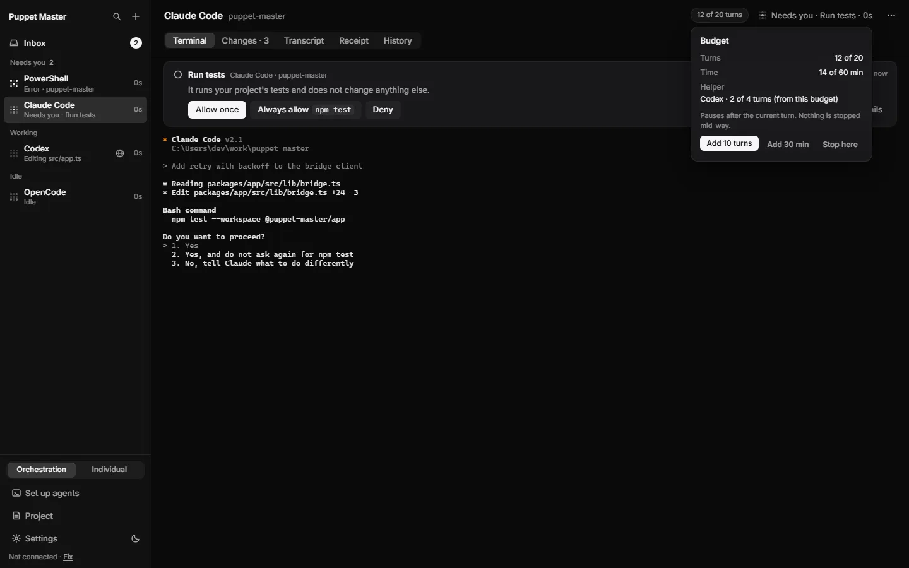
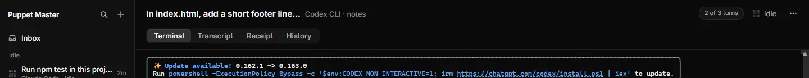
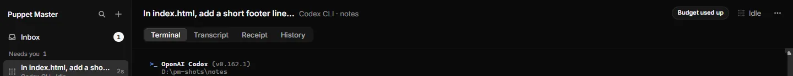

# Budgets

**Status:** Works today. Off by default. Tested by automated tests. The lead also ran one live recording with a real agent.

## What it is
A budget is a limit on how much an agent may do before it must ask you. You can limit the number of **turns** (one turn is one task you give an agent, and its answer) and the number of **minutes**. When the limit is reached, the agent pauses before its next turn. It never stops in the middle of a turn. A card in the Inbox asks what to do.

*Real run (0.2.1). The budget card: "Codex CLI used its 3 turns. 3 of 3 turns. It's paused after its last turn. Nothing was lost." Add 2 turns, or Stop here.*

*Real run (0.2.1). After a real click on Add 2 turns, the toast says "Answer sent" and the Inbox is clear.*

## Why it matters
An agent can keep working for hours and use a lot of your plan or money. This is a problem when you go away, or when one agent starts many helpers. A budget is a simple brake. You choose it once, and it protects you.

## How to use it
1. Open **Settings**, then **General**, then the **Budgets** group.
2. Set **Turns an agent may use**. The number `0` means no limit.
3. Set **Time an agent may use** in minutes. The number `0` means no limit.
4. Start agents as usual. Every new agent run now has this budget. The settings save by themselves.
5. Look at the pane header. A chip shows the budget, for example "6 of 20 turns". When the agent has used 80 percent or more, the chip becomes bold. Click the chip to see a small box with the numbers and the helpers.
6. When the budget is used up, the agent stops before the next turn. A card appears in the Inbox. The text is like "Claude Code used its 20 turns. Nothing was lost." The buttons are:
   - **Add 10 turns** (the number changes with your budget) or **Add 30 min**
   - **Stop here**
7. The same card can show on your phone. Only a person can answer it. An agent cannot answer for you.

**From an agent.** The MCP tool `run_agent` accepts `budget_turns` and `budget_minutes` for a new run. An agent can set a budget only on the runs it starts.

*Real run (0.2.1). Settings, General, Budgets: turns and minutes an agent may use (here 3 turns, no time limit). 0 means no limit. Undo and memory and Labs follow.*

*Example data. The chip in the pane header ("12 of 20 turns") opens a popover with Add 10 turns, Add 30 min and Stop here.*

*Real run (0.2.1). Near the limit the chip in the pane header says "2 of 3 turns".*

*Real run (0.2.1). At the limit the chip says "Budget used up" and the Inbox badge shows 1.*

## How it works (simple)
- Turns are counted from the saved records of each run. Minutes are real clock time since the run started.
- The check happens **before each new turn**. If the budget is empty, the run waits. A follow-up call to that agent fails with the code `BUDGET_EXHAUSTED` until you add more.
- The "Add" step is half of the first limit, rounded up, at least one.
- **Helpers share the parent's budget.** When an agent starts a helper, the helper takes its turns and minutes from what is left in the parent's budget. If the helper asks for more than is left, the call is refused with a clear message. If it asks for nothing, it gets half of what is left. Helpers can go two levels deep. A helper's helper's helper is refused.
- The card is a normal question card, so it uses the same Inbox, phone list and notifications as other questions.
- Only turns and minutes are counted. The app does not read tokens or money from the agent's provider.

## Limits and what is not done yet
- Off by default. If you set nothing, agents have no limit.
- No limit on tokens or on cost in money. Only turns and minutes.
- The budget applies to **new** runs. It does not change a run that is already going.
- A turn that is already running is not stopped. One very long turn can use more time than the limit.
- Cards do not survive an app restart. Like all question cards, they go away when the app closes.
- Helpers asking their parent first (before asking you) is not built.
- Missions require a budget. See [Missions](30-missions.md).

## For developers
- Module: `packages/app/src-tauri/src/budgets/` (`admit.rs`, `gate.rs`, `card.rs`, `adjust.rs`, `view.rs`, `accounting.rs`).
- Settings keys: `budget_default_turns`, `budget_default_minutes` (0 = off). Limits: 1 to 10000 turns, 1 to 10080 minutes.
- MCP: `budget_turns`, `budget_minutes`, `budget_parent` on `run_agent` (`tool_registry/catalog/agents.rs`).
- Error codes: `BUDGET_EXHAUSTED`, `BUDGET_NOT_FOUND`.
- UI: `components/cockpit/BudgetChip.tsx`, `BudgetCard.tsx`, `components/settings/sections/BudgetRows.tsx`.
- The pause card is a question of kind `budget` (`questions/`). The depth limit is `MAX_DEPTH = 2` in `budgets/model.rs`.

## Related
- [Usage limit and hand-off](25-usage-limit-and-hand-off.md)
- [Loop guard and panic stop](27-loop-guard-and-panic-stop.md)
- [Missions](30-missions.md)
