# Missions

**Status:** Preview (Labs, off by default). New in 0.2.1. A live run with real agents took a failing project to green. Most other paths are tested with fake agents.

## What it is
A mission gives an agent a goal, some checks and a budget. Checks are commands that must pass, for example your tests. Puppet Master makes one [separate copy](22-separate-copies-worktrees.md) of your project. Then it asks one agent at a time to work towards the goal. After every turn it runs the checks in the copy. It keeps going until the checks pass, the budget is used up, or you stop it. **A mission never merges, pushes or opens a pull request.** At the end you have a separate copy that waits for your review.

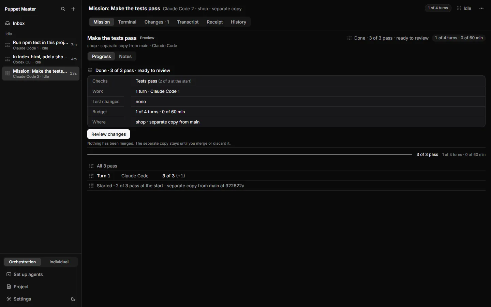

*Real run (0.2.1). The Mission tab of a real mission on the shop project: "Done, 3 of 3 pass, ready to review". Checks, work, test changes, budget and where, then a timeline.*

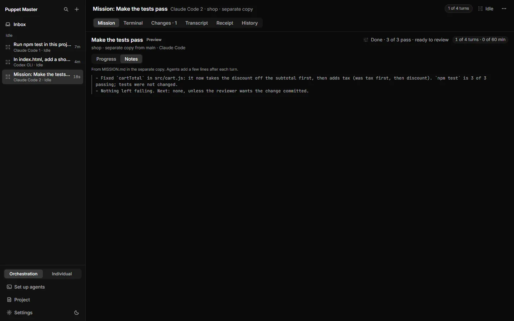

*Real run (0.2.1). The Notes part of the Mission tab: the lines the agent wrote under "Notes from agents" in MISSION.md.*

## Why it matters
Developers can hand over a failing test suite and come back to a green copy. People who build with AI get "keep going until it works", with a limit on cost and a guard against fake green. An orchestrating agent can start a mission over MCP and wait for the result.

## How to use it
1. Turn it on: **Settings**, **General**, **Labs**, switch **Missions (Preview)**.
2. In the sidebar, click **+**, then **Start a mission…**. (You can also press Ctrl+K and find it.) The project must be a Git project with at least one commit.
3. In **What should be true when it's done?**, write the goal.
4. Under **How we'll know**, check the list of checks. Puppet Master suggests some from your project (for example `npm test`, a type check, `cargo test`, `python -m pytest`, `go test ./...`). You can add your own. You need at least one command.
5. Optional: switch **Agents may change tests**. It is off by default. See [Tamper guard](26-tamper-guard.md).
6. Under **Who works on it**, pick the first agent. Add backup agents if you want. They go in order, one at a time.
7. Set the **Budget**. The defaults are 30 turns and 2 hours. A budget is required.
8. Click **More** for: **Go back when checks get worse** (on by default), **Stop a turn after** (default 30 min), **Stop a check after** (default 5 min, up to 10).
9. Click **Start mission**. If something is missing, the button is off and a line says why.
10. Follow it in the **Mission** tab of the agent's pane and in the Inbox, under **Missions**, then **Ready for you**. Agents work in visible panes. You can stop a mission at any time.
11. When it is done, open **Changes** and review it yourself. See [Review, merge and pull requests](23-review-merge-and-pull-requests.md).

**From an agent.** Call `run_agent` with `until_checks_pass: true`, `checks` (with at least one `command_exits`), a budget (`budget_turns` or `budget_minutes`) and optional `backup_agents`. The `task` is the goal. You get a handle like `mission-<id>`. `wait_agents` returns "completed" when all checks pass, or "needs_input" when you must decide.

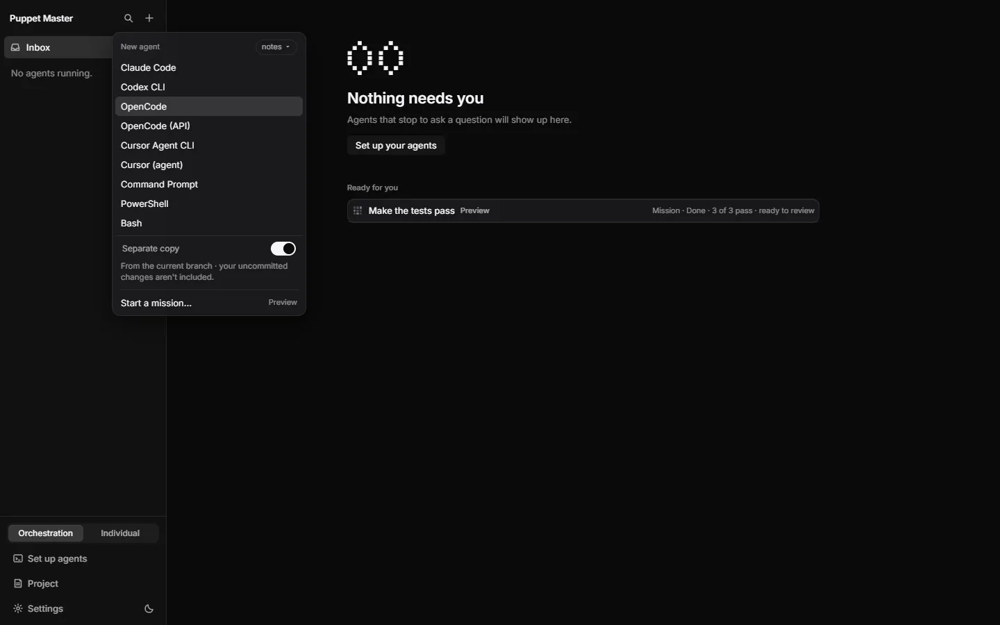

*Real run (0.2.1). Start a mission from the New agent menu ("Start a mission..." - Preview).*

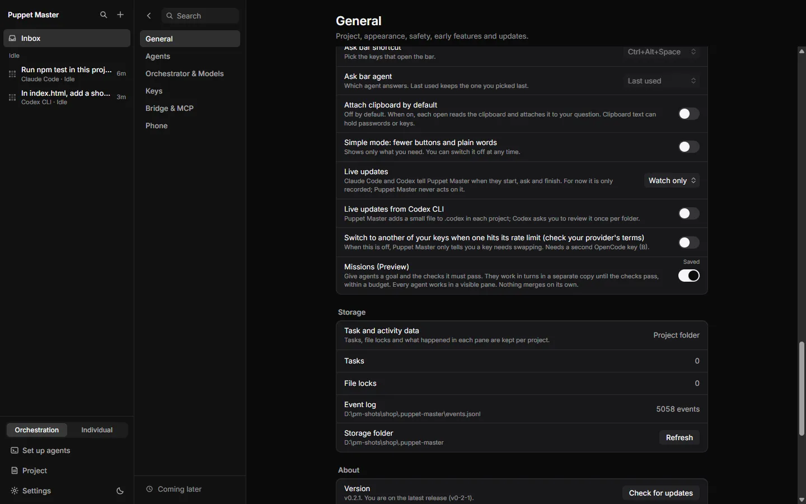

*Real run (0.2.1). Turn it on in Settings, General, Labs: "Missions (Preview)". The row shows "Saved".*

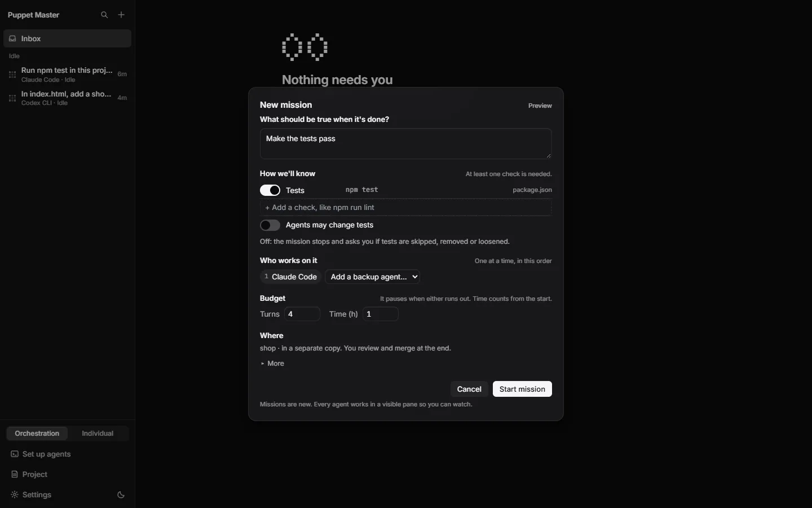

*Real run (0.2.1). The filled sheet: the goal "Make the tests pass", the check (npm test), who works on it, a budget of 4 turns and 1 hour, and "Agents may change tests" off.*

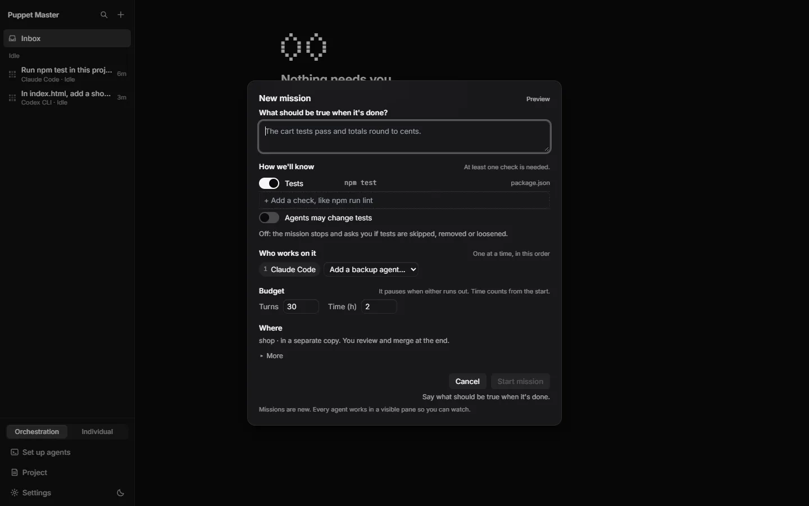

*Real run (0.2.1). Start mission stays off until you say what should be true when it is done.*

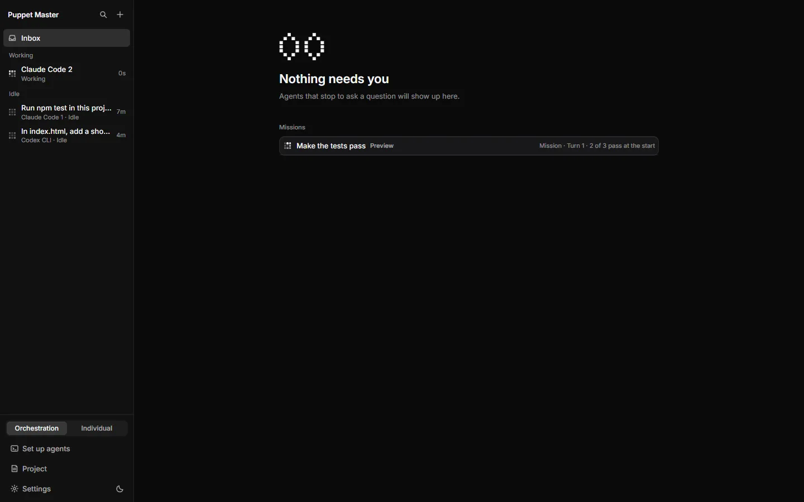

*Real run (0.2.1). While the mission runs, the Inbox lists it under Missions ("Mission - Turn 1 - 2 of 3 pass at the start") and the agent is Working in the sidebar.*

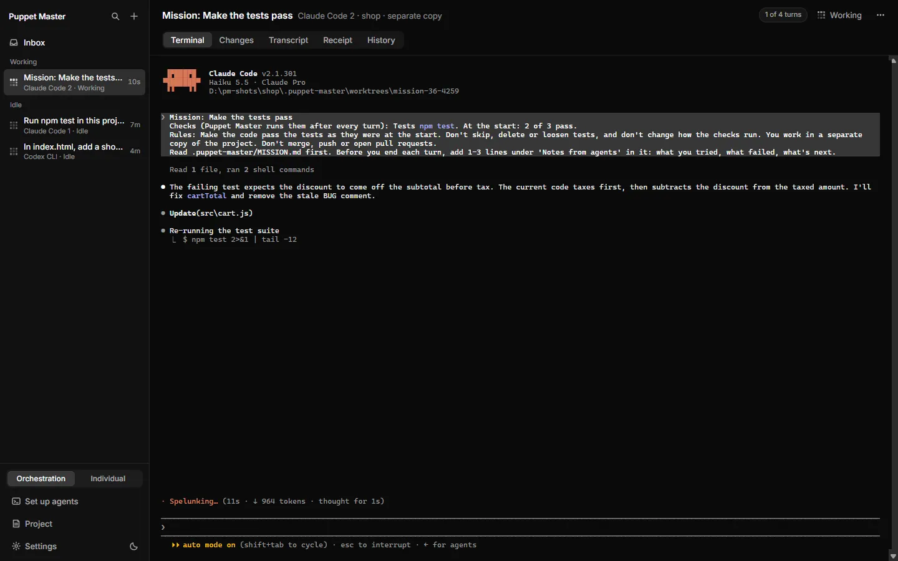

*Real run (0.2.1). The mission agent's pane while it works. The chip says "1 of 4 turns".*

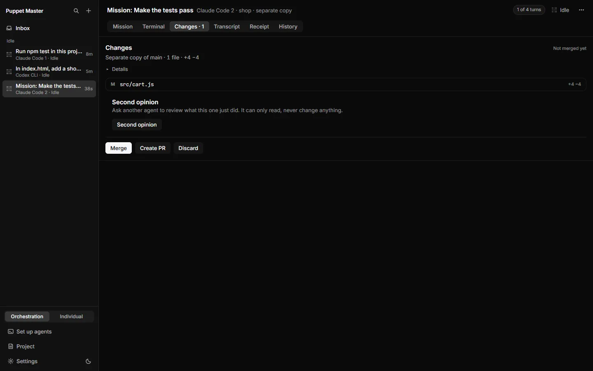

*Real run (0.2.1). After the mission, the Changes tab of the separate copy: Merge, Create PR and Discard. It says "Not merged yet".*

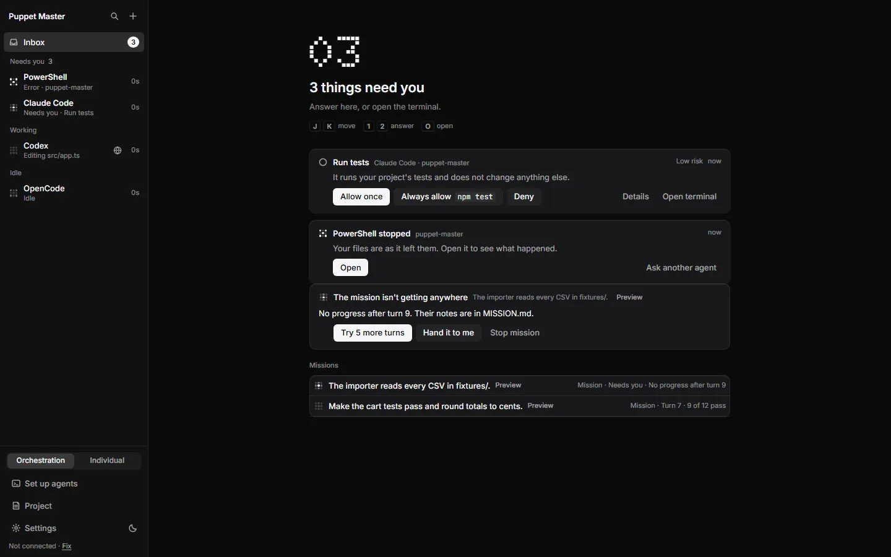

*Example data. "The mission isn't getting anywhere": Try 5 more turns, Hand it to me, or Stop mission.*

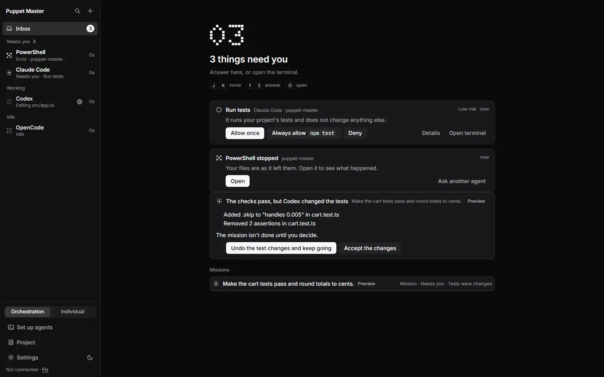

*Example data. "The checks pass, but Codex changed the tests." You choose.*

*Real run. A real mission: the first agent could not start in the new copy, so the mission says so and offers Try again or Stop mission.*

*Real run (0.2.1). A finished mission waits in the Inbox under "Ready for you": "Make the tests pass - Mission - Done - 3 of 3 pass - ready to review".*

## How it works (simple)
After each turn, a fixed table of rules decides what happens next:
- **Checks not green yet:** the agent gets the failures and continues.
- **A turn made things worse:** the copy's files go back to the best turn so far (rollback). Rollback is a snapshot of the files, not a Git command.
- **No progress for 3 turns in a row, or the agent exits:** the next backup agent takes over. It starts from a written brief and the notes file `.puppet-master/MISSION.md` in the copy. This file is kept out of Git.
- **No backup is left, or all are stuck:** a card says "The mission isn't getting anywhere". Buttons: **Try 5 more turns**, **Hand it to me**, **Stop mission**.
- **Checks pass:** the [tamper guard](26-tamper-guard.md) compares the tests with the start. If tests were skipped, deleted or loosened, the mission stops with a card: **Undo the test changes and keep going** or **Accept the changes**.
- **Trust declined or the agent is not installed:** the mission says it cannot go on. It never answers a trust or login question for you.
- **Budget used up:** the usual [budget](24-budgets.md) card appears.
- The mission survives an app restart. It does not repeat a turn.
- Two missions may run at the same time.

## Limits and what is not done yet
- **Preview.** It is off by default. The plan is to turn it on by default only after one week of the founder's own use.
- Visible panes only. A headless mission is refused. A budget and at least one command check are required.
- **No phone view yet.** The cards can reach the phone, but their answers go through the desktop route.
- You can stop a mission from the desktop and from an agent. **Pause is on the desktop only.** An agent cannot pause it.
- **Hand-off at a usage limit is not built.** Backup agents take over only when one is stuck or exits. See [Usage limit and hand-off](25-usage-limit-and-hand-off.md).
- There is no mission row in the sidebar.
- The tests that checked this feature mostly used scripted fake agents. Only one real-agent run is recorded. Real long missions are not proven.
- Warnings like "main moved on" are not built.
- Checks run once per turn, by the engine. A turn's own receipt does not list them. The mission timeline does.

## For developers
- Engine: `packages/app/src-tauri/src/missions/` (`engine.rs`, `decide.rs`, `verdict.rs`, `store.rs`, `ledger.rs`, `cards.rs`, `routes.rs`).
- MCP: `run_agent` gains `until_checks_pass` and `backup_agents` (`tool_registry/catalog/agents.rs`). `mission-<id>` handles work with `wait_agents`, `inspect_agent`, `cancel_agent`. `followup_task`, `send_message` and `answer_prompt` return `MISSION_NOT_STEERABLE`.
- Bridge routes (person only, MCP refused): `/missions`, `/missions/detect`, `/missions/start`, `/missions/<id>/{stop,pause,resume,decide}`.
- Error codes: `MISSIONS_OFF`, `MISSION_CHECKS_REQUIRED`, `MISSION_BUDGET_REQUIRED`, `MISSION_HEADLESS`, `MISSION_NOT_GIT`, `MISSION_LIMIT` (2 at once).
- UI: `components/cockpit/mission/`, `lib/missions.ts`, `Sidebar.tsx` and `NewAgentMenu.tsx`.
- Tests: `missions/tests.rs` (33), `tests/fake_tui_missions.rs` (5 end to end).

## Related
- [Tamper guard](26-tamper-guard.md)
- [Budgets](24-budgets.md)
- [Separate copies](22-separate-copies-worktrees.md)
- [Usage limit and hand-off](25-usage-limit-and-hand-off.md)
- [Second opinion](31-second-opinion.md)
