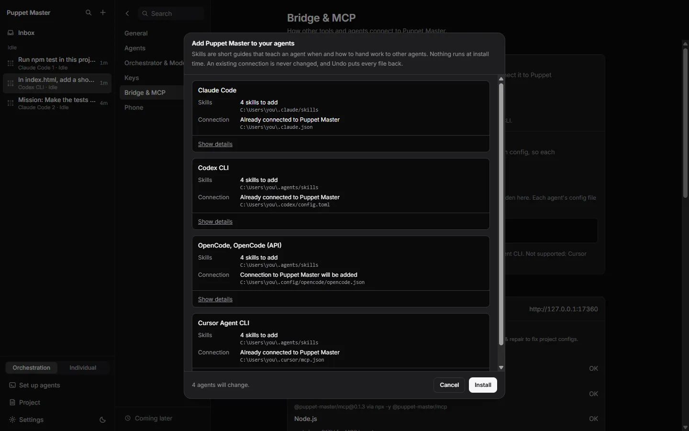
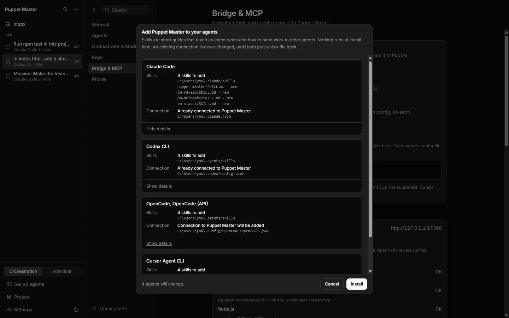
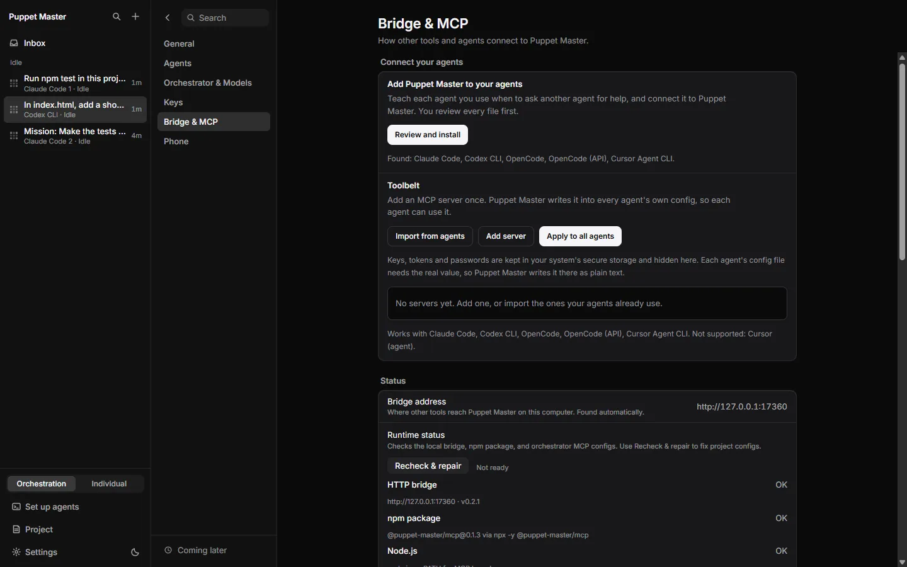
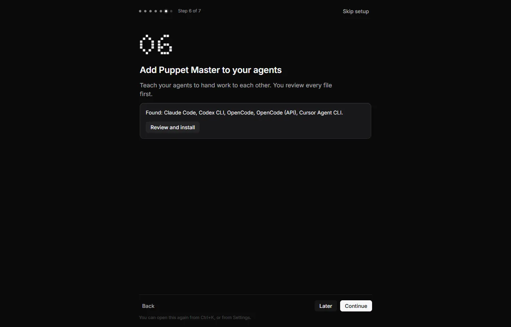

# Agent skill pack ("Add Puppet Master to your agents")

**Status:** Works today. The preview screen was seen live. The **Install** button was not clicked on the founder's own computer. The files it writes are checked by automated tests.

## What it is

A **skill** is a short guide, a text file, that an agent reads. It tells the agent when and how to do something. The skill pack teaches each of your agents how to use Puppet Master (PM): when to ask another agent for help, which tools to call, and how to read a receipt.

One button installs two things for every agent on your computer:

1. The **skills**.
2. The **connection** to PM (the MCP entry in the agent's config). See [Agents controlling agents (MCP)](32-agents-controlling-agents-mcp.md).

*Real run (0.2.1). The preview lists the files for each agent. Nothing runs at install time; an existing connection is never changed. Install was not pressed.*

*Real run (0.2.1). Show details lists each file: puppet-master, pm-review, pm-delegate and pm-status, all new.*

## Why it matters

Without a skill, an agent may not know that PM tools exist, or it may use them badly. With the skill, Claude Code can answer "ask Codex to review this" by itself. You also do not edit config files by hand. You see every change first, and **Undo** puts everything back.

## How to use it

1. Open **Settings > Bridge & MCP**.
2. Find **Add Puppet Master to your agents**. The line under it says which agents were found.
3. Click **Review and install**. A sheet opens. For each agent it lists the **Skills** and the **Connection**, with the file path. Click **Show details** to see the exact files or the config change.
4. Click **Install**. PM writes the files.
5. Restart agents that are already open. In Claude Code, type `/mcp` to reconnect.
6. To remove everything, click **Undo** in the same place. It appears after an install.

If an agent is not installed on your computer, PM skips it and says so.

*Real run (0.2.1). Settings, Bridge & MCP: "Review and install" and the Toolbelt below it.*

*Real run. The same step in the first-run welcome: "Found: Claude Code, Codex CLI, OpenCode, ... Review and install".*

*Real run (0.2.1). The same sheet opened from step 6 of the first-run welcome.*

## How it works (simple)

The pack has four skills:

| Skill | Type | What it does |
|---|---|---|
| `puppet-master` | Automatic | Teaches the five main tools and how to read receipts |
| `pm-delegate` | Command | Hands a task to another agent in a separate copy, then reports what was verified |
| `pm-review` | Command | Gets a second opinion from a different agent on your current changes |
| `pm-status` | Command | Shows which agents are running and which need an answer |

Skills go into the folder each agent reads: `~/.claude/skills` for Claude Code, and `~/.agents/skills` for Codex, Cursor and OpenCode. Agents that share a folder share one write.

The connection is added only if the agent has no Puppet Master entry yet. An existing entry is never rewritten. PM marks its own files with a version note. A foreign file at the same path is replaced only after a backup. **Undo** removes the files PM created and restores replaced files from the backups. A file you edited after the install is left alone, and PM tells you.

## Limits and what is not done yet

- Real agent stores were not tested. Not verified: Codex plugin bundling, the Cursor plugin, and publishing to the MCP Registry.
- The ready-made plugin files in `integrations/` (a Claude Code plugin, a marketplace file and a registry file) point to the npm package `@puppet-master/mcp`. The public 0.1.3 version is the old server, so these files work only after a new npm release. The in-app installer is not affected, because it writes the path of the installed app.
- Cursor and OpenCode also read `~/.claude/skills`. With Claude Code present, they may list a skill twice.
- A "Run in Puppet Master" badge and a `puppetmaster://open` link do not exist yet.
- Kilo has no skills folder declared yet. Skills folders are declared only by the built-in agents.
- The installer cannot be called from the phone or from an MCP session. Only the desktop app can use it.

## For developers

- Installer: `packages/app/src-tauri/src/agent_pack/` (`plan.rs`, `service.rs`, `record.rs`, `host.rs`). Tauri commands: `agent_pack_preview`, `agent_pack_apply`, `agent_pack_undo`. There is no bridge route.
- Canonical skills: `integrations/skills/`. `scripts/sync-skill-pack.mjs` copies them into the plugin folders. The test `pack_files_match_canonical` fails if they drift.
- Undo record: `agent-pack.json` and `agent-pack-backups/` in the app data folder.
- Agent profiles declare their skills folder with `TuiProfile::skills_host`.
- UI: `components/settings/pack/AgentPackGroup.tsx`, `lib/agent-pack.ts`. Settings row id: `agent-pack`.

## Related

- [Agents controlling agents (MCP)](32-agents-controlling-agents-mcp.md)
- [Toolbelt](35-toolbelt.md)
- [One brain](33-one-brain.md)
