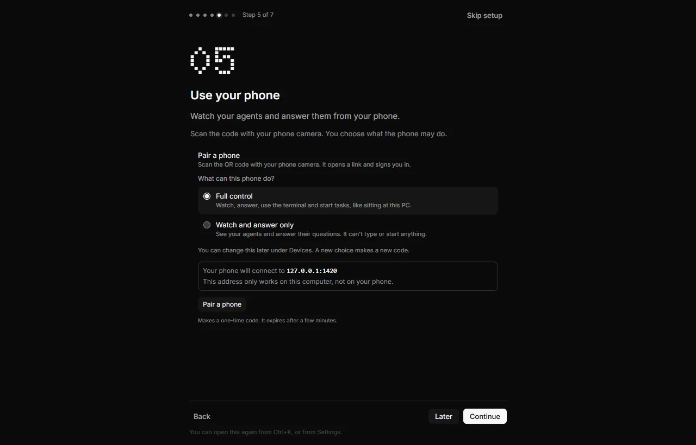
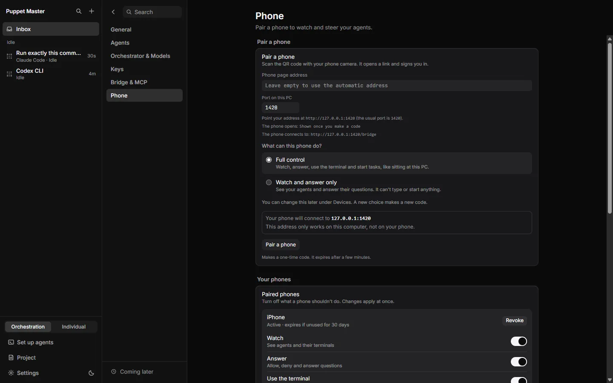
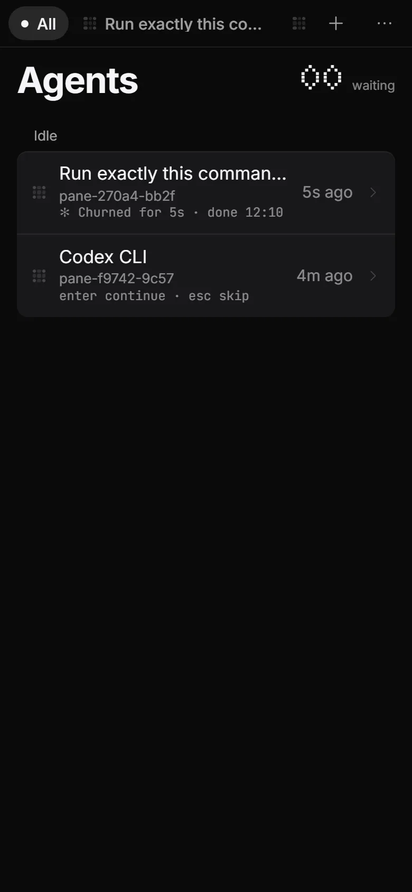
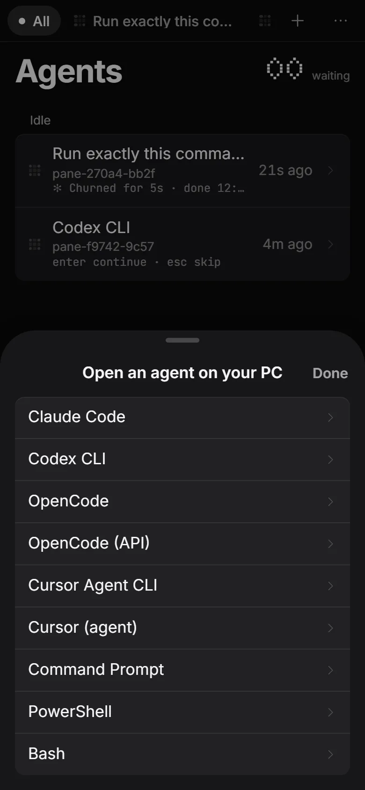
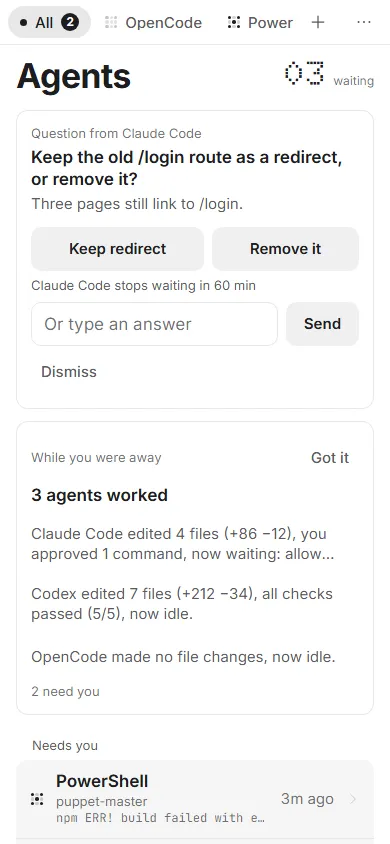
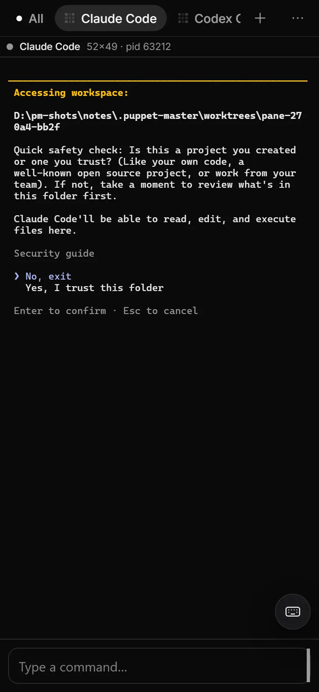

# Phone app

**Status:** Works today, with limits. It was checked live with a paired test phone (a phone-sized browser). It was **not** tested on a real iPhone or Android phone. Push notifications and a real Cloudflare tunnel were never tried live.

## What it is

The phone app is a PWA. A PWA is a web page that you add to your home screen, so it looks and feels like an app. It shows your agents, lets you answer them, and shows the live terminal. The agents keep running on your PC. The phone is only a remote window.

The phone reaches your PC through a **tunnel**. A tunnel is a secure path from the internet to one program on your PC. Puppet Master (PM) ships with Cloudflare's tunnel program (`cloudflared`) and starts it for you. There is no Puppet Master server in the middle. The traffic does pass through Cloudflare's network, because that is how the tunnel works.

*Real run (0.2.1). The phone app on a real run: a "Trust this folder?" card, then Needs you and Idle. The count at the top ("01 waiting") matches the PC.*

## Why it matters

Agents often stop and wait for you. With the phone app, you can leave your desk, see who needs you, and answer from the couch. You can also stop all agents with one tap.

## How to use it

Pair the phone (once):

1. On your PC, open **Settings > Phone**.
2. Under **Pair a phone**, choose **What can this phone do?**: **Full control** (the default) or **Watch and answer only**.
3. Click **Pair a phone**. PM makes a one-time code. It expires after a few minutes. A QR code and a link appear.
4. Scan the QR code with your phone camera. The link opens the app and signs the phone in.
5. On an iPhone, tap Share, then **Add to Home Screen**, and open the app from there. This is needed for notifications.

Use it:

- The **Agents** screen groups your agents as **Needs you**, **Working** and **Idle**. A large counter shows how many need you. Tap an agent to open its terminal. See [Phone terminal](38-phone-terminal.md).
- Answer cards in the Needs you list. See [Phone approval card](37-phone-approval-card.md).
- Tap **+** to open a new agent on your PC. Tap **...** for the menu: connection, **Notifications**, terminal options, **Stop all agents** and closing the open agent.
- To get notifications, open the menu and turn on **Notifications**.

Manage phones on your PC:

- **Settings > Phone > Paired phones** shows each phone with four switches: **Watch**, **Answer**, **Use the terminal** and **Start tasks**. Changes apply at once. A phone that is not used for 30 days signs itself out.
- **Revoke** signs out one phone. **Revoke all devices** signs out every phone.

Keep the same address (optional):

- **Settings > Phone > Public address** has three choices: **Automatic (changes on restart)**, **My Cloudflare tunnel** (you give a hostname and a tunnel token) and **My own domain or proxy**. Click **Save and restart**, **Restart tunnel** or **Test connection**. A fixed address means you pair the phone only once.

*Real run. On the PC, you choose what the phone may do, then press Pair a phone to make a one-time code.*

*Real run (0.2.1). Settings, Phone: the paired phone ("iPhone", Active) and its switches. No pairing code or QR is shown.*

*Real run (0.2.1). The agent list: title, pane and the last line of the terminal.*

*Example data. The phone menu: connection, notifications, terminal options, and "Stop all agents".*

*Real run (0.2.1). Open an agent on your PC.*

*Example data. The light theme on the phone.*

*Real run (0.2.1). Tap an agent to see its real terminal on the phone. Here it is the Claude Code trust prompt, with a typing box at the bottom.*

## How it works (simple)

- The PC runs a small local web server (the "bridge") and a tunnel to it. The phone talks to the bridge through the tunnel.
- Pairing gives the phone a token. The token is saved in the phone's browser for that one address. This is why the automatic address, which changes at each restart, forces you to pair again.
- Every request from a phone is checked against the four abilities of that phone. A phone without an ability gets "not allowed" and is shown a plain message.
- A web page in your own browser cannot use the bridge. Outside requests need a paired token.

## Limits and what is not done yet

- Real iPhone and Android phones were not tested. Push notifications, the lock-screen buttons and your own Cloudflare tunnel were never tried with real services.
- The tunnel starts only in a release build of the app, not in a development build.
- A phone app opened on the PC itself is not paired, so it is refused. The app says so in one line.
- New phones get **Full control** by default. The founder has not decided if the default should be Watch and answer only. The tour recommends Watch and answer.
- Missions (Preview) has no phone view yet.
- Opening an agent on the phone makes its terminal use the phone's width. Some agents then redraw their screen.
- The phone shows team cards only when the Team feature (Labs) is on. See [Co-work Heads-up](39-co-work-heads-up.md).

## For developers

- Phone UI: `packages/app/src/PwaApp.tsx`, `components/mobile/`, `pwa/`, `sw.ts` (service worker), `styles/phone.css`.
- Rust: `mobile_pairing/` (pairing, `caps.rs` for abilities), `mobile_tunnel.rs`, `tunnel_config.rs`, `push/`, `attention/`.
- Routes: `GET /pair/me`, `GET /attention`, `/push/key`, `/push/subscribe`, `/push/presence`, `/push/act`, `/push/preferences`.
- Settings keys: `mobile_input_visible`, `mobile_keyboard_resizes_agent`, `mobile_input_delay_ms`, `public_pwa_url`. Tunnel settings are in `puppet-master.tunnel.json` (not in `settings.json`, because the token is secret).
- Settings UI: `components/settings/sections/PhoneSection.tsx`, `TunnelSection.tsx`, `MobilePairingPanel.tsx`, `blocks/PairedDevices.tsx`.
- Dev check without a phone: the harness route `phone` in `src/dev/` (see [Developer testing](41-developer-testing.md)).

## Related

- [Phone approval card](37-phone-approval-card.md)
- [Phone terminal](38-phone-terminal.md)
- [Co-work Heads-up](39-co-work-heads-up.md)
- [Agents controlling agents (MCP)](32-agents-controlling-agents-mcp.md)
