# Phone approval card (Allow once / Deny)

**Status:** Works today. New in 0.2.1. It was checked live on a paired test phone with real Claude Code. The lock-screen buttons were tested by automated tests only. Real iPhone and Android phones were not tested.

## What it is

When an agent stops to ask permission, your phone shows the same card as the PC. The card says what the agent wants to do, in plain words, and how risky it is: **Low risk**, **Check first** or **High risk**. You tap **Allow once** or **Deny**. The answer goes to the agent on your PC.

Before 0.2.1, the phone could answer these questions only through the Keys panel. Now it has real buttons.

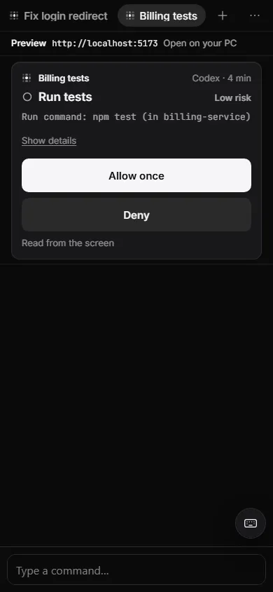

*Example data. Low risk: "Run tests". Allow once is the main button.*

## Why it matters

You can leave your desk while agents work. When one needs a decision, you get a notification and can answer in a few seconds. You see the risk in words, not a terminal menu.

## How to use it

1. Pair your phone and turn on notifications. See [Phone app](36-phone-app.md).
2. When an agent needs you, open the phone app. The **Agents** screen has a **Needs you** list. Each open question is one card, in the same order as on the PC. If nothing is open, it says "Nothing needs you".
3. Read the card: the agent, the risk, the command or file. Tap **Show details** for the reasons. Tap **Hide details** to close them.
4. Tap **Allow once** or **Deny**. The card shows "Sending", then the answer and the time, for example "Allowed once · 09:41 · from this phone".
5. If you open an agent, its own card is docked above the terminal. Under it you see "n more waiting" and a **Next** button.
6. Tap a notification to open the right card. The link goes straight to that one question.
7. To keep command text off your lock screen, open the phone menu (**...**), go to **Notifications**, and turn on **Hide details on lock screen**. It is off by default. Then a notification says only which agent needs you.

Some cards use other words:

- A folder-trust question says **Trust this folder** or **Don't trust**.
- A high-risk card puts **Deny** first and selects it. "Always allow" is never offered on the phone.
- An agent's own question (`ask_user`) shows its own choices or a text box.

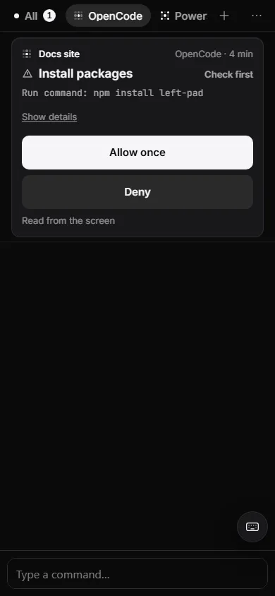

*Example data. Check first: "Install packages". Allow once is still the main button.*

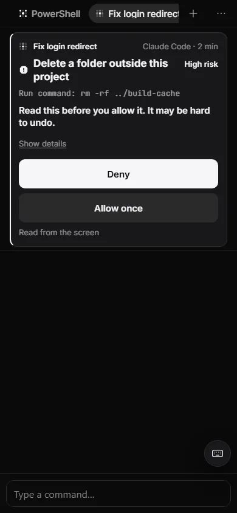

*Example data. High risk: Deny is the main button, and the text says "Read this before you allow it. It may be hard to undo."*

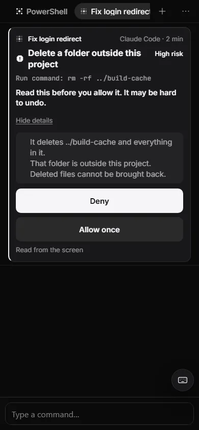

*Example data. Details open: the command, why it is risky, and "Deleted files cannot be brought back."*

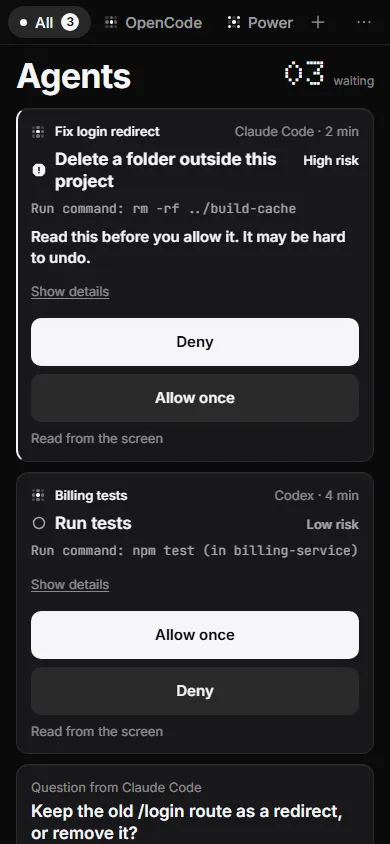

*Example data. Several cards in a queue, the risky one first.*

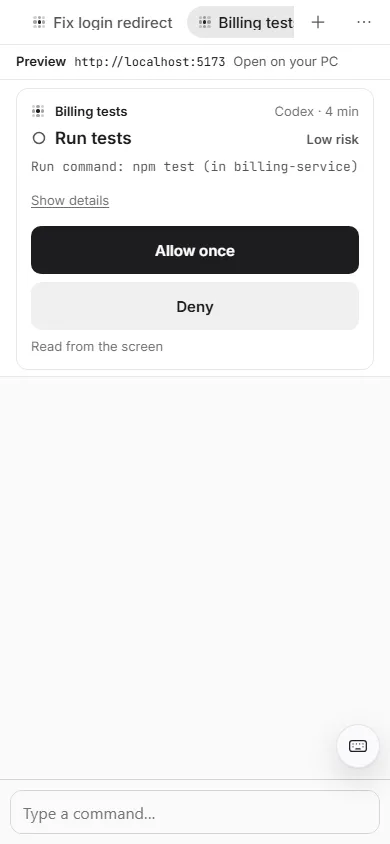

*Example data. The same card in the light theme.*

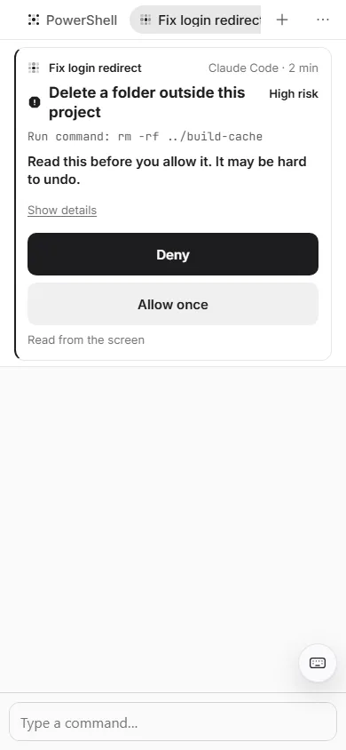

*Example data. The high-risk card in the light theme.*

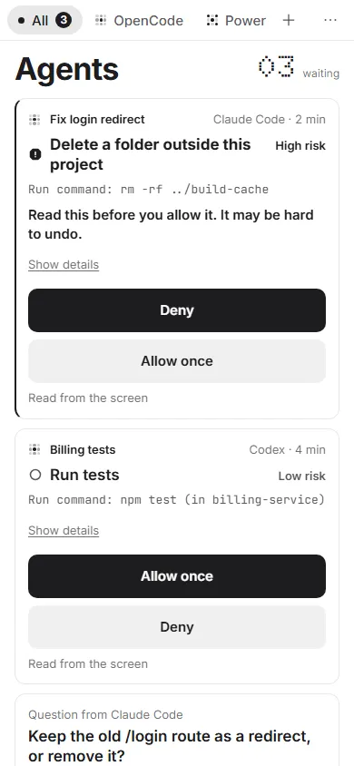

*Example data. The queue in the light theme.*

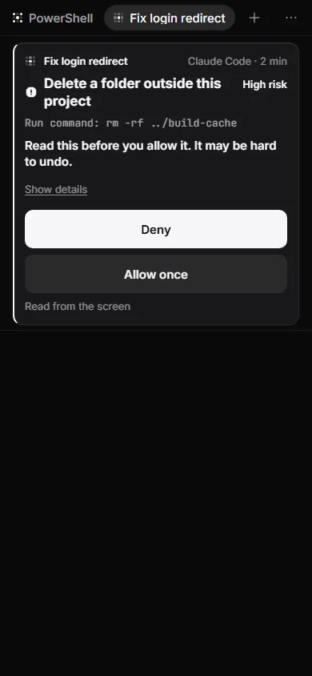

*Example data. Opening a notification takes you straight to the card.*

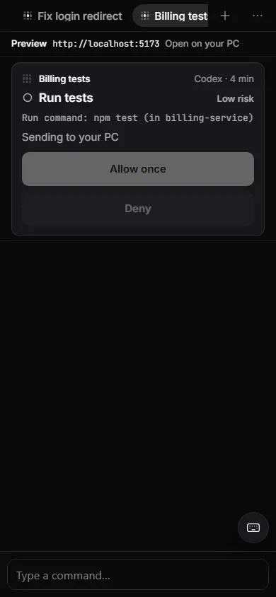

*Example data. After you tap: "Sending to your PC". The buttons are off.*

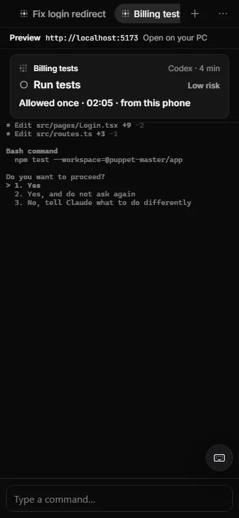

*Example data. Done: "Allowed once - 02:05 - from this phone".*

## How it works (simple)

- The PC keeps one list of everything that needs a person. The Inbox, the tray, the phone counter and the notifications all use this list, so the numbers agree.
- When you tap, the phone sends your choice and a fingerprint of the question it showed you. The PC reads the screen again. If it is a different question, the PC types **nothing**, and the card says "This question changed. Look again."
- One question gets one answer. If you answer on the PC first, the phone says "Already answered on your PC: Allowed once." and the other way round. A retry never presses a key twice.
- A phone with **Watch** only sees the card, without buttons. It says: "This phone can watch only. To answer here, allow it on your PC: Settings › Phone." Allow **Answer** for the phone in **Settings > Phone > Paired phones**.
- If the PC cannot be reached, the card says your answer was not sent and offers **Try again**.

### Buttons on the lock screen

A notification can have **Allow** and **Deny** buttons, but only when all of these are true:

- the risk is **Low**;
- the phone is Android or a desktop browser (an iPhone gets no buttons, because Apple's push service does not show them);
- the phone has the **Answer** ability, and **Hide details on lock screen** is off;
- the button belongs to this one question, and works once, for 10 minutes.

Medium risk, high risk, unknown risk, folder trust, sign-in screens, budget and usage-limit cards never get a lock-screen button. You open the card instead.

## Limits and what is not done yet

- Not tested on a real iPhone or Android phone, or with a real push service. The card was tested in a phone-sized browser.
- When you open an agent on the phone, its terminal changes to the phone's width, and some agents redraw their question. A tap that arrives during the redraw is refused as "changed" and nothing is typed. Wait until the card is still, or tap **Look again**.
- The notification can show the command on a lock screen unless you turn on **Hide details on lock screen**.
- Not built yet: "Ready for you" rows for finished runs, the "You are stuck" card with hint buttons on the phone, and "More options" for broad answers.
- The desktop Inbox still builds its list in the app's front end. The Rust list is used by the phone, the tray and notifications. A shared test set keeps both the same.
- Missions (Preview) has no phone view yet.

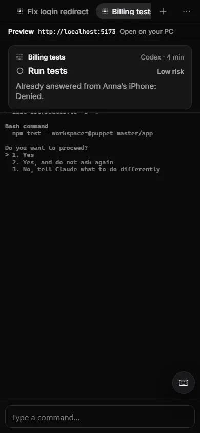

*Example data. If someone answered elsewhere first: "Already answered from Anna's iPhone: Denied."*

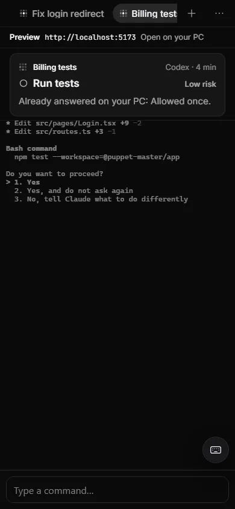

*Example data. "Already answered on your PC: Allowed once."*

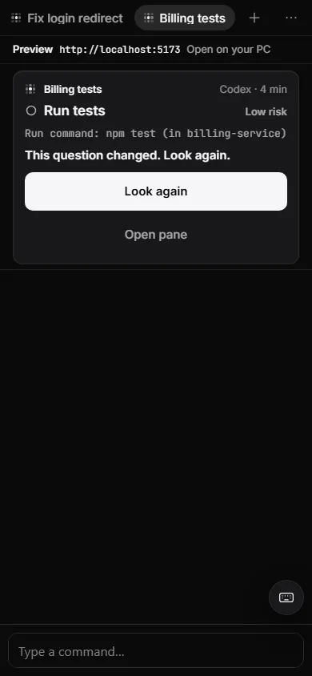

*Example data. "This question changed. Look again." Nothing was sent for the old question.*

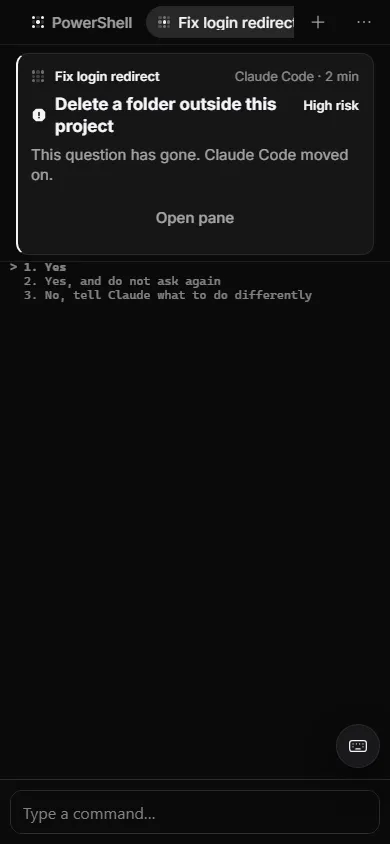

*Example data. "This question has gone. Claude Code moved on."*

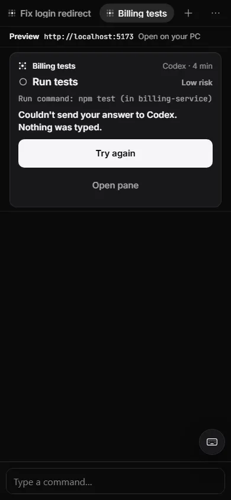

*Example data. "Couldn't send your answer to Codex. Nothing was typed." Try again.*

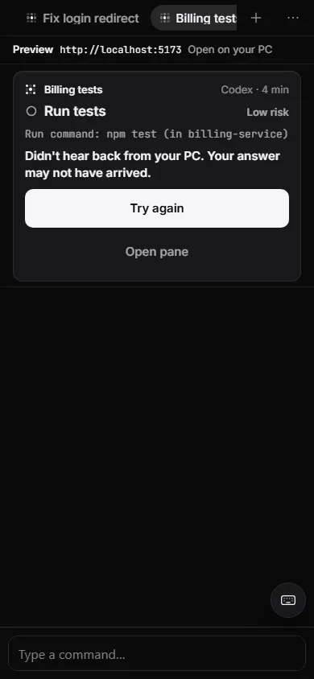

*Example data. "Didn't hear back from your PC. Your answer may not have arrived."*

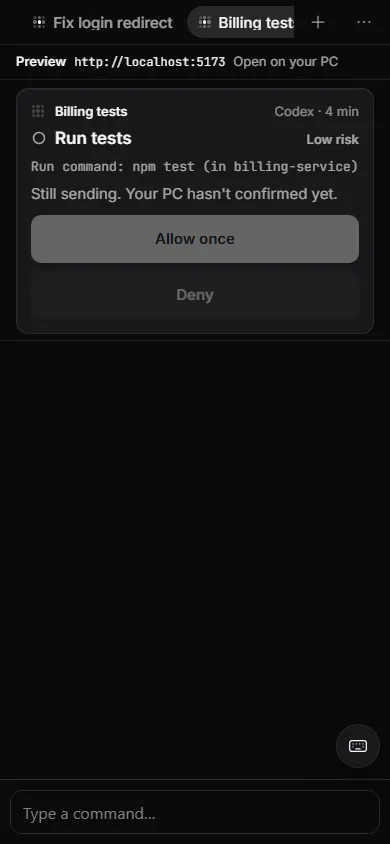

*Example data. "Still sending. Your PC hasn't confirmed yet."*

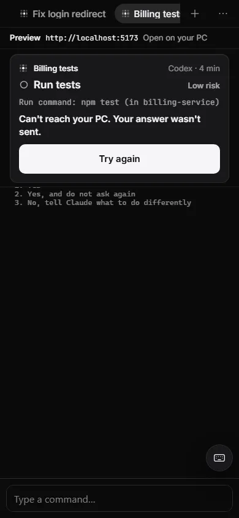

*Example data. "Can't reach your PC. Your answer wasn't sent."*

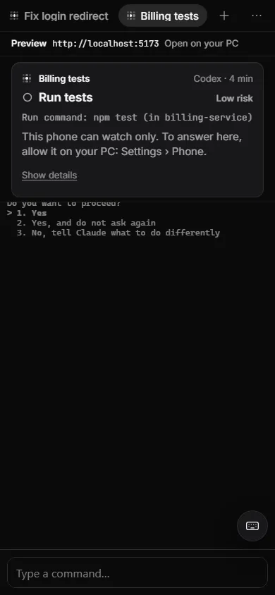

*Example data. A watch-only phone has no buttons.*

*Example data. "Codex is waiting for you. Puppet Master can't read this question. Open the pane."*

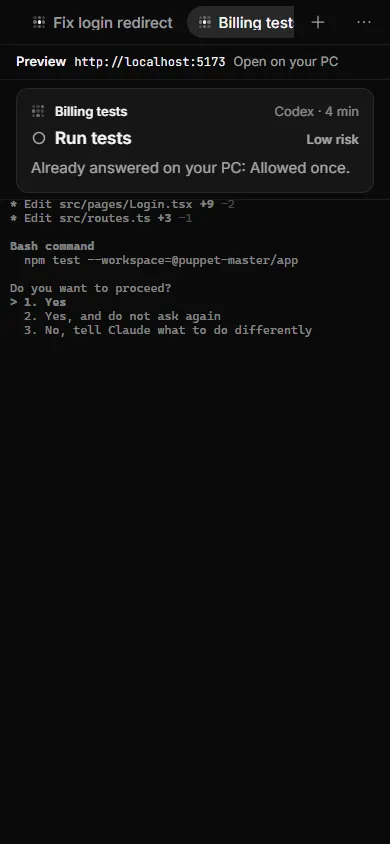

*Example data. If the question was answered meanwhile, you see "Already answered on your PC".*

## For developers

- Rust: `packages/app/src-tauri/src/attention/` (`derive.rs`, `store.rs`, `answer.rs`, `routes.rs`). Routes: `GET /attention`, `POST /attention/{id}/answer` (always HTTP 200 with an `outcome`: `answered`, `already_answered`, `changed`, `gone`, `failed`), `GET|POST /push/preferences`, `POST /push/act`.
- Push: `push/hub.rs`, `push/triggers.rs` (payload `v: 2` with `item_id`; views Full, Ios, Hidden). Golden payloads: `push/golden/*.json`.
- Phone UI: `components/mobile/ApprovalCard.tsx`, `DockedCard.tsx`, `NeedsYouList.tsx`, `CardSheet.tsx`, `NotificationsToggle.tsx`; pure logic in `lib/approval-card.ts`, `lib/attention-copy.ts`, `lib/needs-you-queue.ts`; deep links in `hooks/usePushIntents.ts` and `sw.ts`.
- Parity tests: `packages/shared/fixtures/attention/*.json`, run by both vitest and cargo.
- Abilities: `mobile_pairing/caps.rs` (`answer`, `control`).

## Related

- [Phone app](36-phone-app.md)
- [Phone terminal](38-phone-terminal.md)
- [Agents controlling agents (MCP)](32-agents-controlling-agents-mcp.md)
