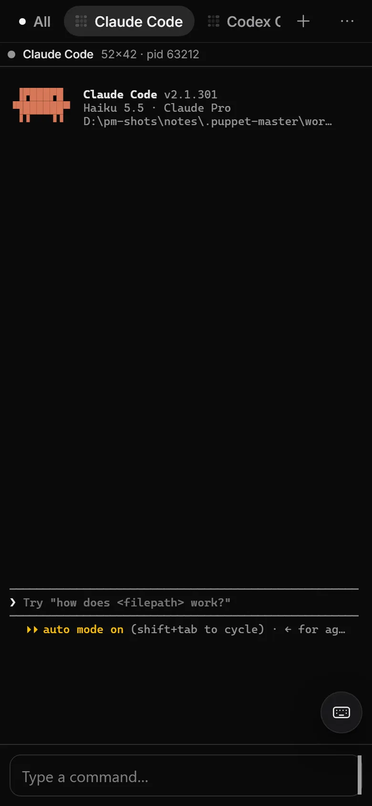
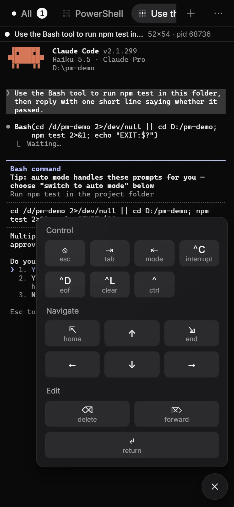
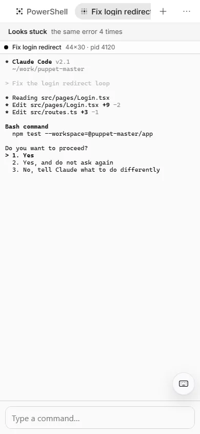
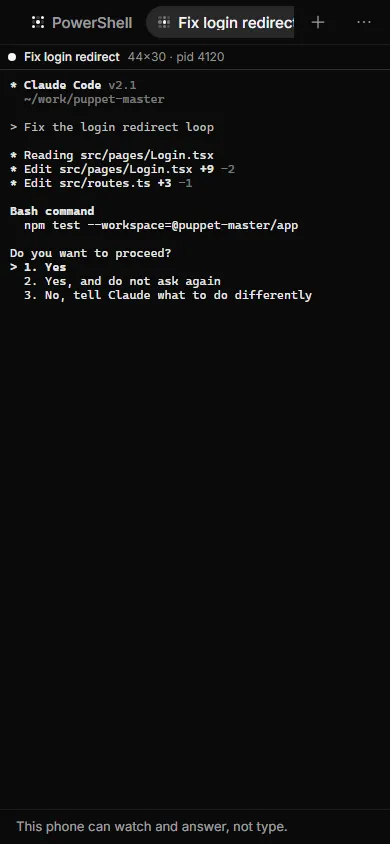
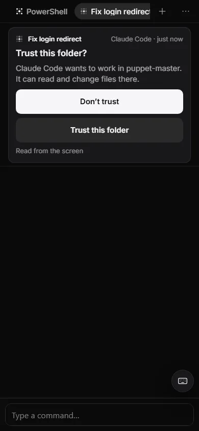
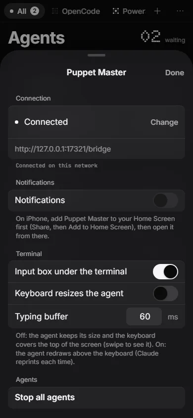

# Phone terminal

**Status:** Works today, with limits. A real paired test device answered a Claude approval with the Keys panel. The "nothing is lost" fix was tested by automated tests only. Real iPhone and Android phones were not tested.

## What it is

Tap an agent on the phone app and you see its real terminal, live. Under it there is an input box and a **Keys** panel with the keys that a phone keyboard does not have: Esc, Tab, Ctrl-C, arrows and more. You can read what the agent prints and type to it, from anywhere your phone has internet.

*Real run (0.2.1). The live terminal on the phone: Claude Code idle, with a typing box ("Type a command...") and a keyboard button.*

*Real run (0.2.1). A trust prompt as it looks in the phone terminal.*

## Why it matters

Sometimes a card is not enough. You want to read the full output, press Esc, or type a short reply. The terminal on the phone must also be **correct**. Before the fix, parts of lines went missing when you opened a terminal, and the screen could look garbled. That is fixed.

## How to use it

1. Pair your phone. See [Phone app](36-phone-app.md).
2. On the **Agents** screen, tap an agent. Its tab opens with the live terminal. The top bar has one tab for each agent, with its title and a state symbol.
3. Type in the input box under the terminal. Your text goes to the agent after a short delay.
4. Tap the keyboard button to open the **Keys** panel. It has three groups:
   - **Control**: Esc, Tab, Shift-Tab, Ctrl-C (interrupt), Ctrl-D, Ctrl-L, and a Ctrl latch. Tap the latch, then a letter, to send that Ctrl key.
   - **Navigate**: Home, End and the four arrows. Hold an arrow to repeat it.
   - **Edit**: Backspace, Delete and Return.
5. To jump to the newest output, tap the jump-to-bottom button.
6. Open the menu (**...**) to change the terminal options:
   - **Input box under the terminal**: show or hide the box. If it is hidden, the terminal still takes your taps.
   - **Keyboard resizes the agent**: off by default. Off means the keyboard covers the top of the screen (swipe to see it) and the agent keeps its size. On means the agent redraws above the keyboard. Claude reprints its screen each time.
   - **Typing buffer**: how many milliseconds to wait before sending what you typed.
   The same three options are on the PC in **Settings > Phone** (**Show the typing box on the phone**, **Keyboard resizes the agent**, **Typing delay**).

*Real run, from 0.2.0. A real Claude Code on the phone (2x size) with the Keys panel open.*

*Example data. The terminal in the light theme.*

*Example data. A phone that may only watch: "This phone can watch and answer, not type."*

*Example data. A trust question shows as a card above the terminal.*

*Example data. Terminal options: "Input box under the terminal", "Keyboard resizes the agent", and the typing buffer.*

## How it works (simple)

When a phone opens a terminal, it joins a stream that is already running. The phone does three things: it listens to the live output, it asks the PC for a snapshot of the screen, and then it goes live. Output that arrives while the snapshot travels used to be thrown away. That was the "chunk eating" bug.

Now every piece of output has a **position** (a count of bytes since the pane started), and the snapshot says which position it covers. The phone writes exactly the bytes after that point, once, in order. If it sees a hole in the numbers, it asks the PC to redraw. The resize of the terminal is numbered too, so the screen does not get a wrong grid. A test replays this with a fake PC and a real terminal screen. Before the fix, 7 of 10 of its checks failed.

The phone look was also redone: grayscale, pill tabs, bottom sheets you can swipe down to close, and a confirm sheet for **Stop all agents**. If an agent repeats the same error four times, the phone shows "Looks stuck: the same error 4 times".

## Limits and what is not done yet

- A phone needs the **Use the terminal** ability to type. Without it you see "This phone can watch and answer, not type." (or "...can watch, not type."). If the PC refuses text, a line under the terminal says why, for example "This phone can't type into agents. Allow typing for it on the PC."
- If another agent runs this agent, you see "This agent is being run by another agent. Answer from the card or open it on the PC."
- A phone app opened on the PC itself is not paired, and cannot type.
- When you open an agent on the phone, its terminal changes to the phone's width for that time. Some agents redraw.
- The automatic repair (redraw) is skipped while you scroll back in history. A hole may stay until the next redraw or until you reopen the tab.
- The fix does not cover the orchestrator mirror, which has its own stream.
- No test on a real phone or a real tunnel. The tests model timing with gates, not with real delay.

## For developers

- Wire: every `terminal` event, `pane-resize` event and `GET /panes/{id}/screen` carries an `offset` (`pty/stream_pos.rs`, `bridge/sse.rs`, `bridge/routes/panes.rs`). Old backends without offsets still work.
- Phone side: `terminal/pane-stream.ts` (`PaneStreamManager`, gap check), `hooks/useBridgePaneRegistry.ts`, `lib/bridge-sse.ts`. Test: `hooks/phone-handoff.test.tsx`.
- Keys panel: `terminal/mobile-input-guard.ts`, `terminal/mobile-input-text.ts` (`SPECIAL_KEY_GROUPS`).
- Look: `styles/phone.css`, `styles/terminal.css`, `components/mobile/*`.
- Settings keys: `mobile_input_visible`, `mobile_keyboard_resizes_agent`, `mobile_input_delay_ms`. Messages: `lib/phone-abilities.ts`, `lib/input-refusal.ts`.
- Typing needs the `type` ability (`mobile_pairing/caps.rs`).

## Related

- [Phone app](36-phone-app.md)
- [Phone approval card](37-phone-approval-card.md)
- [Developer testing](41-developer-testing.md)
