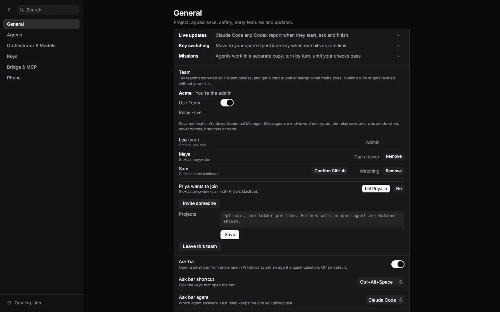
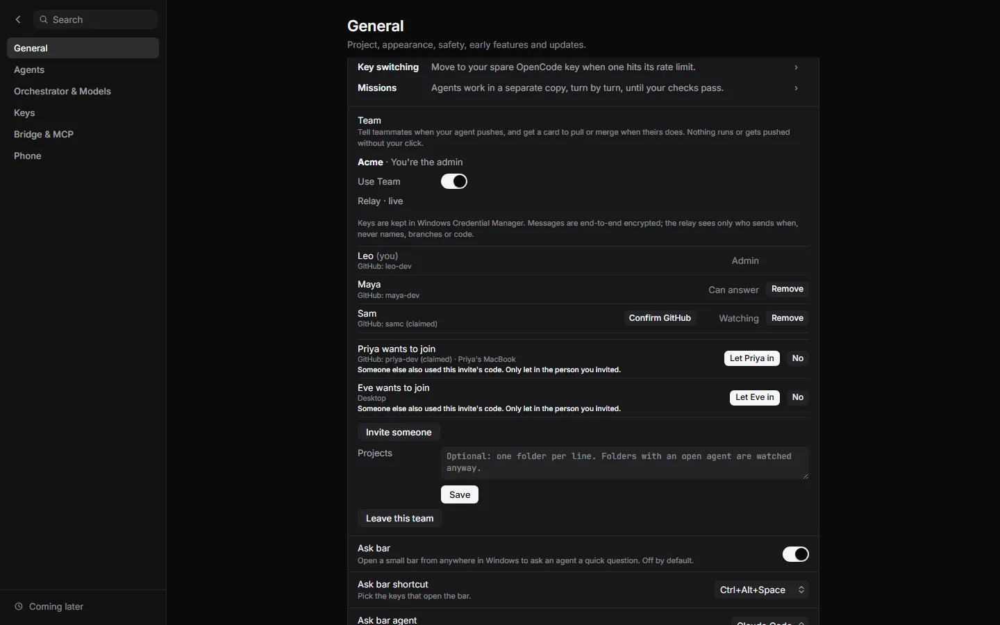
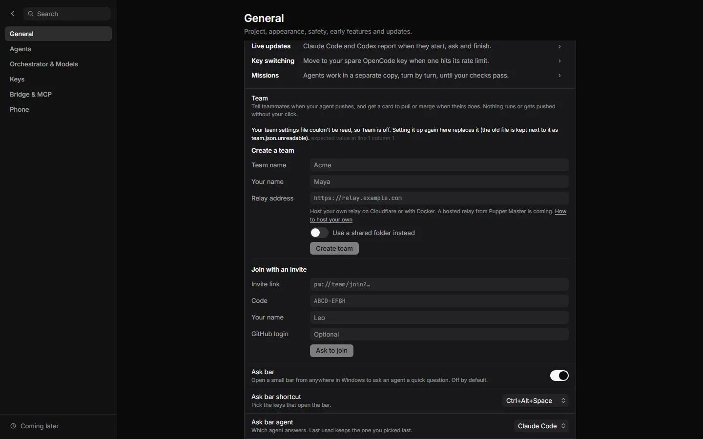
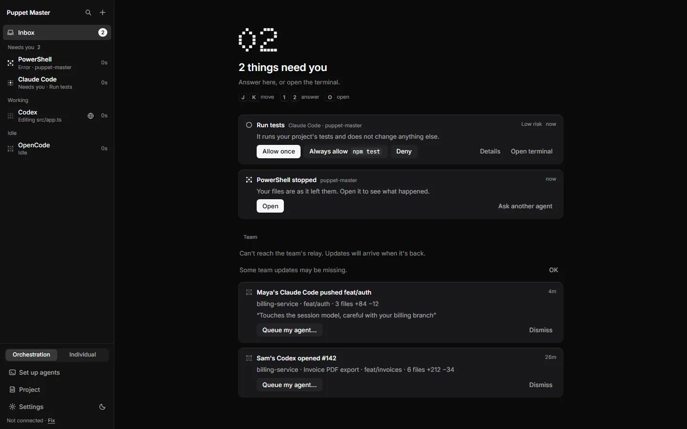

# Team relay (end-to-end encrypted)

**Status:** Partly built. The relay code exists in two versions, a server and a Cloudflare Worker. Both pass the same tests on a local computer. Neither is deployed anywhere. There is no hosted relay from Puppet Master yet.

## What it is

Teammates are not always online at the same time. The relay is a "post office" for the [Co-work Heads-up](39-co-work-heads-up.md) feature. One app leaves a sealed message at the relay. The other apps pick it up later.

The messages are **end-to-end encrypted**. This means they are locked on the sender's computer and unlocked only on a teammate's computer. The relay cannot read them. It sees only the team ID, the public keys of devices, the size and the time of each message.

*Example data. Team settings: "Relay - live", and the note that messages are end-to-end encrypted.*

*No screenshot yet: the relay is a server, not an app screen. The screenshots above show the Team settings in the app that talks to it.*

## Why it matters

Without a relay, a team would have to share a folder. A shared folder has no access control. A relay lets people in different places work together, and it can cut off a removed member at once. Because you can run the relay yourself, you decide who holds the mailbox.

## How to use it

You choose one of three ways to run a relay:

| Way | Good for | How |
|---|---|---|
| Cloudflare | No computer to keep running; TLS included; free to start | Use the "Deploy to Cloudflare" button in `relay/worker/README.md`, or run `npm install`, `npx wrangler login` and `npm run deploy` in `relay/worker` |
| Docker | A computer you already have | `docker build -t pm-relay relay`, then `docker run -d -p 8787:8787 -v pm-relay-data:/data pm-relay`, with TLS in front |
| The program | The same, without Docker | `cargo run --release -p pm-relay -- --listen 127.0.0.1:8787 --db relay.sqlite`, with TLS in front |

Then:

1. Check that it runs. For the Worker, open `<your address>/v1/health`. It should answer `{"ok":true,"protocol":"pm-relay/1"}`.
2. In Puppet Master, open **Settings > General > Labs > Team**.
3. Under **Create a team**, paste the `https://...` address in **Relay address**. Click **Create team**.
4. Invite teammates. The invite link carries the relay address, so they do not type it.

The app accepts plain `http://` only for a relay on the same computer. Anything else must use `https://`.

*Real run (0.2.1). Settings, General, Labs, Team: Create a team (name, your name, relay address) and Join with an invite. The grey text is a placeholder; relay.example.com is a made-up address.*

*Example data. Join requests: someone else used an invite, so the admin sees a warning. Only let in the person you invited.*

*Example data. If the team settings file cannot be read, Team is off and the app says how to set it up again.*

*Example data. When the relay cannot be reached: "Some team updates may be missing."*

## How it works (simple)

- Each person has keys that stay in the Windows credential store. They are never put in a file or a log.
- The admin's key signs the list of members. Each message is signed by the sending device and sealed with a team key. When someone is removed, the team key changes.
- The relay checks signatures, enforces the member list, and keeps a counter that only goes up, so nobody misses a message after a quiet week.
- It keeps:

| What | How long |
|---|---|
| Messages (sealed) | 7 days |
| Join requests (sealed to the admin) | 1 day |
| Member list and key slots (signed, opaque) | Until replaced |

- Main limits: 60 messages a minute and 5,000 a day per device, 24 KiB per message, at most 20,000 messages or 128 MiB stored per team.
- Tests prove that the relay's database holds no names, branch names, notes, invite codes or team keys.

## Limits and what is not done yet

- **No hosted relay yet.** The relay row "Puppet Master's own" in the docs is a plan. You must host one, or use a shared folder.
- **Not deployed.** Cloudflare's real network (idle sockets, free-plan limits, the one-click flow) was not tested. The Docker file was written but never built. The deploy button needs the repository to be public.
- **No forward secrecy.** The relay keeps sealed messages for 7 days. Every device keeps the team keys it was given until it leaves. Whoever gets a device's keys and the relay's data can read what that device could read.
- A new member starts at their join point and does not receive the last 7 days.
- After a removal, a lagging member's app may seal with the old key for about 10 seconds.
- The relay does not limit failed signatures per address. The Worker README suggests a Cloudflare firewall rule for that.
- Rate limits live in memory in the server and reset when it restarts. Registration is open, so a public relay should sit behind a proxy that limits it.
- **Licence is undecided.** The protocol code is MIT. The server and the Worker say "licence pending". The recommended plan: server under AGPL-3.0 (open and self-hostable), the app and protocol stay MIT, and no closed hosted copy.

## For developers

- Server: `relay/server` (axum and SQLite). Protocol: `relay/protocol` (MIT). Worker: `relay/worker` (TypeScript, one Durable Object per team, with the protocol checks compiled to WebAssembly from `relay/protocol`).
- App side: `packages/app/src-tauri/src/team/transport/relay.rs` (WebSocket with long-poll fallback, device-signed requests).
- Same end-to-end tests for both: `relay/server/tests/protocol.rs` and `team/tests_v1.rs`, run against another relay with `PM_RELAY_TEST_URL`.
- Limits can be changed with `LIMIT_...` variables in `relay/worker/wrangler.toml`.
- Security review: `SECURITY-REVIEW-COWORK.md` in the founder's night folder (no Critical or High findings, six Medium findings, fixed in both versions).

## Related

- [Co-work Heads-up](39-co-work-heads-up.md)
- [Phone app](36-phone-app.md)
